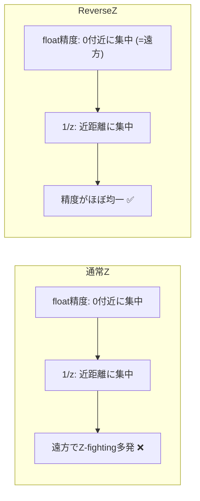

# カメラと射影

## 概要

カメラは3Dシーンを2D画像に落とすための**視点の定義**です。数学的には2つの行列 — 世界をカメラ視点に組み替える**ビュー行列**と、視錐台を立方体に押し込める**射影行列** — で表現されます。このページでは両行列を導出し、透視投影・深度精度 (Reverse-Z)・視錐台カリングまでを扱います。

## なぜ必要なのか

- あらゆる描画は「どこから見るか」の定義なしには始まらない
- 射影行列の中身を理解していないと、深度バッファの精度問題・シャドウマップ・ポストプロセスでの位置再構成を扱えない
- 視錐台はカリング (描画物の絞り込み) の基準 → [GPU Driven Rendering](/graphics/optimization/gpu-driven.html)

## 歴史・誕生した背景

透視図法はルネサンス期 (Brunelleschi, 1420年頃) に遡り、CGでは1960年代にユタ大学で行列形式に定式化されました。OpenGLの `gluLookAt` / `gluPerspective` (1992) がAPIとして標準化。2000年代後半、深度バッファの精度問題への解として **Reverse-Z** が広まり (Reed 2015 の解説が有名)、現在のAAA開発の標準になっています。

## それ以前の技術

固定機能時代はAPI関数 (`glFrustum` 等) がブラックボックスとして行列を作っていました。プログラマブル化以降、開発者が中身を理解して自作する必要が生じました。

## 解決した課題

行列形式の透視投影は、「奥行きで割る」という非線形操作を**同次座標のwに仕込む**ことで、線形パイプライン (行列積) に統合しました。これによりT&Lの完全なハードウェア化が可能になりました。

## 現在の位置づけ

全エンジン・全APIの共通基盤。実務上のポイントは「Reverse-Z + Infinite Far Plane」が現代の既定解であること、そして射影行列からパラメータ (near/far/fov) を逆算する技術がポストプロセスで頻出することです。

## 内部動作

### ビュー行列の導出

カメラの位置 $\mathbf{e}$、注視点 $\mathbf{t}$、上方向 $\mathbf{u}$ から正規直交基底を作ります (右手系・-Z前方の例):

$$
\mathbf{f} = \frac{\mathbf{t}-\mathbf{e}}{\|\mathbf{t}-\mathbf{e}\|},\quad
\mathbf{r} = \frac{\mathbf{f}\times\mathbf{u}}{\|\mathbf{f}\times\mathbf{u}\|},\quad
\mathbf{u}' = \mathbf{r}\times\mathbf{f}
$$

$$
V=\begin{pmatrix}
r_x & r_y & r_z & -\mathbf{r}\cdot\mathbf{e}\\
u'_x & u'_y & u'_z & -\mathbf{u}'\cdot\mathbf{e}\\
-f_x & -f_y & -f_z & \mathbf{f}\cdot\mathbf{e}\\
0&0&0&1
\end{pmatrix}
$$

ビュー行列は**カメラのワールド行列の逆行列**です。回転部分は直交行列なので、逆行列は転置+平行移動の内積で安価に構成できます。

### 透視射影行列の導出

垂直視野角 $\theta$、アスペクト比 $a$、近平面 $n$、遠平面 $f$ とすると (DX系、深度 $[0,1]$、左手系):

$$
P=\begin{pmatrix}
\frac{1}{a\tan(\theta/2)} & 0 & 0 & 0\\
0 & \frac{1}{\tan(\theta/2)} & 0 & 0\\
0 & 0 & \frac{f}{f-n} & \frac{-nf}{f-n}\\
0 & 0 & 1 & 0
\end{pmatrix}
$$

最下行 $(0,0,1,0)$ が鍵で、**クリップ空間の $w$ にビュー空間の $z$ を書き込みます**。GPUが後で $x,y,z$ を $w$ で割ることで「遠くのものほど小さい」透視効果が生まれます。

$$z_{ndc} = \frac{f}{f-n} - \frac{nf}{(f-n)\,z_{view}}$$

この式は $z_{view}$ に対して**非線形 (1/zに比例)** で、深度精度は近距離に極端に偏ります。

### Reverse-Z — 現代の標準

浮動小数点は0付近の精度が高いため、通常のZ (近=0) では「精度が高い数値域」と「1/zで精度が高い近距離」が重なり、**遠方の精度が壊滅**します。深度を反転 (近=1, 遠=0) すると両者が打ち消し合い、ほぼ均一な精度が得られます。



実装は (1) 射影行列のnear/farを入れ替え、(2) 深度比較を `GREATER` に、(3) クリアを0に、の3点セット。UnityもUEも内部でReverse-Zを使用しています。

### 正射影 (Orthographic)

$w$ に $z$ を仕込まない (最下行が $(0,0,0,1)$) ため遠近感が出ません。**シャドウマップ (平行光源)** やUI描画で使用 → [シャドウ](/graphics/lighting/shadow.html)

### 視錐台とカリング

射影行列の行の加減算でクリップ平面6枚を抽出できます (Gribb & Hartmann の方法)。AABBやバウンディング球と平面の判定で、見えない物体の描画を事前に省きます。

## 各環境での扱い

### Unity
`Camera` コンポーネント。`camera.worldToCameraMatrix` / `camera.projectionMatrix`。**GPUへ渡る直前に `GL.GetGPUProjectionMatrix()` でプラットフォーム差 (Y反転・Reverse-Z) が適用される**二段構えに注意。シェーダ側マクロ `UNITY_REVERSED_Z` で分岐できます。

### Unreal Engine
`FMinimalViewInfo` → `FSceneView`。UEは**無限遠 + Reverse-Z**が既定。シェーダでは `View.ViewToClip` など。大ワールドのためビュー行列はカメラ相対 (TranslatedWorld) 基準です。

### DirectX 12
API自体はカメラ概念を持たず、アプリがDirectXMath (`XMMatrixLookAtLH`, `XMMatrixPerspectiveFovLH`) で構築して定数バッファへ。Reverse-Zは `D3D12_COMPARISON_FUNC_GREATER` + クリア値0で実現。

### Vulkan
同様にアプリ責務。glm + `GLM_FORCE_DEPTH_ZERO_TO_ONE` + Y反転が定番。`VkViewport` の `minDepth/maxDepth` と深度比較 `VK_COMPARE_OP_GREATER` でReverse-Z。

## コード例

Reverse-Z 射影行列 (C++ / glm, 無限遠版):

```cpp
// 近=1, 遠(無限)=0 になる透視射影
glm::mat4 PerspectiveReverseZInfinite(float fovY, float aspect, float zNear) {
    float f = 1.0f / tan(fovY * 0.5f);
    glm::mat4 m(0.0f);
    m[0][0] = f / aspect;
    m[1][1] = f;
    m[2][2] = 0.0f;       // 無限遠: z_ndc → 0
    m[2][3] = 1.0f;       // w に z_view (左手系)
    m[3][2] = zNear;      // 近平面で z_ndc = 1
    return m;
}
```

視錐台平面の抽出とAABBカリング:

```cpp
// Gribb-Hartmann: viewProj の行の和/差が平面になる
void ExtractPlanes(const glm::mat4& vp, glm::vec4 planes[6]) {
    for (int i = 0; i < 3; ++i) {
        planes[i*2+0] = glm::row(vp, 3) + glm::row(vp, i); // left/bottom/near
        planes[i*2+1] = glm::row(vp, 3) - glm::row(vp, i); // right/top/far
    }
}
bool AabbVisible(const glm::vec4 planes[6], glm::vec3 c, glm::vec3 e) {
    for (int i = 0; i < 6; ++i) {
        glm::vec3 n(planes[i]);
        float r = glm::dot(e, glm::abs(n));       // AABBの投影半径
        if (glm::dot(n, c) + planes[i].w < -r) return false; // 完全に外側
    }
    return true;
}
```

## 前提知識

- [ベクトル](/math/rendering/vector.html), [行列](/math/rendering/matrix.html), [座標変換](/math/rendering/transform.html)

## 次に読むべきページ

- [パイプライン全体像](/graphics/pipeline/overview.html)
- [シャドウ](/graphics/lighting/shadow.html) — ライトを「カメラ」として使う技術
- [クォータニオン](/math/rendering/quaternion.html)

## 理解度チェック

1. **透視射影行列の最下行 $(0,0,1,0)$ が果たす役割を説明せよ。**
   ::: details 解答
   クリップ空間のw成分にビュー空間のz(奥行き)をコピーする。後段のperspective divideでx,y,zがこのwで割られることで、奥行きに反比例して物が小さく見える透視効果が線形パイプラインの中で実現される。
   :::

2. **Reverse-Zが深度精度を改善する原理を、浮動小数点の性質と絡めて説明せよ。**
   ::: details 解答
   NDC深度は1/z_viewに比例し近距離に精度が集中する。floatも0付近に精度が集中する。通常Z(近=0)では両方の高精度域が近距離に重なり遠方が壊滅するが、Reverse-Z(遠=0)ではfloatの高精度域が遠方に割り当てられ、1/zの偏りと相殺して全域でほぼ均一な精度になる。
   :::

3. **シャドウマップで平行光源に正射影を使う理由は。**
   ::: details 解答
   平行光源の光線は平行であり、視点からの距離によるサイズ変化(遠近感)が存在しないため。透視投影を使うと光線が一点から発散する点光源の幾何になってしまう。
   :::

## 参考資料

- Nathan Reed, *"Depth Precision Visualized"* (2015) — Reverse-Z解説の決定版
- Gribb & Hartmann, *"Fast Extraction of Viewing Frustum Planes from the World-View-Projection Matrix"*
- Song Ho Ahn, *OpenGL Projection Matrix*
- Real-Time Rendering 4th ed., Chapter 4.7
