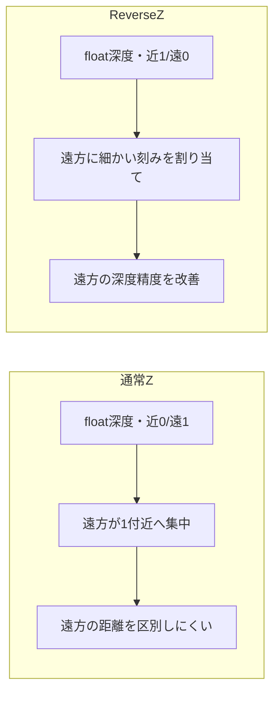

# カメラと射影

## 概要

カメラは、3Dシーンを2D画像へ投影するときの視点を定めます。この視点はビュー行列と射影行列の2つで表します。ビュー行列はワールド座標をカメラ基準の座標に変換し、射影行列は視錐台を立方体の範囲に写すときに使います。両行列を導出し、透視投影、Reverse-Zによる深度精度、視錐台カリングを説明します。

## なぜ必要なのか

- あらゆる描画は「どこから見るか」の定義なしには始まらない
- 射影行列の中身を理解していないと、深度バッファの精度問題・シャドウマップ・ポストプロセスでの位置再構成を扱えない
- 視錐台はカリング (描画物の絞り込み) の基準 → [GPU Driven Rendering](/graphics/optimization/gpu-driven.html)

## 歴史・誕生した背景

透視図法はルネサンス期 (Brunelleschi, 1420年頃) に遡ります。CGの初期研究では、L. G. Robertsが[MITの博士論文 (1963)](https://dspace.mit.edu/entities/publication/840d8056-9b54-4bd4-b16f-2f3d8296386e)で、透視投影を同次座標の変換行列で表しました。OpenGLの `gluLookAt` / `gluPerspective` (1992) がAPIとして標準化。深度バッファの精度を改善する技法の一つに**Reverse-Z**があり、Nathan Reedの[NVIDIA公式解説](https://developer.nvidia.com/blog/visualizing-depth-precision/)では、浮動小数点と固定小数点の深度形式を分けて効果を比較しています。

## それ以前の技術

固定機能時代はAPI関数 (`glFrustum` 等) がブラックボックスとして行列を作っていました。プログラマブル化以降、開発者が中身を理解して自作する必要が生じました。

## 解決した課題

行列形式の透視投影では、奥行きの値を同次座標のwに入れ、後でwで割ります。奥行きで割る非線形操作を行列積を使うパイプラインに組み込めるようになり、T&Lを完全にハードウェア化できるようになりました。

## 現在の位置づけ

ビュー・射影変換は多くの3D描画で使われる基盤です。Reverse-Zや無限遠の遠平面は設計上の選択肢であり、すべてのエンジン・APIで必須の設定ではありません。射影、深度形式、近遠クリップ、深度比較をそろえ、ポストプロセスで深度を復元する式にも同じ規約を使います。

## 内部動作

### ビュー行列の導出

カメラの位置 $\mathbf{e}$、注視点 $\mathbf{t}$、上方向 $\mathbf{u}$ から正規直交基底を作ります (右手系・-Z前方の例):

$$
\mathbf{f} = \frac{\mathbf{t}-\mathbf{e}}{\|\mathbf{t}-\mathbf{e}\|},\quad
\mathbf{r} = \frac{\mathbf{f}\times\mathbf{u}}{\|\mathbf{f}\times\mathbf{u}\|},\quad
\mathbf{u}' = \mathbf{r}\times\mathbf{f}
$$

$$
V=\begin{pmatrix}
r_x & r_y & r_z & -\mathbf{r}\cdot\mathbf{e}\\
u'_x & u'_y & u'_z & -\mathbf{u}'\cdot\mathbf{e}\\
-f_x & -f_y & -f_z & \mathbf{f}\cdot\mathbf{e}\\
0&0&0&1
\end{pmatrix}
$$

ビュー行列は**カメラのワールド行列の逆行列**です。回転部分は直交行列なので、逆行列は転置+平行移動の内積で安価に構成できます。

### 透視射影行列の導出

垂直視野角 $\theta$、アスペクト比 $a$、近平面 $n$、遠平面 $f$ とすると (DX系、深度 $[0,1]$、左手系):

$$
P=\begin{pmatrix}
\frac{1}{a\tan(\theta/2)} & 0 & 0 & 0\\
0 & \frac{1}{\tan(\theta/2)} & 0 & 0\\
0 & 0 & \frac{f}{f-n} & \frac{-nf}{f-n}\\
0 & 0 & 1 & 0
\end{pmatrix}
$$

最下行 $(0,0,1,0)$ が鍵で、**クリップ空間の $w$ にビュー空間の $z$ を書き込みます**。GPUが後で $x,y,z$ を $w$ で割ることで「遠くのものほど小さい」透視効果が生まれます。

$$z_{ndc} = \frac{f}{f-n} - \frac{nf}{(f-n)\,z_{view}}$$

この式は $z_{view}$ に対して**非線形（1/zを係数と定数で変換した形）**です。等間隔に量子化した深度をこの式で読むと、視点からの距離の刻みは近くで細かく、遠くで粗くなります。実際の誤差は、深度形式や近遠平面、頂点変換の丸めにも依存します。

<div id="reverse-z-—-現代の標準" class="study-legacy-anchor" aria-hidden="true"></div>

### Reverse-Zと浮動小数点の深度精度

ここでは**透視射影と浮動小数点の深度バッファ**を使い、射影後の深度と保存する深度をともに`[0,1]`の範囲として扱う場合を考えます。通常のZ（近=0、遠=1）では、遠方が1付近へ押し込まれます。Reverse-Z（近=1、遠=0）は、正規化数の範囲で0に近い側ほど値の間隔が細かくなる性質を遠方に割り当て、1/zの非線形性による偏りを緩和します。とくに遠方の距離を区別する精度を改善できますが、**世界座標での絶対的な間隔が全域で一定になるわけではありません**。[NVIDIAの比較と条件](https://developer.nvidia.com/blog/visualizing-depth-precision/)を参照してください。

固定小数点（UNORM）の深度は保存値の刻みが等間隔なので、順序を反転するだけでは浮動小数点のような刻み幅の利点は得られません。また、Reverse-Zで大座標の頂点位置の誤差まで解消できるわけではありません。値の間隔の基礎は[浮動小数点の本文](/data/floating-point-spacing.html)、実際の刻み幅の確認は[観察例](/practice/data/float-spacing-observation.html)で扱います。



典型的には、射影で近=1・遠=0にし、viewportの深度範囲を整合させ、深度比較を`GREATER`などにして0でクリアします。比較の等号の扱い、深度バイアス、深度を読む処理も確認が必要です。DirectXMathでは、有限で正かつ異なる近遠距離を`XMMatrixPerspectiveFovLH`へ逆順に渡す方法が文書化されていますが、あらゆる射影関数へ無条件に適用できる手順ではありません。[MicrosoftのAPI契約](https://learn.microsoft.com/en-us/windows/win32/api/directxmath/nf-directxmath-xmmatrixperspectivefovlh)を参照してください。

APIの深度規約も区別します。Vulkanの`VkViewport`は`minDepth > maxDepth`も許し、viewportでも反転を表せます。射影側とviewport側で意図せず二重に反転しないようにします。OpenGLの従来のNDC深度範囲`[-1,1]`では、深度を保存する直前に向きを変えるだけで上記と同じ利点になるとは限りません。対応する環境では`glClipControl`の`GL_ZERO_TO_ONE`などで規約をそろえます。[Vulkanのviewport](https://docs.vulkan.org/refpages/latest/refpages/source/VkViewport.html)と[Khronosのclip-control仕様](https://raw.githubusercontent.com/KhronosGroup/OpenGL-Registry/main/extensions/ARB/ARB_clip_control.txt)を参照してください。

### 正射影 (Orthographic)

$w$ に $z$ を仕込まない (最下行が $(0,0,0,1)$) ため遠近感が出ません。**シャドウマップ (平行光源)** やUI描画で使用 → [シャドウ](/graphics/lighting/shadow.html)

### 視錐台とカリング

射影行列の行の加減算でクリップ平面6枚を抽出できます (Gribb & Hartmann の方法)。AABBやバウンディング球と平面の判定で、見えない物体の描画を事前に省きます。

## 各環境での扱い

### Unity
`Camera`の`worldToCameraMatrix` / `projectionMatrix`と、GPU用の射影行列を区別します。自分で行列を渡す場合、`GL.GetGPUProjectionMatrix(proj, renderIntoTexture)`で対象API用へ調整し、描画先に応じた引数を使います。Reverse-Zの使用は対象APIで異なるため、`SystemInfo.usesReversedZBuffer`やシェーダ側の`UNITY_REVERSED_Z`で確認します。[Unity 6の行列変換API](https://docs.unity3d.com/6000.0/Documentation/ScriptReference/GL.GetGPUProjectionMatrix.html)と[プラットフォーム間の深度規約](https://docs.unity3d.com/6000.0/Documentation/Manual/SL-PlatformDifferences.html)を参照してください。

### Unreal Engine
`FMinimalViewInfo` → `FSceneView`、シェーダでは`View.ViewToClip`などを調べます。実際の射影規約や無限遠の扱いは、使用するエンジン版と描画経路で確認します。カメラ相対の空間（TranslatedWorld）など、大座標の誤差を減らす工夫は深度バッファの向きとは別に考えます。

### DirectX 12
アプリがDirectXMath（`XMMatrixLookAtLH`、`XMMatrixPerspectiveFovLH`など）で行列を構築して渡します。Reverse-Zでは、反転した射影とviewportの規約に加え、`D3D12_COMPARISON_FUNC_GREATER`などの比較、クリア値0、深度形式をそろえます。比較関数とクリア値だけを変えても射影は反転しません。

### Vulkan
射影とviewportはアプリが設定します。GLMを使う場合も、深度範囲と左右の座標系を明示し、Yの向きの調整は別に扱います。Reverse-Zは、射影またはviewportの深度範囲で意図した向きへ変換し、`VK_COMPARE_OP_GREATER`などの比較とクリア値を合わせます。`minDepth/maxDepth`は名前に反して大小関係を逆にできます。[VkViewportの仕様](https://docs.vulkan.org/refpages/latest/refpages/source/VkViewport.html)を参照してください。

## コード例

Reverse-Z 射影行列（C++ / GLM、左手系・列ベクトル、NDC深度`[0,1]`、無限遠版の断片）です。`0 < fovY < π`、`aspect > 0`、`zNear > 0`の有限値を前提に、viewportの深度範囲は0〜1のまま使います。描画APIへの組み込みと実行検証はこの例に含みません。

```cpp
// 近=1, 遠(無限)=0 になる透視射影
glm::mat4 PerspectiveReverseZInfinite(float fovY, float aspect, float zNear) {
    float f = 1.0f / tan(fovY * 0.5f);
    glm::mat4 m(0.0f);
    m[0][0] = f / aspect;
    m[1][1] = f;
    m[2][2] = 0.0f;       // 無限遠: z_ndc → 0
    m[2][3] = 1.0f;       // w に z_view (左手系)
    m[3][2] = zNear;      // 近平面で z_ndc = 1
    return m;
}
```

視錐台平面の抽出とAABBカリングの次の断片は、**NDC深度`[-1,1]`のクリップ範囲を前提**にしています。直前の`[0,1]`のReverse-Z行列とそのまま組み合わせる例ではありません。深度範囲や無限遠の射影が違う場合は、深度方向の平面の抽出と扱いも合わせる必要があります。

```cpp
// Gribb-Hartmann: viewProj の行の和/差が平面になる
void ExtractPlanes(const glm::mat4& vp, glm::vec4 planes[6]) {
    for (int i = 0; i < 3; ++i) {
        planes[i*2+0] = glm::row(vp, 3) + glm::row(vp, i); // left/bottom/near
        planes[i*2+1] = glm::row(vp, 3) - glm::row(vp, i); // right/top/far
    }
}
bool AabbVisible(const glm::vec4 planes[6], glm::vec3 c, glm::vec3 e) {
    for (int i = 0; i < 6; ++i) {
        glm::vec3 n(planes[i]);
        float r = glm::dot(e, glm::abs(n));       // AABBの投影半径
        if (glm::dot(n, c) + planes[i].w < -r) return false; // 完全に外側
    }
    return true;
}
```

## 前提知識

- [ベクトル](/math/rendering/vector.html), [行列](/math/rendering/matrix.html), [座標変換](/math/rendering/transform.html)
- [浮動小数点と値の間隔](/data/floating-point-spacing.html)

## 次に読むべきページ

- [パイプライン全体像](/graphics/pipeline/overview.html)
- [シャドウ](/graphics/lighting/shadow.html) — ライトを「カメラ」として使う技術
- [クォータニオン](/math/rendering/quaternion.html)

## 理解度チェック

1. **透視射影行列の最下行 $(0,0,1,0)$ が果たす役割を説明せよ。**
   ::: details 解答
   クリップ空間のw成分にビュー空間のz(奥行き)をコピーする。後段のperspective divideでx,y,zがこのwで割られることで、奥行きに反比例して物が小さく見える透視効果が線形パイプラインの中で実現される。
   :::

2. **Reverse-Zが深度精度を改善する原理を、浮動小数点の性質と絡めて説明せよ。**
   ::: details 解答
   透視射影の深度は1/z_viewを係数と定数で変換した形になる。浮動小数点深度と0〜1の深度規約を使う場合、Reverse-Z（近=1、遠=0）は遠方へ細かい保存値の刻みを割り当て、遠方の距離を区別する精度を改善する。世界座標での絶対精度が全域で一定になる保証ではなく、近遠平面、変換の丸め、深度形式やAPIの規約にも依存する。等間隔の固定小数点深度では、単なる反転から同じ刻み幅の利点は得られない。
   :::

3. **シャドウマップで平行光源に正射影を使う理由は。**
   ::: details 解答
   平行光源の光線は平行であり、視点からの距離によるサイズ変化(遠近感)が存在しないため。透視投影を使うと光線が一点から発散する点光源の幾何になってしまう。
   :::

## 参考資料

- [Nathan Reed: Visualizing Depth Precision（NVIDIA公式）](https://developer.nvidia.com/blog/visualizing-depth-precision/)
- [Microsoft: XMMatrixPerspectiveFovLH](https://learn.microsoft.com/en-us/windows/win32/api/directxmath/nf-directxmath-xmmatrixperspectivefovlh)
- [Khronos: VkViewport](https://docs.vulkan.org/refpages/latest/refpages/source/VkViewport.html)
- [Khronos: ARB_clip_control](https://raw.githubusercontent.com/KhronosGroup/OpenGL-Registry/main/extensions/ARB/ARB_clip_control.txt)
- Gribb & Hartmann, *"Fast Extraction of Viewing Frustum Planes from the World-View-Projection Matrix"*
- Song Ho Ahn, *OpenGL Projection Matrix*
- Real-Time Rendering 4th ed., Chapter 4.7

Reverse-Zの精度とAPI規約に関する説明を2026-11-03に一次資料と照合しました。コードは前提を示す断片であり、このページの描画コードの実行、各エンジンの全描画経路での動作検証は今回の確認に含みません。
