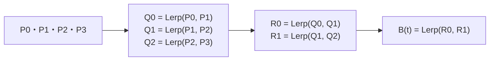

# 補間と曲線 — Lerp・Slerp・イージング・スプライン

カメラを目標へ追従させるときと、カメラを決めた経路に沿って動かすときでは、毎フレーム求めたい値が違います。追従では今の位置と目標との差を少しずつ縮めます。経路上の移動では、経過時間や移動距離から経路上の位置を求めます。**時間から何を計算するか**と**その値から位置や向きをどう求めるか**を分けると、使う補間を選べます。

## Lerpで二つの値の間を求める

**線形補間（Lerp）**は `a + (b - a) * t` です。`t = 0` で始点 `a`、`t = 1` で終点 `b`、`t = 0.5` で中点になります。座標は成分ごとに補間でき、二つの固定された点の間で `t` を等速に増やすと、直線上を等速で進みます。C++20の `std::lerp` は浮動小数点の線形補間を提供します。区間内に収めるときは呼び出し側で `t` を0から1に制限します。


## 指数減衰で目標に追従する

毎フレーム `current = lerp(current, target, 0.1)` とすると、1秒間に呼ぶ回数が多いほど早く近づきます。目標を固定して、差が時間 `dt` 秒の後に `exp(-lambda * dt)` 倍になるようにすると、補間率は `1 - exp(-lambda * dt)` です。`lambda` は1秒あたりの減衰率で、半減期を `H` 秒にしたければ `lambda = log(2) / H` とします。

0.2秒を1回で進めても0.1秒を2回進めても、固定した目標なら指数の積が等しいため、丸め誤差の範囲で同じ位置になります。動く目標を各フレームで読み直す場合は、サンプリングする時刻によって結果が変わります。終点に指定時刻で着く演出には、固定した始点・終点と経過時間の比を使います。

## イージングで加減速を作る

1秒で開く扉なら、まず `t = clamp(経過時間 / 1秒, 0, 1)` を求めます。`t` をそのまま角度のLerpに使うと等速です。`t * t * (3 - 2 * t)` に置き換えると、両端で傾きがゼロになり、途中で速くなります。始動だけゆっくりしたいなら `t * t`、停止だけゆっくりしたいなら `1 - (1 - t)²` が出発点になります。

[キーフレームとアニメーション](/graphics/basics/keyframes-and-animation.html)では、キーがある時刻とその値から区間を選びます。区間内の時間比を何に変換するかがイージングで、その値で何を評価するかが補間です。例えばglTF 2.0のアニメーションには `STEP`、`LINEAR`、接線を持つ `CUBICSPLINE` があり、回転チャンネルにも規則があります。

## 回転はSlerpかNlerpで補間する

[単位クォータニオン](/math/rendering/quaternion.html)では `q` と `-q` が同じ回転を表します。短い回転経路を選ぶときは両端の内積を調べ、負なら片方の符号を反転してから補間します。

| 方法 | 何を計算するか | 角速度 |
| --- | --- | --- |
| Slerp（球面線形補間） | 単位球面上の弧をたどる | 固定した両端に対して `t` が等速なら一定 |
| Nlerp（正規化線形補間） | 成分を線形補間してから長さを1に戻す | 一般に変化する |

端点がほぼ一致すると、Slerpの式に出る角度の正弦が小さくなります。その区間だけNlerpへ切り替える実装が使えます。カメラが一定の角速度で向きを変える演出ではSlerpを、短い回転を多数混ぜる場面では誤差と計算量を見てNlerpを選べます。

## ベジェ曲線は制御点の間を繰り返し補間する

3次ベジェ曲線では、`P0` と `P3` が端点です。`P1` と `P2` は端点付近の向きや曲がり方に効き、曲線が通常そこを通るわけではありません。**de Casteljau法**は、隣り合う点を同じ `t` で補間し、4点から3点、2点、1点へ減らして曲線上の点を求めます。



## 通過点と接線でスプラインを作る

**3次エルミート曲線**の1区間は両端の位置と、両端での接線を指定します。隣り合う区間の境界で位置と同じパラメーターに対する接線をそろえると、進行方向と微分値がつながります。時刻の幅が異なるキーフレーム間で時間あたりの接線を使う場合は、区間の長さを掛けて区間内の `t` に対する接線へ直します。glTF 2.0の `CUBICSPLINE` にもこの換算があります。回転チャンネルでは値と接線をクォータニオンの成分ごとに補間し、得られた回転値を適用前に正規化します。[glTF 2.0 — Cubic Spline Interpolation](https://registry.khronos.org/glTF/specs/2.0/glTF-2.0.html#interpolation-cubic)

**Catmull–Rom**は通過点の並びから接線を決められます。等間隔のパラメーターを使う場合、`Pi` での接線は `(P[i+1] - P[i-1]) / 2` です。開いた経路の両端では、片側の点から接線を決めるなどの端点処理が要ります。点が大きく偏っているときは、点間距離の平方根に応じてパラメーターの間隔を取る**求心Catmull–Rom**も選べます。

## 弧長から一定速に近い位置を求める

曲線の `t` を0.1ずつ増やしても、各区間で進む距離は一般に異なります。実装では曲線を細かく評価し、隣接する点の距離を累積して `(t, s)` の表を作れます。目標の距離 `s = 速さ * 経過時間` が入る区間を二分探索し、その区間で `t` を補間して曲線を評価します。曲がりが強い区間を細かく取ると近似誤差を減らせます。表を作る際は長さが増えない区間を省き、全長がゼロなら始点を返します。

## C++20で曲線の一点と追従を調べる

次を `interpolation.cpp` として保存し、`cl /std:c++20 /EHsc interpolation.cpp` または `g++ -std=c++20 interpolation.cpp -o interpolation` でビルドできます。半減期0.25秒の追従を、1回の更新と4回の更新で比べます。

```cpp
#include <cmath>
#include <iomanip>
#include <iostream>

struct Vec2 {
    double x;
    double y;
};

Vec2 lerp(Vec2 a, Vec2 b, double t) {
    return {std::lerp(a.x, b.x, t), std::lerp(a.y, b.y, t)};
}

Vec2 bezier(Vec2 p0, Vec2 p1, Vec2 p2, Vec2 p3, double t) {
    const Vec2 q0 = lerp(p0, p1, t);
    const Vec2 q1 = lerp(p1, p2, t);
    const Vec2 q2 = lerp(p2, p3, t);
    const Vec2 r0 = lerp(q0, q1, t);
    const Vec2 r1 = lerp(q1, q2, t);
    return lerp(r0, r1, t);
}

double follow(double current, double target, double dt, double half_life) {
    const double lambda = std::log(2.0) / half_life;
    const double alpha = -std::expm1(-lambda * dt);
    return std::lerp(current, target, alpha);
}

int main() {
    const Vec2 point = bezier({0, 0}, {0, 4}, {4, 4}, {4, 0}, 0.5);
    const double one_step = follow(0, 8, 0.25, 0.25);
    double four_steps = 0;
    for (int i = 0; i < 4; ++i) {
        four_steps = follow(four_steps, 8, 0.25 / 4, 0.25);
    }

    std::cout << std::fixed << std::setprecision(3)
              << "B(0.5): " << point.x << ", " << point.y << '\n'
              << "follow: " << one_step << " / " << four_steps << '\n';
}
```

`B(0.5)` は `2.000, 3.000`、追従は両方とも `4.000` です。`expm1(x)` は `exp(x) - 1` を計算し、`dt` が小さいときの桁落ちを抑えます。この例では `dt >= 0`、`half_life > 0` を前提にしています。

## 理解度チェック

1. 毎フレーム0.1を使う追従を30 FPSから120 FPSへ変えると、同じ1秒で目標への近づき方はどう変わりますか。

   ::: details 解答
   120 FPSの方が差を0.9倍する回数が多く、早く近づきます。時間に応じた指数減衰を使うと、固定した目標への近づき方を経過時間で指定できます。
   :::

2. SlerpとNlerpは、一定の `t` の増分に対してどう違いますか。

   ::: details 解答
   同じ端点間でSlerpは一定の角速度になります。Nlerpは各結果を単位長さに戻しますが、角速度は一般に一定になりません。
   :::

3. ベジェ曲線に沿ってカメラを一定速で動かすには、何を表にしますか。

   ::: details 解答
   曲線のパラメーター `t` と、始点からの累積距離 `s` の対応です。移動距離から `t` を引き、曲線を評価します。
   :::

## 関連項目

- [クォータニオン](/math/rendering/quaternion.html)で回転の合成と補間を確認する。
- [キーフレームとアニメーション](/graphics/basics/keyframes-and-animation.html)でキーから姿勢を作る流れを確認する。
- [ゲームループと時間](/game/basics/game-loop-and-time.html)で更新間隔と描画間隔を確認する。

## 参考資料

- [WG21 N4861 — `c.math.lerp`](https://timsong-cpp.github.io/cppwp/n4861/c.math.lerp)
- [Shoemake — Animating Rotation with Quaternion Curves](https://www.cs.cmu.edu/~kiranb/animation/p245-shoemake.pdf)
- [Patrikalakis、Maekawa、Cho — Algorithms for Bézier Curves](https://web.mit.edu/hyperbook/Patrikalakis-Maekawa-Cho/node13.html)
- [Yuksel、Schaefer、Keyser — Parameterization and Applications of Catmull–Rom Curves](https://www.cemyuksel.com/research/catmullrom_param/)
- [Khronos — glTF 2.0 Specification, Animations](https://registry.khronos.org/glTF/specs/2.0/glTF-2.0.html#animations)
- [W3C — CSS Easing Functions Level 1](https://www.w3.org/TR/css-easing-1/)
