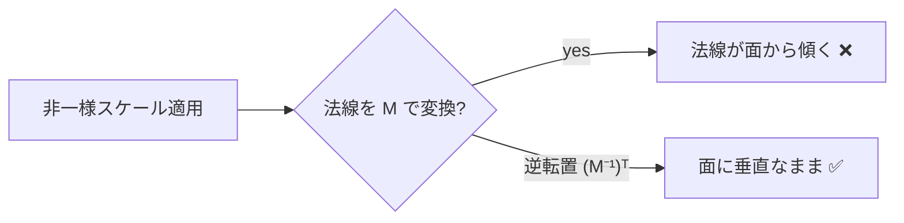

# 行列

## 概要

行列は**空間の変換 (移動・回転・拡縮・射影) を1つのデータで表現する道具**です。3Dグラフィックスでは4x4行列がすべての座標変換の共通言語であり、GPUのVertex Shaderは本質的に「毎頂点に行列を掛ける機械」です。

## なぜ必要なのか

- 「回転してから移動して、カメラ空間に移して、射影する」という**変換の連鎖を、行列の積として1個に合成**できる (100万頂点 × 1回の行列積で済む)
- 平行移動を線形変換として扱うには3x3では不可能で、**同次座標 + 4x4行列**が必要
- スケルタルアニメーション(スキニング)、法線変換、シャドウマップ — すべて行列の理解が前提

## 歴史・誕生した背景

行列による座標変換は Sutherland の Sketchpad (1963) やユタ大学のCG研究で導入され、**同次座標**は E. Roberts (1965) がCGに持ち込みました。SGIのハードウェア (Geometry Engine, 1982, Jim Clark) は「4x4行列積を行う専用チップ」であり、これが後のGPUのT&Lユニットの原型です。OpenGLの `glMatrixMode` (1992) を経て、プログラマブルシェーダ時代には行列はアプリが自前で管理するものになりました。

## それ以前の技術

成分ごとの三角関数による座標計算 (x' = x cosθ - y sinθ, ...) を変換ごとに個別コーディングしていました。変換の合成・逆変換の管理が困難で、ハードウェア化にも不向きでした。

## 解決した課題

1. **変換の合成**: $M = P \cdot V \cdot W$ と事前に1個へ畳める
2. **統一的なハードウェア化**: 「4x4行列 × ベクトル」という単一の演算に全変換を還元
3. **階層構造**: 親子関係 (シーングラフ、ボーン) を行列の積み重ねで自然に表現

## 現在の位置づけ

全シェーダ言語がネイティブの行列型 (`float4x4`, `mat4`) を持ちます。MVP行列は今もVertex Shaderの中心ですが、値の計算はCPU (またはCompute) で行い、シェーダには積み終えた行列を渡すのが定石です。

## 内部動作

### 基本の変換行列

$$
T(t)=\begin{pmatrix}1&0&0&t_x\\0&1&0&t_y\\0&0&1&t_z\\0&0&0&1\end{pmatrix}\quad
S(s)=\begin{pmatrix}s_x&0&0&0\\0&s_y&0&0\\0&0&s_z&0\\0&0&0&1\end{pmatrix}\quad
R_z(\theta)=\begin{pmatrix}\cos\theta&-\sin\theta&0&0\\\sin\theta&\cos\theta&0&0\\0&0&1&0\\0&0&0&1\end{pmatrix}
$$

### 同次座標 — なぜ4次元なのか

平行移動 $\mathbf{p}' = \mathbf{p} + \mathbf{t}$ は3x3行列では表現できません(線形変換は原点を固定するため)。そこで $w$ 成分を追加し:

- **位置**は $w = 1$: $(x, y, z, 1)$ → 平行移動の影響を**受ける**
- **方向**は $w = 0$: $(x, y, z, 0)$ → 平行移動の影響を**受けない**

さらに $w$ は透視投影で「奥行きで割る」操作 (perspective divide) を行列に組み込む鍵になります → [カメラと射影](/math/rendering/camera.html)

### 変換の合成と順序

行列の積は**非可換**です。列ベクトル規約 ($\mathbf{p}' = M\mathbf{p}$) では、変換は**右から左**へ適用されます:

$$\mathbf{p}_{clip} = P \cdot V \cdot W \cdot \mathbf{p}_{model}$$

(World → View → Projection の順に適用)

### 行優先/列優先の混乱を整理する

初学者の最大の躓きポイントです。**「数学的規約」と「メモリレイアウト」は別の話**です。

| | 数学的規約 (ベクトルの掛け方) | メモリ格納順 |
|---|---|---|
| HLSL (既定) | どちらも書ける (`mul(v, M)` / `mul(M, v)`) | **列優先** (column-major) が既定 |
| GLSL | 列ベクトル $M \cdot v$ が慣習 | **列優先** |
| DirectXMath | 行ベクトル $v \cdot M$ | 行優先 |
| glm | 列ベクトル | 列優先 |
| Unity | 列ベクトル (`transform.localToWorldMatrix`) | 列優先 |
| UE | 行ベクトル (`FMatrix`) | 行優先 |

転置して渡せば辻褄が合うため、**「自分のコードベースの規約を1つ決めて全員が従う」**ことが唯一の正解です。

### 逆行列と法線変換

- 逆行列 $M^{-1}$ は「変換を元に戻す」。ビュー行列はカメラのワールド行列の逆行列
- **法線は同じ行列で変換してはいけない**。非一様スケールで法線が面に垂直でなくなるため、**逆転置行列** $(M^{-1})^T$ を使う:

$$\mathbf{n}' = ((M^{-1})^T)\,\mathbf{n}$$



## 各環境での扱い

### Unity
`Matrix4x4` (C#)。`transform.localToWorldMatrix`、シェーダでは `UNITY_MATRIX_MVP`(現在は `UnityObjectToClipPos()`)、URP/HDRPでは `TransformObjectToHClip()`。定数 `unity_ObjectToWorld` / `unity_WorldToObject` (後者が逆行列で、法線変換に転置利用)。

### Unreal Engine
`FMatrix` (行ベクトル規約)。実務では `FTransform` (位置+回転Quat+スケールの分解表現) が主で、行列はGPUに渡す直前に生成。シェーダ内は `View.TranslatedWorldToClip` など。**カメラ相対レンダリング** (大ワールドの精度対策) のため "TranslatedWorld" という空間を持つのが特徴的です。

### DirectX 12
DirectXMathの `XMMATRIX`。`XMMatrixMultiply`, `XMMatrixInverse`, `XMMatrixTranspose`。HLSLへ定数バッファで渡す際、HLSL既定が列優先のため**転置してから書き込む**か `row_major` 修飾子を使うのが定番です。

### Vulkan
glmの `glm::mat4`。GLSLのstd140レイアウトで `mat4` は列優先。GLMは列優先なのでそのままmemcpyでき、相性が良い組み合わせです。

## コード例

MVP行列の構築と頂点変換 (C++ / glm):

```cpp
glm::mat4 model = glm::translate(glm::mat4(1), pos)
                * glm::mat4_cast(rotation)          // クォータニオン→行列
                * glm::scale(glm::mat4(1), scale);
glm::mat4 view  = glm::lookAt(camPos, camTarget, glm::vec3(0,1,0));
glm::mat4 proj  = glm::perspective(glm::radians(60.f), aspect, 0.1f, 1000.f);
glm::mat4 mvp   = proj * view * model;   // 列ベクトル規約: 右から適用
```

Vertex Shader での使用 (HLSL):

```hlsl
cbuffer PerObject : register(b0) {
    float4x4 gWorld;
    float4x4 gWorldInvTranspose; // 法線用
    float4x4 gViewProj;
};

VSOut VSMain(VSIn i) {
    VSOut o;
    float4 worldPos = mul(gWorld, float4(i.pos, 1.0));      // w=1: 位置
    o.normal   = mul((float3x3)gWorldInvTranspose, i.normal); // w=0相当: 方向
    o.clipPos  = mul(gViewProj, worldPos);
    return o;
}
```

## 前提知識

- [ベクトル](/math/rendering/vector.html)

## 次に読むべきページ

- [座標変換](/math/rendering/transform.html) — 行列が繋ぐ空間の全体地図
- [カメラと射影](/math/rendering/camera.html) — View行列とProjection行列の中身
- [クォータニオン](/math/rendering/quaternion.html) — 回転表現の本命

## 理解度チェック

1. **平行移動が3x3行列で表現できない理由と、同次座標がそれをどう解決するかを説明せよ。**
   ::: details 解答
   3x3行列による変換は線形変換であり、必ず原点を原点に写す(定数項を持てない)。平行移動は原点を動かすため表現不可能。同次座標では4次元目のw=1を導入し、4x4行列の第4列に移動量を置くことで、行列積の中に定数項の加算を埋め込める。
   :::

2. **法線の変換に逆転置行列が必要になるのはどのような場合か。不要な場合も述べよ。**
   ::: details 解答
   モデル行列に非一様スケール(軸ごとに異なる倍率)やせん断が含まれる場合、法線を同じ行列で変換すると面との垂直性が壊れるため逆転置が必要。回転と平行移動と一様スケールのみなら、行列の回転部分をそのまま使ってよい(直交行列の逆転置は自分自身のため)。
   :::

3. **$P \cdot V \cdot W$ という積の順序 (列ベクトル規約) で、頂点に最初に適用される変換はどれか。**
   ::: details 解答
   W (ワールド行列)。列ベクトル規約では p' = P(V(Wp)) と右側の行列から順に適用される。
   :::

## 参考資料

- Eric Lengyel, *Foundations of Game Engine Development, Vol.1*
- 3D Math Primer for Graphics and Game Development, 2nd ed.
- glm / DirectXMath 公式ドキュメント
- Song Ho Ahn, *OpenGL Transformation* (図解が優れた定番Web資料)
