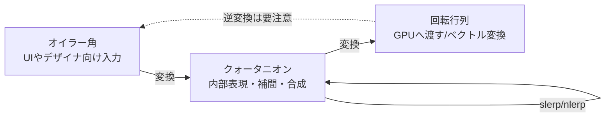

# クォータニオン

## 概要

クォータニオン (四元数) は**3D回転を4つの数 $(x, y, z, w)$ で表現する**数学的道具です。オイラー角のジンバルロックがなく、回転行列より省メモリで、**滑らかな補間 (slerp)** ができるため、ゲームエンジンの回転表現の標準となっています。

## なぜ必要なのか

回転を表す主な3つの方法と、それぞれの欠点を比べます。

| 表現 | サイズ | 補間 | 合成 | 欠点 |
|---|---|---|---|---|
| オイラー角 | 3 float | 困難 | 困難 | **ジンバルロック**、順序依存、補間で暴れる |
| 回転行列 | 9 float | 成分ごとの線形補間では直交性を失うことがある | 27乗算 | 冗長、ドリフトの再直交化が高価 |
| クォータニオン | 4 float | **符号をそろえて slerp で最短経路** | 16乗算 | 直感的でない、二重被覆 (q と -q が同じ回転) |

クォータニオンは、アニメーションのキーフレーム補間、カメラ制御、物理の角速度積分で使われます。

## 歴史・誕生した背景

1843年、W. R. ハミルトンがダブリンの橋の上で発見した(橋に刻んだ逸話が有名)数体系です。CGへの導入は **Ken Shoemake の SIGGRAPH 1985 論文 "Animating Rotation with Quaternion Curves"** が決定的で、キーフレームアニメーション補間の問題を解決するために持ち込まれました。以降、スケルタルアニメーションの普及 (1990年代後半〜) とともにゲームエンジンの標準になりました。

## それ以前の技術

オイラー角と回転行列です。初期のフライトシミュレータや3Dゲームはオイラー角を使い、ピッチ±90度付近で軸が縮退する**ジンバルロック**に苦しみました (アポロ計画の慣性航法装置でも実際に問題になった話が有名です)。

## 解決した課題

1. **ジンバルロックの根絶** — 回転を軸+角度の連続的な表現で扱う
2. **回転の補間** — 端点の符号で短い経路を選び、slerp の補間率を時間に比例させると等角速度で進む
3. **数値的安定性** — 誤差の蓄積は4成分の再正規化1回で修正できる (行列は再直交化が必要)

## 現在の位置づけ

Unity (`Quaternion`)、UE (`FQuat`)、glm (`glm::quat`)、物理エンジン (PhysX/Jolt/Bullet)、すべての標準です。GPUスキニングでは行列かデュアルクォータニオンに変換して使います。近年は機械学習分野で回転の連続表現 (6D表現) も研究されていますが、エンジンの主役は今もクォータニオンです。

## 内部動作

### 定義

回転軸 $\hat{\mathbf{a}}$ (単位ベクトル) と回転角 $\theta$ から、単位クォータニオンを求めます。

$$q = \left(\hat{\mathbf{a}}\sin\frac{\theta}{2},\; \cos\frac{\theta}{2}\right) = (x, y, z, w), \qquad \|q\| = 1$$

**なぜ半角なのか**: ベクトルの回転は $\mathbf{v}' = q\,\mathbf{v}\,q^{-1}$ という「挟み込み」で行われ、qが2回作用するためです。この構造ゆえに $q$ と $-q$ は同じ回転を表します (二重被覆)。

### 乗算 = 回転の合成

$$q_1 q_2 = (w_1 \mathbf{v}_2 + w_2 \mathbf{v}_1 + \mathbf{v}_1 \times \mathbf{v}_2,\; w_1 w_2 - \mathbf{v}_1 \cdot \mathbf{v}_2)$$

$q_1 q_2$ は「$q_2$ の回転を先に、$q_1$ を後に」適用します (列ベクトル規約の行列積と同じ向き)。**非可換**です。

### slerp (球面線形補間)

単位クォータニオン $q_0,q_1$ の内積が負なら補間に使う終点を $q'_1=-q_1$ とし、それ以外は $q'_1=q_1$ とします。$\Omega>0$ では次の式で補間します。

$$\text{slerp}(q_0, q'_1, t) = \frac{\sin((1-t)\Omega)}{\sin\Omega} q_0 + \frac{\sin(t\Omega)}{\sin\Omega} q'_1, \quad \cos\Omega = q_0 \cdot q'_1$$

$\Omega=0$ では両端が同じ向きなので $q_0$ を返せます。実装では、近い端点で $\sin\Omega$ が小さくなるときに、線形補間と正規化を組み合わせた **nlerp** で近似する方法もあります。[glTF 2.0 — 回転の球面線形補間](https://registry.khronos.org/glTF/specs/2.0/glTF-2.0.html#interpolation-slerp)

### 回転行列への変換

GPUに渡す際は3x3行列に展開するのが普通です:

$$
R(q)=\begin{pmatrix}
1-2(y^2+z^2) & 2(xy-wz) & 2(xz+wy)\\
2(xy+wz) & 1-2(x^2+z^2) & 2(yz-wx)\\
2(xz-wy) & 2(yz+wx) & 1-2(x^2+y^2)
\end{pmatrix}
$$



エンジン内部の典型的なデータフロー: **入力はオイラー角、保持と補間はクォータニオン、GPUには行列**。

## 各環境での扱い

### Unity
`Quaternion` (C#)。`transform.rotation` の実体。`Quaternion.Slerp`, `Quaternion.AngleAxis`, `Quaternion.LookRotation`。インスペクタのRotation表示はオイラー角ですが内部はクォータニオンです。`Quaternion * Vector3` 演算子でベクトル回転。

### Unreal Engine
`FQuat` (内部表現) と `FRotator` (オイラー角、Pitch/Yaw/Roll)。`FTransform` は回転を `FQuat` で保持。Blueprintに見えるのは主に `FRotator` で、内部で相互変換されます。`FQuat::Slerp`。

### DirectX 12
DirectXMath: `XMQuaternionRotationAxis`, `XMQuaternionSlerp`, `XMMatrixRotationQuaternion`。スキニング行列パレットの構築で多用します。

### Vulkan
Vulkan と組み合わせる CPU 側の計算には GLM の `glm::quat`、`glm::slerp`、`glm::mat4_cast(q)` などが使えます。glTF 2.0 の回転値はクォータニオンの `(x, y, z, w)` 順です。GLM 1.0.1 に渡すときは、引数順が明示される `glm::quat::wxyz(w, x, y, z)` が使えます。4引数コンストラクターは既定ではこの順ですが、`GLM_FORCE_QUAT_DATA_XYZW` の定義によって順番が変わります。

## コード例

C++17 と GLM 1.0.1 を使った単体例です。GLM の `slerp` は内部で終点の符号を選ぶので、呼び出し側では結果を正規化します。途中の回転と、回転を合成した視線を表示します。

```cpp
#include <glm/gtc/quaternion.hpp>
#include <glm/trigonometric.hpp>
#include <iostream>

glm::quat Interpolate(glm::quat a, glm::quat b, float t) {
    return glm::normalize(glm::slerp(a, b, t));
}

int main() {
    const glm::quat start = glm::quat::wxyz(1.0f, 0.0f, 0.0f, 0.0f);
    const glm::quat yaw = glm::angleAxis(glm::radians(90.0f), glm::vec3(0, 1, 0));
    const glm::quat pitch = glm::angleAxis(glm::radians(30.0f), glm::vec3(1, 0, 0));
    const glm::vec3 initialForward{0, 0, -1};

    const glm::vec3 halfway = Interpolate(start, -yaw, 0.5f) * initialForward;
    // 固定ワールド軸では X 軸ピッチを先に、Y 軸ヨーを後に適用する。
    const glm::vec3 combined = (yaw * pitch) * initialForward;
    std::cout << halfway.x << ' ' << halfway.y << ' ' << halfway.z << '\n';
    std::cout << combined.x << ' ' << combined.y << ' ' << combined.z << '\n';
}
```

途中の視線はおよそ `(-0.7071, 0, -0.7071)`、合成後の視線は `(-0.8660, 0.5, 0)` です。Unity 6.3 LTS で固定方向へ追従する場合、次の例では目標が同じ位置に来たときに現在の回転を保ちます。

```csharp
using UnityEngine;

public sealed class TrackRotation : MonoBehaviour
{
    [SerializeField] private Transform target;
    [SerializeField, Min(0f)] private float rotateSpeed = 5f;

    private void Update()
    {
        if (target == null) return;
        Vector3 direction = target.position - transform.position;
        if (direction.sqrMagnitude <= 1e-12f) return;

        Quaternion desired = Quaternion.LookRotation(direction, Vector3.up);
        // 固定した目標方向への差を、経過時間に応じて指数的に減らす。
        float t = 1f - Mathf.Exp(-rotateSpeed * Time.deltaTime);
        transform.rotation = Quaternion.Slerp(transform.rotation, desired, t);
    }
}
```

## 前提知識

- [ベクトル](/math/rendering/vector.html), [行列](/math/rendering/matrix.html)

## 次に読むべきページ

- [座標変換](/math/rendering/transform.html) — 回転が変換パイプラインに入る場所
- [Vertex Shader](/graphics/pipeline/vertex-shader.html) — スキニングでの行列パレット
- [Compute Shader](/graphics/compute/compute-shader.html) — GPUスキニング
- [補間と曲線](/math/rendering/interpolation-and-curves.html) — Lerp・Slerp・イージングの使い分け

## 理解度チェック

1. **ジンバルロックとは何か。クォータニオンではなぜ起きないのか。**
   ::: details 解答
   オイラー角で中間軸の回転が±90度になると、第1軸と第3軸の回転軸が重なって自由度が1つ失われる現象。クォータニオンは回転を3つの軸回転の合成ではなく単一の軸+角度として連続的に表現するため、特異点となる姿勢が存在しない(表現の縮退が起きない)。
   :::

2. **slerpの前に $q_0 \cdot q_1 < 0$ なら片方を反転するのはなぜか。**
   ::: details 解答
   qと-qは同じ回転を表す(二重被覆)ため、内積が負の組み合わせのまま補間すると4次元球面上で遠回りの経路を通り、実空間では「逆回りに大回転する」補間になる。反転すれば最短経路での補間になる。
   :::

3. **回転の内部表現にクォータニオンを使うエンジンが、GPUへは行列で渡すのはなぜか。**
   ::: details 解答
   シェーダでの頂点変換は他の変換(移動・スケール・射影)との合成が必要で、それらはすべて行列で表現される。クォータニオンのままではベクトル回転に挟み込み積が必要でALUコストも高く、行列に一度展開して他の変換と1個のMVP行列に畳む方が、毎頂点のコストが最小になる。
   :::

## 参考資料

- Ken Shoemake, [Animating Rotation with Quaternion Curves](https://doi.org/10.1145/325334.325242) (SIGGRAPH 1985) — 原典
- [GLM 1.0.1 — クォータニオンのコンストラクター](https://github.com/g-truc/glm/blob/1.0.1/glm/detail/type_quat.hpp)・[slerp の実装](https://github.com/g-truc/glm/blob/1.0.1/glm/ext/quaternion_common.inl)
- [Unity 6.3 LTS — Quaternion.LookRotation](https://docs.unity3d.com/6000.3/Documentation/ScriptReference/Quaternion.LookRotation.html)
- Eric Lengyel, *Foundations of Game Engine Development, Vol.1* — Chapter 4
- 3Blue1Brown & Ben Eater, *Visualizing quaternions* (インタラクティブ教材)
- Jonathan Blow, *"Understanding Slerp, Then Not Using It"* (nlerpの実務的擁護)
