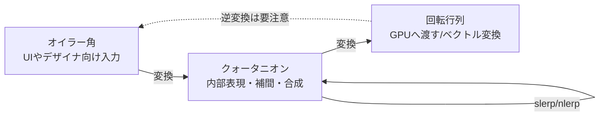

# クォータニオン

## 概要

クォータニオン (四元数) は**3D回転を4つの数 $(x, y, z, w)$ で表現する**数学的道具です。オイラー角のジンバルロックがなく、回転行列より省メモリで、**滑らかな補間 (slerp)** ができるため、ゲームエンジンの回転表現の標準となっています。

## なぜ必要なのか

回転表現には主に3つの選択肢があり、それぞれ致命的な欠点があります:

| 表現 | サイズ | 補間 | 合成 | 欠点 |
|---|---|---|---|---|
| オイラー角 | 3 float | 困難 | 困難 | **ジンバルロック**、順序依存、補間で暴れる |
| 回転行列 | 9 float | 不可(直交性が壊れる) | 27乗算 | 冗長、ドリフトの再直交化が高価 |
| クォータニオン | 4 float | **slerpで最短経路** | 16乗算 | 直感的でない、二重被覆 (q と -q が同じ回転) |

アニメーションのキーフレーム補間・カメラ制御・物理の角速度積分には、クォータニオンがほぼ唯一の実用解です。

## 歴史・誕生した背景

1843年、W. R. ハミルトンがダブリンの橋の上で発見した(橋に刻んだ逸話が有名)数体系です。CGへの導入は **Ken Shoemake の SIGGRAPH 1985 論文 "Animating Rotation with Quaternion Curves"** が決定的で、キーフレームアニメーション補間の問題を解決するために持ち込まれました。以降、スケルタルアニメーションの普及 (1990年代後半〜) とともにゲームエンジンの標準になりました。

## それ以前の技術

オイラー角と回転行列です。初期のフライトシミュレータや3Dゲームはオイラー角を使い、ピッチ±90度付近で軸が縮退する**ジンバルロック**に苦しみました (アポロ計画の慣性航法装置でも実際に問題になった話が有名です)。

## 解決した課題

1. **ジンバルロックの根絶** — 回転を軸+角度の連続的な表現で扱う
2. **正しい補間** — slerpは回転群 $SO(3)$ 上の最短測地線を等角速度で進む
3. **数値的安定性** — 誤差の蓄積は4成分の再正規化1回で修正できる (行列は再直交化が必要)

## 現在の位置づけ

Unity (`Quaternion`)、UE (`FQuat`)、glm (`glm::quat`)、物理エンジン (PhysX/Jolt/Bullet)、すべての標準です。GPUスキニングでは行列かデュアルクォータニオンに変換して使います。近年は機械学習分野で回転の連続表現 (6D表現) も研究されていますが、エンジンの主役は今もクォータニオンです。

## 内部動作

### 定義

単位クォータニオンは、回転軸 $\hat{\mathbf{a}}$ (単位ベクトル) と回転角 $\theta$ から:

$$q = \left(\hat{\mathbf{a}}\sin\frac{\theta}{2},\; \cos\frac{\theta}{2}\right) = (x, y, z, w), \qquad \|q\| = 1$$

**なぜ半角なのか**: ベクトルの回転は $\mathbf{v}' = q\,\mathbf{v}\,q^{-1}$ という「挟み込み」で行われ、qが2回作用するためです。この構造ゆえに $q$ と $-q$ は同じ回転を表します (二重被覆)。

### 乗算 = 回転の合成

$$q_1 q_2 = (w_1 \mathbf{v}_2 + w_2 \mathbf{v}_1 + \mathbf{v}_1 \times \mathbf{v}_2,\; w_1 w_2 - \mathbf{v}_1 \cdot \mathbf{v}_2)$$

$q_1 q_2$ は「$q_2$ の回転を先に、$q_1$ を後に」適用します (列ベクトル規約の行列積と同じ向き)。**非可換**です。

### slerp (球面線形補間)

$$\text{slerp}(q_0, q_1, t) = \frac{\sin((1-t)\Omega)}{\sin\Omega} q_0 + \frac{\sin(t\Omega)}{\sin\Omega} q_1, \quad \cos\Omega = q_0 \cdot q_1$$

- $q_0 \cdot q_1 < 0$ のときは片方を反転して**最短経路**を取る (二重被覆対策)
- 角度が小さいときは通常の線形補間+正規化 (**nlerp**) で十分高速・高品質。実務ではnlerpが多用されます

### 回転行列への変換

GPUに渡す際は3x3行列に展開するのが普通です:

$$
R(q)=\begin{pmatrix}
1-2(y^2+z^2) & 2(xy-wz) & 2(xz+wy)\\
2(xy+wz) & 1-2(x^2+z^2) & 2(yz-wx)\\
2(xz-wy) & 2(yz+wx) & 1-2(x^2+y^2)
\end{pmatrix}
$$



エンジン内部の典型的なデータフロー: **入力はオイラー角、保持と補間はクォータニオン、GPUには行列**。

## 各環境での扱い

### Unity
`Quaternion` (C#)。`transform.rotation` の実体。`Quaternion.Slerp`, `Quaternion.AngleAxis`, `Quaternion.LookRotation`。インスペクタのRotation表示はオイラー角ですが内部はクォータニオンです。`Quaternion * Vector3` 演算子でベクトル回転。

### Unreal Engine
`FQuat` (内部表現) と `FRotator` (オイラー角、Pitch/Yaw/Roll)。`FTransform` は回転を `FQuat` で保持。Blueprintに見えるのは主に `FRotator` で、内部で相互変換されます。`FQuat::Slerp`。

### DirectX 12
DirectXMath: `XMQuaternionRotationAxis`, `XMQuaternionSlerp`, `XMMatrixRotationQuaternion`。スキニング行列パレットの構築で多用します。

### Vulkan
glm: `glm::quat`, `glm::slerp`, `glm::mat4_cast(q)`。GLTFのアニメーションデータは回転をクォータニオンで格納しており、そのまま扱えます。

## コード例

C++ (glm) — アニメーション補間の基本形:

```cpp
// キーフレーム間の回転補間 (最短経路の保証つき)
glm::quat Interpolate(glm::quat a, glm::quat b, float t) {
    if (glm::dot(a, b) < 0.0f) b = -b;   // 二重被覆: 最短経路を選ぶ
    return glm::normalize(glm::slerp(a, b, t));
}

// 軸回転の合成: ヨー(Y軸)→ピッチ(X軸)の順で適用されるカメラ回転
glm::quat yaw   = glm::angleAxis(yawRad,   glm::vec3(0, 1, 0));
glm::quat pitch = glm::angleAxis(pitchRad, glm::vec3(1, 0, 0));
glm::quat camRot = yaw * pitch;          // 右側が先に適用される
glm::vec3 forward = camRot * glm::vec3(0, 0, -1);
```

Unity (C#) — 滑らかな回転追従:

```csharp
void Update() {
    Quaternion target = Quaternion.LookRotation(enemy.position - transform.position);
    // フレームレート非依存の指数的追従
    float t = 1f - Mathf.Exp(-rotateSpeed * Time.deltaTime);
    transform.rotation = Quaternion.Slerp(transform.rotation, target, t);
}
```

## 前提知識

- [ベクトル](/math/rendering/vector.html), [行列](/math/rendering/matrix.html)

## 次に読むべきページ

- [座標変換](/math/rendering/transform.html) — 回転が変換パイプラインに入る場所
- [Vertex Shader](/graphics/pipeline/vertex-shader.html) — スキニングでの行列パレット
- [Compute Shader](/graphics/compute/compute-shader.html) — GPUスキニング

## 理解度チェック

1. **ジンバルロックとは何か。クォータニオンではなぜ起きないのか。**
   ::: details 解答
   オイラー角で中間軸の回転が±90度になると、第1軸と第3軸の回転軸が重なって自由度が1つ失われる現象。クォータニオンは回転を3つの軸回転の合成ではなく単一の軸+角度として連続的に表現するため、特異点となる姿勢が存在しない(表現の縮退が起きない)。
   :::

2. **slerpの前に $q_0 \cdot q_1 < 0$ なら片方を反転するのはなぜか。**
   ::: details 解答
   qと-qは同じ回転を表す(二重被覆)ため、内積が負の組み合わせのまま補間すると4次元球面上で遠回りの経路を通り、実空間では「逆回りに大回転する」補間になる。反転すれば最短経路での補間になる。
   :::

3. **回転の内部表現にクォータニオンを使うエンジンが、GPUへは行列で渡すのはなぜか。**
   ::: details 解答
   シェーダでの頂点変換は他の変換(移動・スケール・射影)との合成が必要で、それらはすべて行列で表現される。クォータニオンのままではベクトル回転に挟み込み積が必要でALUコストも高く、行列に一度展開して他の変換と1個のMVP行列に畳む方が、毎頂点のコストが最小になる。
   :::

## 参考資料

- Ken Shoemake, *"Animating Rotation with Quaternion Curves"* (SIGGRAPH 1985) — 原典
- Eric Lengyel, *Foundations of Game Engine Development, Vol.1* — Chapter 4
- 3Blue1Brown & Ben Eater, *Visualizing quaternions* (インタラクティブ教材)
- Jonathan Blow, *"Understanding Slerp, Then Not Using It"* (nlerpの実務的擁護)
