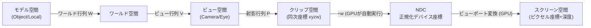

# 座標変換

## 概要

3D空間の頂点は、画面のピクセルになるまでに**複数の座標空間を旅**します。この「空間の地図」— モデル空間 → ワールド空間 → ビュー空間 → クリップ空間 → NDC → スクリーン空間 — を理解することが、レンダリングパイプライン理解の中核です。シェーダのバグの大半は「どの空間にいるかの取り違え」から生まれます。

## なぜ必要なのか

- ライティングは「同じ空間にあるベクトル同士」でしか計算できない (ワールド空間の法線とビュー空間の光方向を混ぜると壊れる)
- シャドウマップ・SSAO・SSRなどの技術は**空間の行き来** (再構成) そのもの
- API間の差異 (Yの向き、深度範囲) はすべてこの空間の定義の差異として現れる

## 歴史・誕生した背景

座標空間の分離は、Sutherland以降のCGパイプライン研究で確立し、OpenGL (1992) の固定機能パイプラインが「ModelView行列 + Projection行列」として制度化しました。プログラマブル化以降は空間設計がアプリケーションの自由になり、精度問題への対策としてUEの「カメラ相対レンダリング」のような変種も生まれています。

## それ以前の技術 / 解決した課題

初期のゲーム (Elite など) はワールド座標から直接スクリーンへの一体化した変換をハードコードしていました。空間を段階的に分離したことで、(1) 各段階の責務が明確になり、(2) ライトやカメラを増やしても同じ枠組みで扱え、(3) ハードウェアパイプラインの各ステージに対応づけられるようになりました。

## 現在の位置づけ

以下の空間分割は全API・全エンジン共通の骨格です (名称の揺れはあります)。

## 内部動作 — 空間の旅の全行程



| 空間 | 原点・軸 | 誰が変換するか |
|---|---|---|
| モデル空間 | モデルの原点 (DCCツールで決まる) | — |
| ワールド空間 | シーンの原点 | Vertex Shader (W) |
| ビュー空間 | カメラが原点、-Z(GL系)/+Z(DX系)が前方 | Vertex Shader (V) |
| クリップ空間 | 同次座標。ここでクリッピング | Vertex Shader (P) — **VSの出力はここ** |
| NDC | $x,y \in [-1,1]$、深度は後述 | **GPU固定機能** (perspective divide) |
| スクリーン空間 | 左上/左下原点のピクセル座標 | **GPU固定機能** (ビューポート変換) |

**Vertex Shaderの責務はクリップ空間まで**。それ以降 (÷w、ビューポート変換) はラスタライザ前の固定機能が行います → [ラスタライゼーション](/graphics/pipeline/rasterization.html)

### API間の差異 — 罠の一覧

| | NDC深度範囲 | NDC Yの向き | テクスチャUV原点 |
|---|---|---|---|
| OpenGL | $[-1, 1]$ | 上が + | 左下 |
| DirectX 10-12 | $[0, 1]$ | 上が + | 左上 |
| Vulkan | $[0, 1]$ | **下が +** (Yが反転) | 左上 |
| Metal | $[0, 1]$ | 上が + | 左上 |
| WebGPU | $[0, 1]$ | 上が + | 左上 |

- Vulkanでは射影行列のY成分に-1を掛ける、またはネガティブビューポートで対処するのが定番
- 深度範囲の差は射影行列の作り分けで吸収 (glmの `GLM_FORCE_DEPTH_ZERO_TO_ONE`)
- 現在は **Reverse-Z** (近=1, 遠=0) が浮動小数点精度の観点から標準的 → [カメラと射影](/math/rendering/camera.html)

### 空間の選び方 (実務指針)

| 計算 | 推奨空間 | 理由 |
|---|---|---|
| ライティング | ワールド or ビュー | どちらでも可。**全ベクトルを同一空間に揃える**ことが絶対条件 |
| 法線マッピング | 接空間 (Tangent Space) | テクスチャが接空間で焼かれているため |
| SSAO / SSR | ビュー空間 | 深度バッファからの位置再構成が素直 |
| 巨大ワールド | カメラ相対ワールド | float精度の維持 (UEの方式) |

### 接空間 (Tangent Space)

法線マップは表面ごとの局所座標系 (T, B, N) で定義されます。TBN行列で接空間⇔ワールド空間を行き来します:

$$\mathbf{n}_{world} = \begin{pmatrix} \mathbf{T} & \mathbf{B} & \mathbf{N} \end{pmatrix} \mathbf{n}_{tangent}$$

## 各環境での扱い

### Unity
`Transform` コンポーネントが Local→World を保持。シェーダでは `TransformObjectToWorld()`, `TransformWorldToHClip()` (URP/HDRP, `SpaceTransforms.hlsl`)。UnityはGL系規約をベースに、プラットフォーム差を `UNITY_UV_STARTS_AT_TOP` などのマクロで吸収します。

### Unreal Engine
`FTransform` が Local→World。シェーダ内では大ワールド精度対策として **TranslatedWorld** (カメラ位置を引いたワールド空間) を経由するのが独特です。`LWC` (Large World Coordinates, UE5) はdouble精度のワールド座標をタイル+オフセットで扱います。

### DirectX 12
規約は「左手系・深度[0,1]・Y上向きNDC」。DirectXMathの `XMMatrixLookAtLH` / `XMMatrixPerspectiveFovLH` が対応。座標系はアプリの自由ですが、慣習的に左手系が多数派です。

### Vulkan
「右手系NDCでY下向き・深度[0,1]」。glm使用時は `GLM_FORCE_DEPTH_ZERO_TO_ONE` を定義し、射影行列の `[1][1]` を反転するのが定石。`VK_KHR_maintenance1` で負の高さのビューポートも使えます。

## コード例

空間を明示した命名によるバグ防止 (HLSL):

```hlsl
// 変数名に空間を含める規約は多くの現場で採用されている
float3 positionWS = mul(gWorld, float4(positionOS, 1)).xyz;  // OS=Object Space
float3 normalWS   = normalize(mul((float3x3)gWorldIT, normalOS));
float3 viewDirWS  = normalize(gCameraPosWS - positionWS);
float4 positionCS = mul(gViewProj, float4(positionWS, 1));   // CS=Clip Space
```

深度バッファからビュー空間位置を再構成する (SSAO等で頻出):

```hlsl
float3 ReconstructViewPos(float2 uv, float deviceDepth,
                          float4x4 invProj)
{
    // UV [0,1] → NDC [-1,1] (Yの向きに注意)
    float2 ndc = uv * 2.0 - 1.0;
    ndc.y = -ndc.y;                       // DX系: UV原点が左上のため
    float4 clip = float4(ndc, deviceDepth, 1.0);
    float4 view = mul(invProj, clip);
    return view.xyz / view.w;             // 逆方向でも perspective divide が必要
}
```

## 前提知識

- [ベクトル](/math/rendering/vector.html)
- [行列](/math/rendering/matrix.html)

## 次に読むべきページ

- [カメラと射影](/math/rendering/camera.html) — V行列とP行列の中身の導出
- [パイプライン全体像](/graphics/pipeline/overview.html) — 各空間がパイプラインのどこに対応するか
- [Vertex Shader](/graphics/pipeline/vertex-shader.html)

## 理解度チェック

1. **Vertex Shaderが出力すべき座標はどの空間か。÷w を自分で行わないのはなぜか。**
   ::: details 解答
   クリップ空間 (同次座標)。クリッピングは÷wの前の同次座標空間で行う必要があり(wが負や0の頂点を先に除外するため)、また透視補正補間にwの値が必要なので、perspective divideはクリッピング後にGPUの固定機能が実行する。
   :::

2. **ワールド空間の法線とビュー空間のライト方向で dot(N, L) を計算すると何が起きるか。**
   ::: details 解答
   異なる空間のベクトル同士の内積は幾何学的に無意味な値になり、カメラを回すとライティングが変化するなどの破綻が起きる。全ベクトルを同一空間に変換してから計算しなければならない。
   :::

3. **VulkanでOpenGL用の射影行列をそのまま使うと、画面はどうなるか。**
   ::: details 解答
   (1) NDCのY軸が逆のため上下反転する。(2) 深度が[-1,1]前提で作られているため[0,1]の深度バッファに正しく写像されず、ニアクリップ付近の挙動と深度精度が壊れる。
   :::

## 参考資料

- Song Ho Ahn, *OpenGL Transformation* / *OpenGL Projection Matrix*
- Matt Pettineo (MJP), *"Reconstructing Position From Depth"* シリーズ
- Unreal Engine ドキュメント *"Large World Coordinates"*
- Real-Time Rendering 4th ed., Chapter 4
