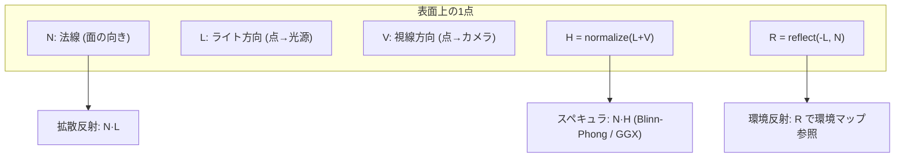

# ベクトル

## 概要

ベクトルは3Dグラフィックスにおける最も基本的なデータ型で、**位置・方向・速度・法線・色**まで、あらゆるものを表現します。レンダリングの計算は突き詰めれば「ベクトルと行列の演算の膨大な繰り返し」であり、GPUのレジスタもシェーダ言語の型 (`float3`, `vec3`) もベクトルを前提に設計されています。

## なぜ必要なのか

- 頂点の位置、カメラの向き、光の方向、表面の法線 — 3D空間の記述はすべてベクトル
- **内積**はライティングの根幹 (拡散反射 $N \cdot L$)、**外積**は法線生成とカメラ基底の構築に必須
- ベクトルの幾何学的意味を理解していないと、シェーダを読むことも書くこともできません

## 歴史・誕生した背景

ベクトル解析は19世紀に J. W. Gibbs と O. Heaviside がハミルトンの四元数から実用部分を抽出して整備したものです。CGへの応用は1960〜70年代のユタ大学 (Sutherland, Catmull, Phong ら) で確立し、Phongの反射モデル (1975) は「法線と光線ベクトルの内積」でライティングを定式化しました。以来、この言語がCGの共通語です。

## それ以前の技術 / 解決した課題

四元数ベースの記法は冗長で、成分ごとの三角関数計算は煩雑でした。ベクトル記法は「幾何学的な操作(投影・回転・反射)」を座標系に依存しない簡潔な式で書けるようにし、そのままハードウェア (SIMD) に落とせる形を与えました。

## 現在の位置づけ

シェーダ言語のネイティブ型 (`float2/3/4`) として言語レベルで組み込まれています。CPU側でも DirectXMath / glm / Unity.Mathematics などのSIMD対応ライブラリが標準です。

## 内部動作 — 主要な演算と幾何学的意味

### 内積 (Dot Product)

$$\mathbf{a} \cdot \mathbf{b} = a_x b_x + a_y b_y + a_z b_z = \|\mathbf{a}\|\|\mathbf{b}\|\cos\theta$$

| 用途 | 式 | 意味 |
|---|---|---|
| 拡散反射 (Lambert) | $\max(0, N \cdot L)$ | 面がどれだけ光に正対しているか |
| 裏面判定 | $N \cdot V < 0$ | 視線に対して裏を向いているか |
| 投影 | $(\mathbf{a} \cdot \hat{\mathbf{b}})\hat{\mathbf{b}}$ | aのb方向成分 |
| 距離の比較 | $\mathbf{d} \cdot \mathbf{d}$ | 平方根を避けて距離²で比較(最適化の定石) |

### 外積 (Cross Product)

$$\mathbf{a} \times \mathbf{b} = (a_y b_z - a_z b_y,\; a_z b_x - a_x b_z,\; a_x b_y - a_y b_x)$$

- 結果は **a, b の両方に垂直** なベクトル。長さは平行四辺形の面積
- 三角形の**法線生成**: $N = \text{normalize}((v_1 - v_0) \times (v_2 - v_0))$
- 順序を入れ替えると符号反転 ($\mathbf{a} \times \mathbf{b} = -\mathbf{b} \times \mathbf{a}$) — **ワインディング順序と表裏**の関係の根拠 → [ラスタライゼーション](/graphics/pipeline/rasterization.html)
- カメラの基底構築 (right = forward × up など) → [カメラと射影](/math/rendering/camera.html)

### 正規化・長さ

$$\hat{\mathbf{v}} = \frac{\mathbf{v}}{\|\mathbf{v}\|}, \qquad \|\mathbf{v}\| = \sqrt{\mathbf{v} \cdot \mathbf{v}}$$

方向を表すベクトル(法線・光線)は原則正規化して扱います。**補間後の法線は長さが1でなくなる**ため、Fragment Shader での再正規化が必要です → [Fragment Shader](/graphics/pipeline/fragment-shader.html)

### 反射・ハーフベクトル

$$\mathbf{r} = \mathbf{v} - 2(\mathbf{v} \cdot \mathbf{n})\mathbf{n} \qquad \mathbf{h} = \frac{\mathbf{l} + \mathbf{v}}{\|\mathbf{l} + \mathbf{v}\|}$$

反射ベクトルは環境マップ参照 ([IBL](/graphics/lighting/ibl.html)) に、ハーフベクトルはスペキュラ計算 ([PBR](/graphics/lighting/pbr.html)) の中心です。

### 図解: ライティングで使うベクトル



## 各環境での扱い

### Unity
`Vector3` (C#) / `float3` (Unity.Mathematics, Burst向け)。`Vector3.Dot`, `Vector3.Cross`, `Vector3.Reflect`。シェーダ (HLSL) では `float3` と `dot()`, `cross()`, `reflect()`。

### Unreal Engine
`FVector` (C++, **doubleベース** — UE5でLWC対応のため)。`FVector::DotProduct`, `CrossProduct`。マテリアルエディタのノード (Dot, Cross, Normalize) はHLSLに変換されます。

### DirectX 12
API自体にベクトル型はなく、CPU側は **DirectXMath** (`XMVECTOR`, SIMDレジスタ直結)、シェーダ側はHLSLの `float3/float4` を使用。定数バッファへ渡す際は16バイトアラインメント規則に注意。

### Vulkan
CPU側は **glm** (`glm::vec3`) がデファクト。シェーダ側はGLSLの `vec3/vec4`。std140/std430レイアウト規則で `vec3` が16バイト境界に揃えられる罠が有名です。

## コード例

HLSLでのBlinn-Phongライティング(ベクトル演算の実践):

```hlsl
float3 ShadeBlinnPhong(float3 N, float3 L, float3 V,
                       float3 albedo, float3 lightColor, float shininess)
{
    N = normalize(N);                      // 補間後の再正規化
    float  NdotL = saturate(dot(N, L));    // 拡散: 面と光の正対度
    float3 H     = normalize(L + V);       // ハーフベクトル
    float  spec  = pow(saturate(dot(N, H)), shininess);
    return (albedo * NdotL + spec) * lightColor;
}
```

C++ (glm) での三角形法線と面積:

```cpp
glm::vec3 e1 = v1 - v0, e2 = v2 - v0;
glm::vec3 c  = glm::cross(e1, e2);
glm::vec3 normal = glm::normalize(c);
float area = 0.5f * glm::length(c);   // 外積の長さ = 平行四辺形の面積
```

## 前提知識

- 高校数学のベクトル(あれば十分)

## 次に読むべきページ

- [行列](/math/rendering/matrix.html) — ベクトルを変換する道具
- [座標変換](/math/rendering/transform.html) — ベクトルが空間を渡り歩く仕組み
- [PBR](/graphics/lighting/pbr.html) — 内積とハーフベクトルの本格活用

## 理解度チェック

1. **$N \cdot L$ がライティングの明るさを表す幾何学的理由を説明せよ。**
   ::: details 解答
   両者が単位ベクトルのとき $N \cdot L = \cos\theta$ (θは面法線と光方向のなす角)。面が光に正対する(θ=0)と単位面積あたりに受ける光束が最大になり、傾くほど同じ光束が広い面積に薄まる。この幾何学的減衰がちょうど cosθ に比例する (Lambertの余弦則)。
   :::

2. **距離の比較に `length()` でなく `dot(d, d)` を使うのはなぜか。**
   ::: details 解答
   length は内部で平方根を計算するが、大小比較だけなら距離の2乗同士の比較で十分であり、sqrt を省ける。
   :::

3. **三角形の頂点順序 (ワインディング) を逆にすると法線はどうなるか。その理由は。**
   ::: details 解答
   反転する。法線はエッジベクトルの外積で求まり、外積は引数の順序を入れ替えると符号が反転するため。これが表裏判定(バックフェースカリング)の数学的基盤になっている。
   :::

## 参考資料

- Eric Lengyel, *Foundations of Game Engine Development, Vol.1: Mathematics*
- F. Dunn & I. Parberry, *3D Math Primer for Graphics and Game Development*
- Real-Time Rendering 4th ed., Chapter 1, 4
