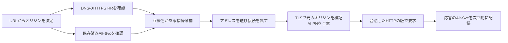

# HTTPS・SVCBレコードとHTTP/3の発見 — 接続候補をDNSとHTTPから知る

ブラウザーが `https://game.example/` を開くとき、HTTP/3を使うには、QUICで接続できる候補を知る必要があります。DNSの**HTTPSレコード**は、最初のHTTPリクエストを送る前に候補を伝えられます。HTTPの**Alt-Svc**は、応答などを通じて今後使える別の接続先を伝えます。どちらで候補を知った場合も、接続の確立とオリジンの確認が続きます。

## HTTPSレコードで接続前に分かること

RFC 9460の**SVCB**はサービスの接続先とパラメーターをDNSで表す仕組みです。**HTTPS RR**はHTTP用のSVCB互換レコードで、既定のHTTPSポートに対してはホスト名をそのまま問い合わせます。例えば、次のレコードは `game.example.` の接続候補を知らせます。

```text
game.example. 300 IN HTTPS 1 edge.game.example. alpn=h3,h2
game.example. 300 IN HTTPS 2 . alpn=h2
```

| 項目 | この例で読み取れること |
| --- | --- |
| `SvcPriority` | 0はAliasModeでサービス名の別名を表す。1以上はServiceModeで、小さい値の候補を優先する |
| `TargetName` | 優先度1の接続先は `edge.game.example.`。ServiceModeの `.` はレコードの所有者名を使う |
| `alpn` | 優先度1はHTTP/3とHTTP/2を案内する。HTTPS RRでは `no-default-alpn` がなければ既定の `http/1.1` も候補集合に加わる |
| `port` | 省略しているのでURIの接続先ポートを使う。このURLの既定は443 |

AliasModeはサービスに対する別名であり、同じ名前の全DNSレコードを別名にするCNAMEとは範囲が異なります。ServiceModeでは、`mandatory` に列挙されたキーなどを処理できない候補を飛ばします。同じ優先度の候補が複数ある場合、RFC 9460はその優先度内でランダムな順序にすることを推奨しています。

`ipv4hint` と `ipv6hint` は、アドレスの問い合わせを待つ間の候補です。ターゲット名のAとAAAAがすでに手元にあればそちらを使います。ヒントが先に届いた場合も、クライアントはターゲットのアドレスを問い合わせ、後の接続にその結果を使えます。

`ech` は TLS Encrypted Client Hello（ECH）の設定を運ぶ ServiceMode のパラメーターです。対応クライアントは接続前に設定を取得し、本来のサーバー名を入れた内側の ClientHello を暗号化できます。RFC 9848 では、SVCB の解決に成功し、すべての代替候補に `ech` がある場合、ECH 対応クライアントが通常の SVCB 省略経路へ戻ることを禁じています。オリジンの証明書の検証は引き続き行います。



## Alt-SvcとALPN — 案内と合意は別の段階

例えば応答に `Alt-Svc: h3=":8443"; ma=300` があれば、同じホストのUDP 8443番でHTTP/3に接続できるという案内です。`ma=300` は案内の有効期間を秒で表します。HTTPS RRの有効期間はDNSのTTLで扱います。RFC 9460では、両方を実装しているクライアントが保存済みAlt-Svcを使う際に、その代替接続先についてもHTTPSレコードを確認し、両方の条件に合う接続を試すことを推奨しています。

`h3` はHTTP/3のALPN識別子です。DNSやHTTPから知った値は、どのトランスポートで接続を試すかを決める情報です。実際に使うプロトコルはハンドシェイクで合意します。接続先ホストが `edge.game.example` になっても、元のURLのオリジンとHTTPのauthorityは `game.example` のままです。TLSの証明書も元のオリジンを基準に検証します。

## Happy Eyeballs — アドレスの片方が遅くても待ち続けない

RFC 8305のHappy Eyeballs v2は、IPv6とIPv4の名前解決や接続試行を組み合わせます。候補を並べ、最初の試行が完了しない間に、間隔を空けて次のアドレスを試します。RFCの推奨既定値の一つは接続試行の間隔250 msです。例えばIPv6を0 ms、IPv4を250 msに開始し、IPv4が80 msで確立するなら、他が先に成功しない場合は330 msで使える接続を得ます。この時間は説明用で、実装は観測や設定に応じて間隔を変えられます。

IPv4とIPv6はアドレスの種類、QUICとTCPはトランスポートです。RFC 8305 の v2 はアドレスの解決と接続試行を扱います。QUIC が確立しないネットワークでは、RFC 9114 は TCP ベースの HTTP を試すことを推奨しています。

2026 年 11 月 13 日時点で、IETF の **Happy Eyeballs v3** は Internet-Draft `draft-ietf-happy-happyeyeballs-v3-05`（11 月 2 日版）です。HTTPS・SVCB レコードから得た ALPN や接続先をアドレス情報と組み合わせ、QUIC と TCP＋TLS の試行も候補に含めます。例えば HTTPS レコードが `h3` と `h2` を案内する接続先では、アドレスごとの候補に QUIC と TCP＋TLS を組み合わせて順序を決めます。並行試行の間隔や優先方針は、ブラウザーの実装でも確認します。

## コード例 — 互換性を確認し、優先度の小さい候補を選ぶ

C++20の単体プログラムです。`cl /std:c++20 /EHsc discovery.cpp` でコンパイルできます。AliasModeを解決済みで、優先度の重複がない架空のServiceModeレコードを使います。DNS問い合わせやソケット接続は行いません。表示するALPNは試すトランスポートを決めるための候補で、ハンドシェイク結果ではありません。

```cpp
#include <algorithm>
#include <array>
#include <iostream>
#include <span>
#include <string_view>

using namespace std::string_view_literals;

struct Binding {
    int priority;
    std::string_view target;
    int port;
    std::span<const std::string_view> alpn;
    bool noDefaultAlpn;
    std::span<const std::string_view> mandatory;
};

bool compatible(const Binding& record,
                std::span<const std::string_view> supportedAlpn)
{
    constexpr std::array keys{"alpn"sv, "port"sv, "no-default-alpn"sv};
    const auto understands = [&](std::string_view key) {
        return std::find(keys.begin(), keys.end(), key) != keys.end();
    };
    if (!std::all_of(record.mandatory.begin(), record.mandatory.end(), understands)) {
        return false;
    }

    const auto supports = [&](std::string_view alpn) {
        return std::find(supportedAlpn.begin(), supportedAlpn.end(), alpn)
            != supportedAlpn.end();
    };
    return std::any_of(record.alpn.begin(), record.alpn.end(), supports)
        || (!record.noDefaultAlpn && supports("http/1.1"));
}

int main()
{
    constexpr auto origin = "game.example"sv;
    constexpr std::array h3{"h3"sv};
    constexpr std::array h2{"h2"sv};
    constexpr std::array unsupported{"key65444"sv};
    constexpr std::array client{"h3"sv, "h2"sv, "http/1.1"sv};
    const std::array records{
        Binding{3, origin, 443, h2, false, {}},
        Binding{1, "special.game.example", 443, h3, true, unsupported},
        Binding{2, "edge.game.example", 8443, h3, true, {}}
    };

    const Binding* best = nullptr;
    for (const auto& record : records) {
        if (compatible(record, client) && (!best || record.priority < best->priority)) {
            best = &record;
        }
    }
    if (!best) {
        std::cout << "No compatible HTTPS binding\n";
        return 0;
    }
    std::cout << "Priority: " << best->priority << '\n'
              << "Connect to: " << best->target << ':' << best->port << '\n'
              << "Validate origin: " << origin << '\n';
}
```

優先度1は未知の必須キーがあるため飛ばし、優先度2の `edge.game.example:8443` を選びます。元のオリジン名は `game.example` です。この簡略例は構文解析を終えた候補の比較に絞っています。実際のクライアントには、同順位の扱い、他候補や既定の接続への切り替え、DNSキャッシュ、アドレス解決、TLS検証が必要です。

## 理解度チェック

1. 初めて開くURLでHTTP応答をまだ受け取っていない場合、HTTPS RRとAlt-Svcのどちらから候補を知れますか。
2. 優先度1のレコードに知らない必須キーがあり、優先度2のレコードは互換性があります。どちらを試しますか。
3. IPv6のQUIC接続が確立しないとき、IPv4で試すこととTCPへ切り替えることはどう違いますか。

::: details 解答
1. DNSのHTTPS RRです。Alt-Svcは以前の応答などで受け取った案内を保存していれば、次の接続に使えます。
2. 優先度1は互換性がないため除外し、優先度2を試せます。
3. IPv4はアドレスの種類を変えます。TCPへの切り替えはトランスポートを変え、HTTP/2やHTTP/1.1などを使う判断につながります。
:::

## 関連項目

- [DNSの名前解決](/network/dns-resolution.html)
- [QUICとHTTP/3](/network/quic-and-http3.html)
- [TLSとHTTPS](/network/tls-https.html)

## 参考資料

- [IETF RFC 9460、SVCBとHTTPSレコード](https://www.rfc-editor.org/rfc/rfc9460.html)
- [IETF RFC 9114、HTTP/3 §3](https://www.rfc-editor.org/rfc/rfc9114.html#section-3)
- [IETF RFC 7838、HTTP Alternative Services](https://www.rfc-editor.org/rfc/rfc7838.html)
- [IETF RFC 8305、Happy Eyeballs Version 2](https://www.rfc-editor.org/rfc/rfc8305.html)
- [IETF、Happy Eyeballs Version 3 Internet-Draft -05](https://datatracker.ietf.org/doc/html/draft-ietf-happy-happyeyeballs-v3-05)
- [IETF RFC 9848、SVCB・HTTPS での ECH 設定の配布](https://www.rfc-editor.org/rfc/rfc9848.html)・[RFC 9849、TLS Encrypted Client Hello](https://www.rfc-editor.org/rfc/rfc9849.html)
