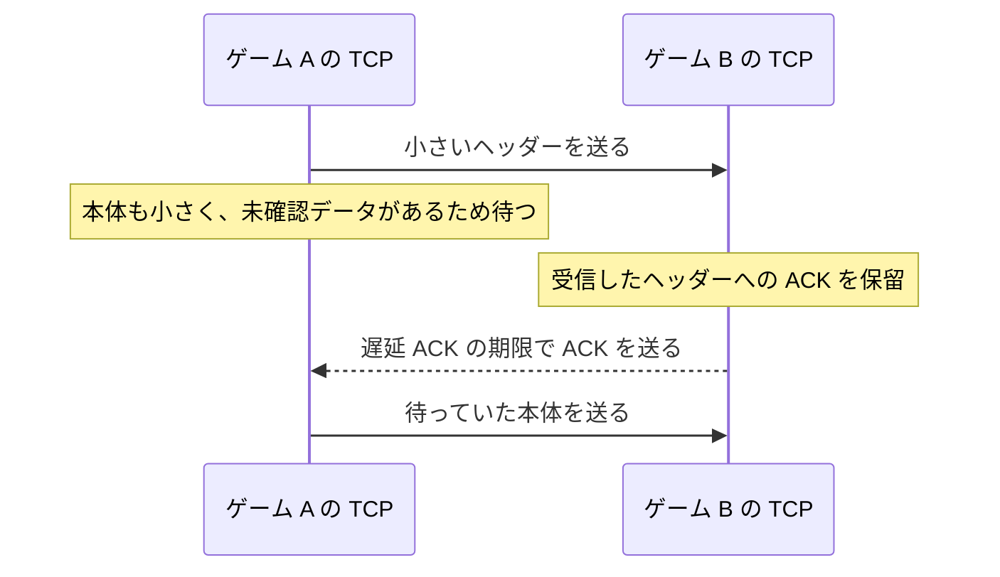

# Nagle アルゴリズムと遅延 ACK — TCP の小さい送信を観察する

ゲームの TCP 接続で、同じメッセージをヘッダーと本体に分けて書き込むと、二回目の小さい書き込みが TCP 内にとどまることがある。送信側が小さいセグメントをまとめる処理と、受信側が ACK をまとめる処理の両方が働くため。どちらの側が何を待っているかを追うと、アプリの書き込み方で変えられる遅延を見つけやすい。

## 送信側の Nagle、受信側の遅延 ACK

| 処理 | 何を待つか | 目的 |
| --- | --- | --- |
| Nagle アルゴリズム | 送信済みのデータに対する ACK、またはフルサイズのセグメントを送れる量のデータ | 小さい TCP セグメントが続くときに、複数の書き込みをまとめる。 |
| 遅延 ACK | ACK を一緒に返せる機会や、実装が選んだ期限 | ACK 単体のセグメント数を減らす。 |

RFC 896 で提案され、RFC 9293 §3.7.4 が説明する Nagle の基本形では、未確認のデータがある間、新しい小さい送信をまとめる。`MSS`（Maximum Segment Size）は TCP セグメントに入るデータ部分の最大サイズを表し、この判定では接続の有効送信 MSS を使う。未確認のデータがなく、送信ウィンドウにも余裕があれば、この規則による待ちは生じない。実装には変種があり、ほかの送信制約も残る。

遅延 ACK はデータを受け取った側の処理。RFC 1122 §4.2.3.2 と RFC 9293 §3.8.6.3 は、遅延を 0.5 秒未満とし、フルサイズのセグメントが続く場合の ACK の頻度も示す。0.5 秒は規格上の上限であり、実際の待ち時間は OS、通信状況、接続の状態などに依存する。TCP の ACK は接続上でバイトを受け取ったことを示し、相手のゲームがそのメッセージを処理したかどうかはアプリの応答で確認する。

## 二回の書き込みが待つ例



次の数値は動作を追うための仮定。片道 10 ms、B は最初のデータを受信してから 40 ms 後に ACK、ヘッダーの書き込みは 0 ms、本体は 1 ms とする。A へ ACK が戻るのは `10 + 40 + 10 = 60 ms`。その ACK を待つと本体が B へ届くのは 70 ms。Nagle による待ちがなければ、同じ片道遅延の仮定で本体は 11 ms に届く。図と数値は最初のデータに対して B がすぐには ACK を返さない場合を示す。

## ゲームでの TCP_NODELAY

Winsock と Linux の TCP ソケットでは、`setsockopt` のレベルを `IPPROTO_TCP`、オプションを `TCP_NODELAY`、値を有効にすると、そのソケットの送信側で Nagle を無効にできる。Windows の Winsock 文書では値の型を `DWORD`（真偽値）、Linux の `tcp(7)` では `int` としている。双方向で必要なら、それぞれの送信端で設定する。

`TCP_NODELAY` を有効にしても、相手側の遅延 ACK は残る。輻輳制御、送受信のウィンドウ、送信キューなどの影響も受ける。TCP はバイトストリームなので、アプリの `send` と相手の `recv` の呼び出し数やバイトの区切りが対応するとは限らない。

ヘッダーと本体が同時に用意できるなら、先にアプリ側で一つの論理メッセージにまとめて書き込む方法がある。時刻が別の小さい操作を早く届けたい接続では `TCP_NODELAY` を比較し、送るセグメント数、遅延の分布、実際のフレームへの影響を測る。計測ではアプリが書き込んだ時刻、TCP のデータと ACK が観測された時刻、相手アプリが読み取った時刻を区別する。ローカルループバックだけでは同じ待ちが現れない場合がある。

### 書き込みのまとめ方と受信側の設定

Linux では、ヘッダーと本体を別々のメモリに置いたまま `writev` や `sendmsg` にまとめて渡せる。`MSG_MORE` は同じ送信の続きがあることを呼び出し単位で示す。`TCP_CORK` はソケット単位で部分セグメントの送出を抑え、解除すると保留分の送出を促す。書き込みの結合や `MSG_MORE` を使っても、TCP のセグメント境界と受信側の読み取り境界は一致するとは限らない。 [Linux man-pages — writev(2)](https://man7.org/linux/man-pages/man2/writev.2.html)・[send(2)](https://man7.org/linux/man-pages/man2/send.2.html)・[tcp(7)](https://man7.org/linux/man-pages/man7/tcp.7.html)

Linux の受信側で `TCP_QUICKACK` を設定すると、即時 ACK を送るモードへの切り替えを要求できる。以後の TCP の処理でモードは変わり得る。Windows Server には `TcpAckFrequency` のレジストリ設定があり、遅延 ACK のタイマーを待たずに ACK を送るまでの件数に関わる。こちらは送信ソケット単位の `TCP_NODELAY` と異なる範囲に作用する。 [Linux man-pages — tcp(7)](https://man7.org/linux/man-pages/man7/tcp.7.html)・[Microsoft — TcpAckFrequency](https://learn.microsoft.com/en-us/troubleshoot/windows-server/networking/registry-entry-control-tcp-acknowledgment-behavior)

Linux で送信の計測点を分けたい場合は `SO_TIMESTAMPING` を使える。`SOF_TIMESTAMPING_TX_SCHED` はパケットスケジューラーへ入る前、`SOF_TIMESTAMPING_TX_SOFTWARE` はデバイスドライバーへの引き渡し付近のソフトウェア時刻を記録する。TCP はバイトストリームで、書き込み単位がパケットに一対一で対応しないため、アプリの書き込み時刻とは別に記録する。 [Linux Kernel Documentation — Timestamping](https://docs.kernel.org/networking/timestamping.html)

## コード例 — 2 回目の書き込み時刻を比較する

C++20 のモデル。最初の書き込みを送信した時刻を 0 ms とし、二回目の書き込み時に未確認のデータが残る場合を計算する。送信側のウィンドウには余裕があり、経路遅延は固定、相手の ACK 時刻はパラメーターで与える。実際にソケットを開いて測るサンプルではない。

```cpp
#include <iostream>

struct Scenario
{
    int oneWayMs;
    int ackHoldMs;
    int secondWriteMs;
    int secondBytes;
    int effectiveMss;
};

int secondArrivalMs(const Scenario& s, bool noDelay)
{
    const int firstAckAtSender = 2 * s.oneWayMs + s.ackHoldMs;
    const bool waitsForAck = !noDelay && s.secondWriteMs < firstAckAtSender
                           && s.secondBytes < s.effectiveMss;
    const int secondSend = waitsForAck ? firstAckAtSender : s.secondWriteMs;
    return secondSend + s.oneWayMs;
}

int main()
{
    constexpr Scenario smallWrite{10, 40, 1, 24, 1200};
    constexpr Scenario fullSegment{10, 40, 1, 1200, 1200};

    const int nagle = secondArrivalMs(smallWrite, false);
    const int noDelay = secondArrivalMs(smallWrite, true);
    const int full = secondArrivalMs(fullSegment, false);
    std::cout << "Nagle: " << nagle << " ms\n"
              << "TCP_NODELAY: " << noDelay << " ms\n"
              << "Full-sized segment: " << full << " ms\n";
    return nagle == 70 && noDelay == 11 && full == 11 ? 0 : 1;
}
```

小さい本体では 70 ms と 11 ms、フルサイズを送れる場合は Nagle が有効でも 11 ms。二回目の書き込みを 60 ms 以降に動かすと、このモデルでは最初の ACK を受信済みになる。

## 理解度チェック

<details><summary>Nagle と遅延 ACK は、どちらの端点の処理？</summary>

ここでのデータを送る側が Nagle、受信して ACK を返す側が遅延 ACK を実行する。

</details>

<details><summary>送信側で TCP_NODELAY を有効にすると、相手の ACK もすぐ返る？</summary>

`TCP_NODELAY` が変えるのはそのソケットの Nagle による待ち。相手がどの時点で ACK を送るかは相手の TCP が決める。

</details>

<details><summary>TCP_NODELAY を有効にすれば、1 回の send が相手の 1 回の recv で受け取れる？</summary>

TCP はバイトストリーム。受信側はメッセージの長さや区切りをアプリのプロトコルで判断する。

</details>

## 関連項目

- [TCP ソケット](/network/tcp-sockets.html)
- [UDP データグラム](/network/udp-datagrams.html)
- [遅延・スループット・キュー](/network/latency-throughput-and-queues.html)
- [ゲームのネットワーク同期](/game/network-sync.html)

## 参考資料

- [John Nagle — RFC 896: Congestion Control in IP/TCP Internetworks](https://www.rfc-editor.org/rfc/rfc896.html)
- [IETF — RFC 1122 §4.2.3.2 When to Send an ACK Segment](https://www.rfc-editor.org/rfc/rfc1122.html#page-96)
- [IETF — RFC 9293 §3.7.4 Nagle Algorithm](https://www.rfc-editor.org/rfc/rfc9293.html#section-3.7.4)
- [IETF — RFC 9293 §3.8.6.3 Delayed Acknowledgments](https://www.rfc-editor.org/rfc/rfc9293.html#section-3.8.6.3)
- [Microsoft Winsock — IPPROTO_TCP socket options](https://learn.microsoft.com/en-us/windows/win32/winsock/ipproto-tcp-socket-options)
- [Linux man-pages — tcp(7)](https://man7.org/linux/man-pages/man7/tcp.7.html)
- [Linux Kernel Documentation — Timestamping](https://docs.kernel.org/networking/timestamping.html)
