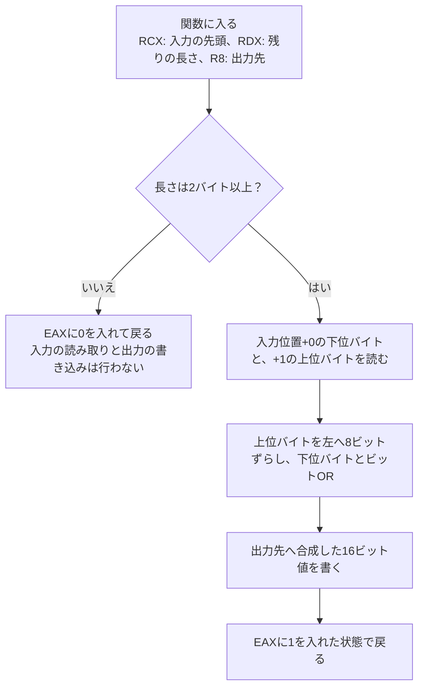

# Cのバイト読み取りをx86-64の逆アセンブリで追う

[Cでバイト列を読む](/languages/c/reading-byte-arrays.html)の `read_u16_le` を、Windows x64用に `/Od` と `/O2` でビルドします。長さの検査、2バイトの合成、結果の書き込みに対応する命令を両方のビルドで探します。

## 手元で動かす {#run-locally}

<a href="/study/samples/compilers/c-byte-decoder-disassembly/byte_decoder.h" download>byte_decoder.h</a>、<a href="/study/samples/compilers/c-byte-decoder-disassembly/byte_decoder.c" download>byte_decoder.c</a>、<a href="/study/samples/compilers/c-byte-decoder-disassembly/main.c" download>main.c</a>を新しい作業フォルダーに保存します。MSVCのC++ツールが入った環境で **x64 Native Tools Command Prompt for VS** を開き、そのフォルダーで以下を実行します。[Microsoftのコマンドライン用C++ツール](https://learn.microsoft.com/en-us/cpp/build/building-on-the-command-line?view=msvc-170)

```bat
mkdir od
mkdir o2
cl /nologo /TC /std:c17 /W4 /WX /Od /Z7 /FAcs /Faod\ /Food\ /Feod\byte_study.exe main.c byte_decoder.c /link /DEBUG:FULL /INCREMENTAL:NO
od\byte_study.exe
cl /nologo /TC /std:c17 /W4 /WX /O2 /Z7 /FAcs /Fao2\ /Foo2\ /Feo2\byte_study.exe main.c byte_decoder.c /link /DEBUG:FULL /INCREMENTAL:NO
o2\byte_study.exe
dumpbin /disasm od\byte_decoder.obj
dumpbin /disasm o2\byte_decoder.obj
```

`/Od` は最適化を無効にし、`/O2` は実行速度を優先した最適化を選びます。呼び出し元と読み取り関数は別々の `.c` ファイルに置き、リンク時最適化を使わずにビルドします。`/FAcs` はソース行と機械語バイトを含む `byte_decoder.cod` も出力します。コマンドの `dumpbin /disasm` では、各OBJに入った機械語を逆アセンブルします。[`/Od`](https://learn.microsoft.com/en-us/cpp/build/reference/od-disable-debug?view=msvc-170) · [`/O2`](https://learn.microsoft.com/en-us/cpp/build/reference/o1-o2-minimize-size-maximize-speed?view=msvc-170) · [`/FA`](https://learn.microsoft.com/en-us/cpp/build/reference/fa-fa-listing-file?view=msvc-170) · [DUMPBINのDISASM](https://learn.microsoft.com/en-us/cpp/build/reference/disasm?view=msvc-170)

両方のEXEで次の出力が得られます。最初の呼び出しは `wire + 1` から残り3バイトのうち2バイトを読みます。2回目は同じ位置から1バイトだけ読めるという条件を渡し、出力用変数に入れておいた `0xBEEF` が保持されることを確認します。

```text
wire size = 4 bytes
struct size = 6 bytes, alignment = 2
member offsets: tag=0, value=2, flags=4
tag=0xA5 value=0x1234 (4660) flags=0x7E
short input: return=0, out=0xBEEF
```

## 命令を追う順番

Windows x64の呼出規約では、この関数の引数 `bytes`、`size`、`out` は順に `RCX`、`RDX`、`R8` に入ります。戻り値の `int` は `RAX` の下位32ビット `EAX` で受け取ります。`0x1234` は戻り値と別に、`out` が指すメモリに格納されます。[Windows x64の呼出規約](https://learn.microsoft.com/en-us/cpp/build/x64-calling-convention?view=msvc-170)



図はCの処理の流れです。機械語の命令順は変わることがあります。以下はMSVC 19.35.32217.1で確認した例です。左端はOBJの逆アセンブリに出る位置を短く表記したもので、実行中のアドレスはVisual Studio側で確認します。[Visual Studioの逆アセンブリ ウィンドウ](https://learn.microsoft.com/en-us/visualstudio/debugger/how-to-use-the-disassembly-window?view=vs-2022)

### `/Od` でCの式と対応づける

このビルドでは、冒頭で引数を呼び出し側が確保したスタック上の領域に保存し、`sub rsp,18h` でローカル領域を確保します。以降は `RSP` の値が変わるため、同じ引数を保存した場所でも `RSP` から見たオフセットが変わります。`RDX` の `size` は保存時に `[rsp+10h]`、比較時に `[rsp+28h]` です。[Windows x64の呼出規約とシャドウ領域](https://learn.microsoft.com/en-us/cpp/build/x64-calling-convention?view=msvc-170)

```text
0000  mov     qword ptr [rsp+18h],r8
0005  mov     qword ptr [rsp+10h],rdx
000A  mov     qword ptr [rsp+8],rcx
000F  sub     rsp,18h
0013  cmp     qword ptr [rsp+28h],2
0019  jae     001F
001B  xor     eax,eax
001D  jmp     0065
      ...
002D  movzx   eax,byte ptr [rcx+rax]
      ...
0043  movzx   eax,byte ptr [rcx+rax]
      ...
004D  shl     eax,8
      ...
0054  or      ecx,eax
      ...
005D  mov     word ptr [rcx],ax
0060  mov     eax,1
0065  add     rsp,18h
0069  ret
```

`cmp` と `jae` で長さを符号なしで比較します。2以上なら `001F` に進み、2回の `movzx` でそれぞれ1バイトを読み、上位ビットを0で埋めます。`shl` と `or` で値を合成し、`word ptr` が示す16ビットを書き込みます。2未満なら `xor eax,eax` で `EAX` を0にし、`0065` の終了処理へ直接進みます。[Intelの命令セット リファレンス](https://www.intel.com/content/www/us/en/developer/articles/technical/intel-sdm.html)

### `/O2` で同じ処理を見つける

```text
0000  mov     rax,rcx
0003  cmp     rdx,2
0007  jae     000C
0009  xor     eax,eax
000B  ret
000C  movzx   ecx,byte ptr [rcx+1]
0010  movzx   eax,byte ptr [rax]
0013  shl     cx,8
0017  or      cx,ax
001A  mov     eax,1
001F  mov     word ptr [r8],cx
0023  ret
```

このビルドでは引数や途中の値をスタックに保存していません。`mov rax,rcx` が入力アドレスをコピーし、`[rcx+1]` の上位バイトを先に読みます。次の命令が `[rax]` の下位バイトを読み、16ビットレジスタの `CX` と `AX` で合成します。出力先は `R8` に残り、`EAX` に戻り値の `1` を設定したあとで `[r8]` に16ビットを書き込みます。先に分岐の行き先、次に読み書きのアドレスを確認すると、命令順が変わっても同じ処理を見つけられます。

## Visual Studioで実行中のレジスタを見る

1. Visual Studioで **ファイル → 開く → プロジェクト** を選び、`od\byte_study.exe` を開きます。EXEの横にあるPDBは `/Z7` と `/DEBUG:FULL` を指定したビルドで生成されています。 [`/Z7` のデバッグ情報](https://learn.microsoft.com/en-us/cpp/build/reference/z7-zi-zi-debug-information-format?view=msvc-170) · [ソリューション外で作ったEXEをデバッグする](https://learn.microsoft.com/en-us/visualstudio/debugger/how-to-debug-an-executable-not-part-of-a-visual-studio-solution?view=vs-2022)
2. オプションの **デバッグ → 全般** でアドレスレベルのデバッグを有効にします。`read_u16_le` に関数ブレークポイントを設定してデバッグを開始し、止まったら **デバッグ → ウィンドウ** から **逆アセンブリ** と **レジスタ** を開きます。[逆アセンブリ ウィンドウ](https://learn.microsoft.com/en-us/visualstudio/debugger/how-to-use-the-disassembly-window?view=vs-2022) · [ブレークポイントの使用](https://learn.microsoft.com/en-us/visualstudio/debugger/using-breakpoints?view=vs-2022)
3. 1回目は長さ `3` が比較に使われ、16ビットの書き込みを通ります。続行して2回目に止まると、長さ `1` で終了側へ分岐します。停止位置が関数冒頭の命令より後なら、`/Od` で保存された引数はスタック上の場所をたどれます。次に `o2\byte_study.exe` を開き、Cの行番号と併せて、実際に停止した命令を確認します。

## ソース

### `byte_decoder.h`

<<< @/public/samples/compilers/c-byte-decoder-disassembly/byte_decoder.h{c}

### `byte_decoder.c`

<<< @/public/samples/compilers/c-byte-decoder-disassembly/byte_decoder.c{c}

### `main.c`

<<< @/public/samples/compilers/c-byte-decoder-disassembly/main.c{c}

## 関連項目

- [アセンブリの学習ガイド](/guide/low-level/assembly.html)
- [関数呼び出し・コールスタック・呼出規約](/runtime/cpp-internals/function-calls-and-cpu.html)
- [2つのC++ファイルからOBJ・EXE・PDBを作って読む](/practice/compilers/build-artifact-observation.html)
