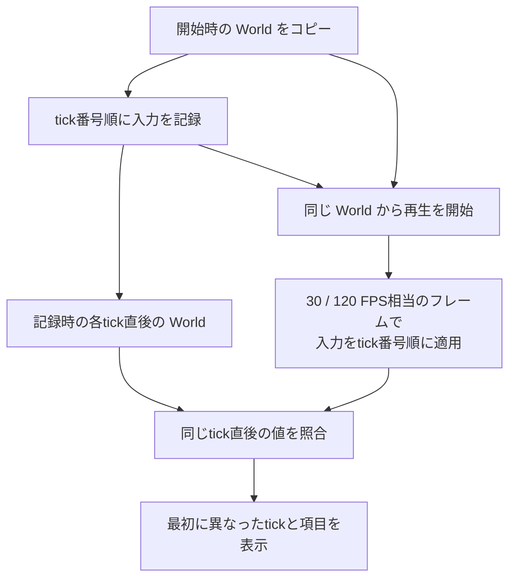

# C++実践 — 入力を記録して最初にずれたtickを探す

一度起きたゲームの不具合を調べるために、開始時点の状態と、その後に使った入力を残します。[小さなシューティングの設計](/game/shooter-design.html)で使うC++モデルを、入力ログから二通りの描画頻度で進めます。各tickの直後に状態を照合して、入力が1tickずれたときに最初の差を見つけます。

## 初期状態と入力を記録する

この実践の `World` は、プレイヤーの位置・HP・無敵時間、生存判定を含む弾と敵の並び、スコア、ゲーム終了フラグ、射撃や敵出現の残りtickなどを持ちます。開始時に `World` を値としてコピーします。初期位置のXを `300`、射撃の残り時間を `2` tickにしておくので、再生する側も保存した状態から始める必要があります。

入力を記録する際は、`World::Tick` に実際に渡す `FrameInput` をtick番号順に並べます。ここでは60件をプログラムで作り、毎tick射撃を押し、tick `10` だけ右へ動かします。tick番号は0始まりです。`10` の状態とは、11回目の `Tick` にその入力を渡し終えた直後の状態です。



開始状態と操作履歴から処理をやり直す方法は、物理エンジンの不具合調査にも使われます。Box2D 3.2の記録では、物理Worldのスナップショットに続けて、Worldを変更するAPIの呼び出しを残します。今回の小さなモデルでは、Worldの更新に渡す入力が記録の単位です。[Box2D 3.2 — Recording and Replay](https://box2d.org/documentation/recording.html)

## 描画フレームとシミュレーションのtickを分ける

モデルは60 Hzで、1回の `Tick` が `1/60` 秒分を進めます。実践では描画を呼ぶ代わりに、理想的な間隔でフレームが来たものとして回数を数えます。整数の蓄積値にフレームごとに `60` を足し、蓄積値がFPS以上の間は `Tick` を1回呼んでFPSを引きます。どのフレームで処理する場合も、モデルには同じ順番の入力を1件ずつ渡します。

| フレーム頻度 | フレームごとのtick数 | 1秒分のフレーム回数 | 合計tick数 |
| --- | --- | ---: | ---: |
| 30 FPS相当 | 毎フレーム2 | 30 | 60 |
| 120 FPS相当 | `0, 1, 0, 1, …` | 120 | 60 |

例えば30 FPS相当の最初のフレームではtick `0` と `1` の両方を進めます。照合に使う値は、各 `Tick` の直後に保存します。描画フレームの末尾でしか保存しないと、そのフレームの途中で生じた差が見えません。

## 手元で動かす {#run-locally}

<a href="/study/samples/shooter/replay/replay.cpp" download>replay.cpp</a> と <a href="/study/samples/shooter/cpp/shooter_model.hpp" download>shooter_model.hpp</a> を同じフォルダーに置きます。シューティングのC++実装で使うヘッダーをそのまま利用します。C++17のコンパイラーと標準ライブラリで動かせます。

Visual Studioの **x64 Native Tools Command Prompt** では次を実行します。

```bat
cl /nologo /std:c++17 /EHsc /W4 /O2 replay.cpp /Fe:replay.exe
replay.exe
```

WindowsのMinGW-w64でGCCを使う場合の例です。

```bat
g++ -std=c++17 -O2 -Wall -Wextra -Wpedantic -static replay.cpp -o replay.exe
replay.exe
```

## 状態を照合し、ずれた入力を探す

比較するのは、`World` の状態を構成するフィールドの値です。弾と敵は個数を見てから、同じ添字の要素を順番に照合します。コンテナの容量やアドレスは照合に含めません。位置には `float` の値の完全一致を使い、出力では位置を小数点以下3桁に丸めます。

同じログの30 FPS相当と120 FPS相当の再生は、記録時の状態とすべてのtickで一致します。比較用の再生だけ、右入力をtick `10` から `11` へ遅らせます。初期Xが `300`、速度は毎秒 `280` なので、正しい再生のtick `10` 直後のXは約 `304.667`。遅らせた再生では、この時点はまだ `300.000` です。比較結果は、差が見つかった最初のtickとフィールド名を示します。

```text
Recorded: 60 ticks, initial player.x=300.000
30 FPS: 30 frames, 60 ticks (0/1/2 per frame: 0/0/30)
120 FPS: 120 frames, 60 ticks (0/1/2 per frame: 60/60/0)
Same input log: all 60 states match at both rates
Input pulse delayed 10 -> 11: first difference after tick 10 at player.position.x (304.667 vs 300.000)
```

<<< @/public/samples/shooter/replay/replay.cpp{cpp}

この実践の入力は、すでにtickに割り当てた値です。実ゲームで再現に必要な記録を作るときは、キーボードやゲームパッドのイベントをどのtickに渡したかも決めておきます。描画フレームごとに読んだ入力をそのフレーム内の全tickへ使うと、描画頻度によって割り当てが変わり得ます。

## 確認範囲

Windows x64で、Visual Studio 2022のMSVC `19.35.32217.1`（C++17、`/O2`）とMinGW-w64のGCC `16.2.0`（C++17、`-O2`）を使い、掲載ファイルをコンパイルして実行しました。各ビルドで、30・120 FPS相当の全60tickが記録時の状態と一致し、入力を遅らせるとtick `10` で初めて差が出ました。

入力ログ・初期状態・照合用の状態はメモリに置きます。ゲームパッドや実時間のフレーム計測、ログファイルの形式、複数端末での同期は、それぞれ別の検証が必要です。このモデルは乱数を使いません。乱数を使うゲームでは、再開地点で必要な生成器の状態と、生成器を呼ぶ順序も扱います。環境を変えると浮動小数点演算の結果が変わる場合があるため、再現性は同じ実行ファイルで試したログについて確認します。[Microsoft — 浮動小数点のコンパイラー設定](https://learn.microsoft.com/en-us/cpp/build/reference/fp-specify-floating-point-behavior) · [浮動小数点の決定性](/languages/cpp/floating-point-determinism.html)

ネットワーク同期のクライアント予測では、受け取った状態から未確定の入力を順に適用し直すことがあります。UEのReplay Systemはレプリケーションによって得たデータを記録して再生する仕組みで、保存するデータの役割を見比べられます。[ゲームのネットワーク同期](/game/network-sync.html) · [Epic — Unreal EngineのReplay System](https://dev.epicgames.com/documentation/unreal-engine/using-the-replay-system-in-unreal-engine)

## 理解度チェック

1. 120 FPS相当で最初のフレームにtickが進まないとき、ログの最初の入力はいつ使われますか。

   ::: details 解答
   2フレーム目で初めて `Tick` が呼ばれるときに使います。入力はフレーム番号とは独立に、tick番号順で適用します。
   :::

2. tick `10` の直後にプレイヤーのXが違っていたと分かれば、どこから調べ始められますか。

   ::: details 解答
   tick `9` の直後まで照合した状態は一致しているので、まずtick `10` に渡した入力と、その入力で行われた更新を調べます。
   :::

## 関連項目

- [ゲームの決定性 — 同じ入力から同じ結果を得る条件](/game/simulation-determinism.html)。乱数やタイマーがあるゲームで、再生や巻き戻しに必要な状態を考えます。
- [Game Loop と Update Method](/game/patterns/game-loop-and-update.html)
- [小さなシューティングの設計](/game/shooter-design.html)
- [ゲームのネットワーク同期](/game/network-sync.html)
