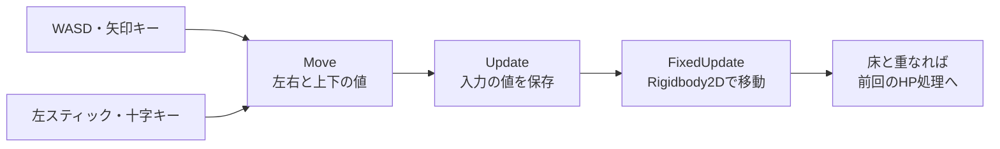

# Unity実践 — キーボードとゲームパッドでPlayerを動かす

[前回のダメージ床の実践](/practice/unity/scene-health-demo.html)では、Playすると `Player` が自動で右へ進みました。今回は移動のコンポーネントを交換し、キーボードかゲームパッドで上下左右に動かします。床へ入れば前回と同じようにHPが減り、入力を離すとその場で止まります。

## 1. シーンを複製し、Input Systemを用意する

1. 前回の `SceneHealth` を開き、Playを止めてから **File > Save As** で `SceneHealthInput` として保存します。`Player` が `(-3, 0, 0)`、Starting Hpが10、床Aと床BのDamageが3と9、両方の **Is Trigger** がオンか確認します。
2. Unity 6.3（6000.3系）の **Window > Package Management > Package Manager** を開きます。**Unity Registry** で **Input System** を探し、インストールします。この実践で使う版は **1.20.1** です。 [Unity 6.3の対応パッケージ](https://docs.unity3d.com/6000.3/Documentation/Manual/com.unity.inputsystem.html)
3. Input Systemを有効にする確認が出たら、作業を保存して案内に沿って再起動します。**Edit > Project Settings > Player > Other Settings** の **Active Input Handling** が **Input System Package (New)** または **Both** なら、このコードで使う入力が有効です。 [Input System 1.20の導入手順](https://docs.unity3d.com/Packages/com.unity.inputsystem@1.20/manual/Installation.html)
4. **Edit > Project Settings > Input System Package** で **Update Mode** を **Process Events In Dynamic Update** にします。入力の設定アセットを作る案内が表示された場合は、その画面から作って設定を開きます。 [Input System 1.20のUpdate Mode](https://docs.unity3d.com/Packages/com.unity.inputsystem@1.20/api/UnityEngine.InputSystem.InputSettings.UpdateMode.html)

## 2. 入力アセットとスクリプトをPlayerにつなぐ

次の2ファイルをダウンロードし、`Assets/SceneHealthInput` などのフォルダーに置きます。`.inputactions` はUnityが読み込む入力設定ファイルです。ファイル名と拡張子を保ちます。

- <a href="/study/samples/unity/input-health-demo/HealthControls.inputactions" download>HealthControls.inputactions</a>。入力を `Player/Move` に割り当てるアセット
- <a href="/study/samples/unity/input-health-demo/InputMover.cs" download>InputMover.cs</a>。`Move` の値をPlayerの移動に使うコンポーネント

1. 複製したシーンの `Player` を選び、**Demo Mover** のチェックを外して無効にします。**Rigidbody 2D**（Kinematic）、**Box Collider 2D**、**Health Target** はそのまま使います。
2. **Add Component** で **Input Mover** を追加します。**Speed** は `2` のままにします。
3. Projectウィンドウで `HealthControls` の左にある三角を開きます。中の **Player/Move** を、Inspectorの **Input Mover > Move** 欄へドラッグします。オブジェクト選択ボタンを使う場合も、`HealthControls` の `Player/Move` を選びます。
4. シーンを保存します。この実践では `InputMover` が `Move` を有効にします。

**Move** は `Value` 型のアクションで、`Vector2` の `(x, y)` を返します。Xは左右、Yは上下です。WASDの4キーと矢印の4キーには、それぞれ **2D Vector Composite** を使い、押されている方向を一つの値にまとめています。 [Input System 1.20のVector2 Composite](https://docs.unity3d.com/Packages/com.unity.inputsystem@1.20/api/UnityEngine.InputSystem.Composites.Vector2Composite.html)

| デバイス | コントロール | `Move` が受け取る方向 |
| --- | --- | --- |
| キーボード | W / A / S / D | 上 / 左 / 下 / 右 |
| キーボード | ↑ / ← / ↓ / → | 上 / 左 / 下 / 右 |
| ゲームパッド | 左スティック | 倒した方向と大きさ |
| ゲームパッド | 十字キー | 押した方向 |

`HealthControls` をダブルクリックすると、Input Actionsエディターで **Player** マップ、**Move** アクション、その下の各バインディングを確認できます。たとえば `<Gamepad>/leftStick` は、ゲームパッドの左スティックを表すバインディングです。 [Input System 1.20のGamepad](https://docs.unity3d.com/Packages/com.unity.inputsystem@1.20/api/UnityEngine.InputSystem.Gamepad.html)

## 3. 動かして、離したときと床に入ったときを見る

1. **Play** を押し、Gameビューをクリックします。最初にConsoleへ `Player: hp=10` が出ます。
2. Dまたは右矢印を押し続け、床Aを通ります。床と床の間で離し、そこで止まることを確かめます。`DamagePadA: damage=3, hp=7, changed=True` と出ます。
3. ゲームパッドを接続している場合は、左スティックを右へ倒すか十字キーの右を押し、床Bを通ります。`DamagePadB: damage=9, hp=0, changed=True` と出ます。中央へ戻すか離すと止まります。キーボードだけでも両方の床を通れます。
4. Playを止めて再実行し、今度は床Aに着く前に上か下へ移動してから右へ進みます。床との重なりを避ければ、その床のダメージは発生しません。

## 入力を読む処理と物理で動かす処理

<<< @/public/samples/unity/input-health-demo/InputMover.cs{csharp}

**OnEnable** では `InputActionReference` から `Move` の実行用コピーを作り、有効にします。**OnDisable** では入力の値をゼロに戻し、コピーを無効化して破棄します。コピーを使うので、Playerを無効にしてもアセットを参照する別の処理のアクションまで無効にはなりません。 [Input System 1.20のInputActionReference](https://docs.unity3d.com/Packages/com.unity.inputsystem@1.20/api/UnityEngine.InputSystem.InputActionReference.html) · [InputAction](https://docs.unity3d.com/Packages/com.unity.inputsystem@1.20/api/UnityEngine.InputSystem.InputAction.html)

**Update** で `ReadValue<Vector2>()` を呼び、現在の方向を `direction` に保存します。方向の長さは最大1に収めるので、斜め入力で最大速度が増えません。**FixedUpdate** では保存した方向に `speed` と固定刻みの秒数を掛け、`Rigidbody2D.MovePosition` で移動します。入力処理はDynamic Updateなので、`FixedUpdate` から直接読み直しません。離したことを `Update` で読んだ後の物理更新では、移動量がゼロになります。 [入力の更新時刻](https://docs.unity3d.com/Packages/com.unity.inputsystem@1.20/api/UnityEngine.InputSystem.InputSettings.UpdateMode.html) · [Unity 6.3のMovePosition](https://docs.unity3d.com/6000.3/Documentation/ScriptReference/Rigidbody2D.MovePosition.html)

移動は押している間ずっと値を使います。一度だけ決定する操作を作るなら、例えば `Confirm` という **Button** アクションに `<Keyboard>/enter` と `<Gamepad>/buttonSouth` を割り当て、`Update` で `WasPressedThisFrame()` を調べます。デバイスはキーボードとゲームパッド、コントロールはEnterと南側ボタン、アクションは `Confirm` です。 [Input System 1.20のInputAction](https://docs.unity3d.com/Packages/com.unity.inputsystem@1.20/api/UnityEngine.InputSystem.InputAction.html)

## うまく動かないとき

| 状況 | 確認すること |
| --- | --- |
| `UnityEngine.InputSystem` が見つからない | Package Managerで **Input System** がインストールされているか。 |
| `Assign HealthControls / Player / Move` と出る | **Move** 欄に、アセット全体ではなく中の **Player/Move** を割り当てたか。再設定後は **Input Mover** が有効か確認する。 |
| 入力せずに右へ進む | `Player` に残っている **Demo Mover** が無効か。 |
| キーボードやゲームパッドが反応しない | Play中のGameビューにフォーカスがあるか、Active Input Handlingが適切か。ゲームパッドはOSとUnityのInput Debuggerで認識されているか。 |
| 移動するが床でHPが減らない | `Player` と床のColliderのYが重なるか。床の **Is Trigger**、`DamageTrigger`、`Player` の `HealthTarget` を確認する。 |

## 理解度チェック

1. `<Gamepad>/leftStick` のデバイス、コントロール、対応するアクションを指せますか。

   ::: details 解答
   デバイスはゲームパッド、コントロールは左スティック、アクションは `Move` です。矢印キーも同じアクションに割り当てています。
   :::

2. 方向キーを押し続ける移動と、Enterを一度押したときだけ行う決定では、どの値や状態を調べますか。

   ::: details 解答
   移動は `Move.ReadValue<Vector2>()` で現在の方向を読みます。決定は別のButtonアクションで `WasPressedThisFrame()` を使い、押し始めを調べます。
   :::

3. コードのどのメソッドが入力を読み、どのメソッドがPlayerを動かしますか。

   ::: details 解答
   `Update` が `Move` を読み、`FixedUpdate` が保存した方向から移動量を求めて `Rigidbody2D` を動かします。
   :::

## 関連項目

- [Unityでゲームを作る — 入力の達成条件](/learn/roadmap.html?node=unity-input#unity-game)
- [シーンにキャラクターとダメージ床を配置する](/practice/unity/scene-health-demo.html)で、Playerと床のコンポーネントを作る。
- [入力アクションとデバイスの基本](/game/basics/input-actions-and-devices.html)で、入力の対応付けと押し始めの扱いを整理する。
- [Unityでゲームを作る — 衝突と物理](/learn/roadmap.html?node=unity-collision#unity-game)

## 参考資料

- [Unity 6.3 — Input Systemの対応版](https://docs.unity3d.com/6000.3/Documentation/Manual/com.unity.inputsystem.html) · [Input System 1.20の導入](https://docs.unity3d.com/Packages/com.unity.inputsystem@1.20/manual/Installation.html)
- [Input System 1.20 — InputActionReference](https://docs.unity3d.com/Packages/com.unity.inputsystem@1.20/api/UnityEngine.InputSystem.InputActionReference.html) · [InputAction](https://docs.unity3d.com/Packages/com.unity.inputsystem@1.20/api/UnityEngine.InputSystem.InputAction.html) · [Vector2 Composite](https://docs.unity3d.com/Packages/com.unity.inputsystem@1.20/api/UnityEngine.InputSystem.Composites.Vector2Composite.html) · [Gamepad](https://docs.unity3d.com/Packages/com.unity.inputsystem@1.20/api/UnityEngine.InputSystem.Gamepad.html)
- [Input System 1.20 — Update Mode](https://docs.unity3d.com/Packages/com.unity.inputsystem@1.20/api/UnityEngine.InputSystem.InputSettings.UpdateMode.html) · [Unity 6.3のMovePosition](https://docs.unity3d.com/6000.3/Documentation/ScriptReference/Rigidbody2D.MovePosition.html)
