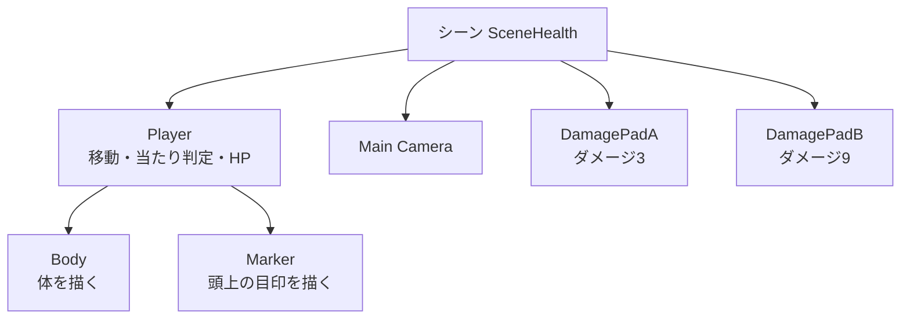

# Unity実践 — シーンにキャラクターとダメージ床を配置する

[C#の基本](/languages/csharp/console-and-unity.html)では、決めておいたダメージを `Health` に順番に渡しました。今回は同じ `Health.cs` を使い、シーンに置いたキャラクターがダメージ床に入ったときにHPを減らします。Playすると、キャラクターが左から右へ進み、HPが `10 → 7 → 0` と変わります。

## シーンに置くもの

シーンには、カメラ、`Player`、二つのダメージ床を置きます。`Player` の下に、体を描く `Body` と、頭上の目印を描く `Marker` を置きます。移動、当たり判定、HPは `Player` のコンポーネントが担当します。



## 1. シーンとスクリプトを用意する

Unity 6.3（6000.3系）を使います。新規プロジェクトで始める場合は、2DのBuilt-In Render Pipelineテンプレートを選べます。前回のプロジェクトを使う場合は、**File > New Scene** でシーンを分けます。シーンを `SceneHealth` として保存します。**Main Camera** のPositionを `(0, 0, -10)`、Projectionを **Orthographic**、Sizeを `4` にします。カメラがなければ **GameObject > Camera** で追加します。Gameビューの比率を16:9にすると、移動範囲を見渡せます。

次のファイルを `Assets/SceneHealth` などに置き、Unityのコンパイルを待ちます。前回から同じプロジェクトを使っている場合は、既存の `Health.cs` を使います。新しくコピーするのは残りの3本です。

- <a href="/study/samples/languages/csharp/console-and-unity/Health.cs" download>Health.cs</a>。前回と共通のHPルール
- <a href="/study/samples/unity/scene-health-demo/HealthTarget.cs" download>HealthTarget.cs</a>。GameObjectが持つHPを作り、ダメージの結果を出力
- <a href="/study/samples/unity/scene-health-demo/DamageTrigger.cs" download>DamageTrigger.cs</a>。床へ入った相手にダメージを渡す
- <a href="/study/samples/unity/scene-health-demo/DemoMover.cs" download>DemoMover.cs</a>。Playerの移動と目印の座標の確認

## 2. Playerと子オブジェクトを配置する

1. **GameObject > Create Empty** で `Player` を作ります。Hierarchyで選択すると、Inspectorに **Transform** が出ます。Positionを `(-3, 0, 0)`、Rotationを `(0, 0, 0)`、Scaleを `(1, 1, 1)` にします。
2. **GameObject > 2D Object > Sprites > Square** で四角形を二つ作り、`Body` と `Marker` に名前を変えます。Hierarchyで両方を `Player` にドラッグして子にします。親子を設定した後で、下の表のとおりInspectorのTransformを入力します。 [Unity 6.3の仮のスプライト](https://docs.unity.com/en-us/engine/6000.3/manual/unity2d/sprite/placeholder)
3. `Body` と `Marker` は **Sprite Renderer > Color** を別の色にします。例えば体を水色、目印を黄色にします。位置や大きさはTransform、色や描画の有効・無効はSprite Rendererで変えられます。

| オブジェクト | 親から見たPosition | Rotation | Scale |
| --- | --- | --- | --- |
| `Body` | `(0, 0, 0)` | `(0, 0, 0)` | `(1, 1, 1)` |
| `Marker` | `(0, 0.8, 0)` | `(0, 0, 0)` | `(0.3, 0.3, 1)` |

Hierarchyで `Player` を選び、Inspectorの **Add Component** から次を付けます。Colliderは `Player` につけます。`Body` と `Marker` はSprite Rendererで形を表示します。

| コンポーネント | 設定 | 担当 |
| --- | --- | --- |
| **Rigidbody 2D** | **Body Type** を **Kinematic** | スクリプトから移動する物理ボディ |
| **Box Collider 2D** | Size `(1, 1)`、Offset `(0, 0)`、**Is Trigger** はオフ | Playerの当たり判定の範囲 |
| **Health Target** | **Starting Hp** を `10` | `Health` のインスタンスを持つ |
| **Demo Mover** | **Speed** を `2`、**End X** を `3.2` | 物理更新で右へ進み、Xが3.2に着くと止まる |

**Demo Mover** の **Marker** 欄には、Hierarchyの `Marker` をドラッグします。この欄には目印のTransformへの参照が入ります。

## 3. 二つのダメージ床を置く

1. Squareを二つ作り、`DamagePadA` と `DamagePadB` にします。両方をHierarchyの直下に置きます。
2. 下の表に合わせてTransformを設定します。Rotationは両方とも `(0, 0, 0)` です。Sprite RendererのColorをPlayerと区別できる色にします。**Order in Layer** を `-1` にすると、同じSorting Layerの体や目印より後ろに描けます。
3. 両方に **Box Collider 2D** を追加し、Sizeを `(1, 1)`、Offsetを `(0, 0)` にして **Is Trigger** をオンにします。TransformのScaleが掛かるので、シーン上で幅0.5、高さ2の範囲になります。`Player` と床は既定の **Default** レイヤーを使います。
4. 両方に **Damage Trigger** を追加して、**Damage** を表の値にします。

| 床 | Position | Scale | Damage |
| --- | --- | --- | --- |
| `DamagePadA` | `(-1, 0, 0)` | `(0.5, 2, 1)` | `3` |
| `DamagePadB` | `(2, 0, 0)` | `(0.5, 2, 1)` | `9` |

**Is Trigger** をオンにした床は、重なり始めたことを知らせます。今回の構成ではPlayerの `Rigidbody2D` があり、床のColliderがトリガーなので、KinematicのPlayerが入ると `OnTriggerEnter2D` が呼ばれます。床の判定でPlayerを押し返す処理は発生しません。 [Unity 6.3のOnTriggerEnter2D](https://docs.unity3d.com/6000.3/Documentation/ScriptReference/MonoBehaviour.OnTriggerEnter2D.html) · [Kinematicの接触条件](https://docs.unity.com/en-us/engine/6000.3/manual/unity2d/2d-physics/rigidbody-2d/body-types/kinematic-body-type/reference)

## 4. Playして、動きとHPを確認する

**Window > General > Console** を開いてから **Play** を押します。Gameビューで体と目印が一緒に右へ進みます。Consoleでは次の順にログが出ます。

```text
Player: hp=10
DamagePadA: damage=3, hp=7, changed=True
DamagePadB: damage=9, hp=0, changed=True
```

`DemoMover` は `FixedUpdate` で小さな移動を予約します。`Rigidbody2D.MovePosition` が次の物理更新で位置を変え、床と重なったときは `DamageTrigger` が相手のColliderと同じGameObjectから `HealthTarget` を探します。`HealthTarget` は、前回と同じ `Health.ApplyDamage` にダメージを渡します。`Player` がHP 0でも進むのは、移動の処理がHPを参照していないためです。 [Unity 6.3のFixedUpdate](https://docs.unity3d.com/6000.3/Documentation/ScriptReference/MonoBehaviour.FixedUpdate.html) · [MovePosition](https://docs.unity3d.com/6000.3/Documentation/ScriptReference/Rigidbody2D.MovePosition.html) · [GetComponent](https://docs.unity3d.com/6000.3/Documentation/ScriptReference/Component.GetComponent.html)


表示と判定の役割を見比べるには、Playを止めて `Body` の **Sprite Renderer** のチェックだけを外し、もう一度Playします。体が消えても、目印は動き、ダメージのログも出ます。Playerの移動と当たり判定は、その親GameObjectに付けたコンポーネントが担当しています。

床の設定も比べられます。Playを止め、`DamagePadA` の **Is Trigger** だけをオフにして再実行すると、床Aのダメージは発生せず、床BでHPが1になります。この実践で使うKinematicの既定設定では、トリガーでない静的Colliderとの通常の接触は作られません。終わったら **Is Trigger** をオンに戻します。 [Unity 6.3のKinematic接触条件](https://docs.unity.com/en-us/engine/6000.3/manual/unity2d/2d-physics/rigidbody-2d/body-types/kinematic-body-type/reference)

## 5. 子のローカル座標とワールド座標を比べる

Playを止め、Inspectorで `Player` を選びます。**Demo Mover** のメニュー（コンポーネント右上の三点）から **Log Marker Position** を選ぶと、Consoleに目印の二つの座標が出ます。`Player` のPositionのXを `-3` から `-2` に変え、もう一度同じメニューを実行します。

| 親のPosition | `marker.localPosition` | `marker.position` |
| --- | --- | --- |
| `(-3, 0, 0)` | `(0, 0.8, 0)` | `(-3, 0.8, 0)` |
| `(-2, 0, 0)` | `(0, 0.8, 0)` | `(-2, 0.8, 0)` |

子から親までの相対位置は同じです。シーン全体から見た位置は、親が右へ1動いた分だけ変わります。元の実践に戻るときは、親のXを `-3` に戻します。 [Unity 6.3のlocalPosition](https://docs.unity.com/en-us/engine/6000.3/script-reference/unityengine/transform/localposition) · [position](https://docs.unity.com/en-us/engine/6000.3/script-reference/unityengine/transform/position) · [ContextMenu](https://docs.unity3d.com/6000.3/Documentation/ScriptReference/ContextMenu.html)

## コードを読み返す

### HealthTarget.cs

<<< @/public/samples/unity/scene-health-demo/HealthTarget.cs{csharp}

### DamageTrigger.cs

<<< @/public/samples/unity/scene-health-demo/DamageTrigger.cs{csharp}

### DemoMover.cs

<<< @/public/samples/unity/scene-health-demo/DemoMover.cs{csharp}

## うまく動かないとき

| 状況 | 確認すること |
| --- | --- |
| Squareのメニューが見つからない | 2D Spriteパッケージがプロジェクトに入っているか確認する。 [Unity 6.3の仮のスプライト](https://docs.unity.com/en-us/engine/6000.3/manual/unity2d/sprite/placeholder) |
| PlayしてもPlayerが動かない | `Player` にDemo Moverが付いていて有効か、Rigidbody 2DのBody TypeがKinematicか、Consoleにエラーが出ていないか。 |
| 動くがダメージのログが出ない | `Player` のRigidbody 2DとBox Collider 2D、床の **Is Trigger** とDamage Triggerが有効か。`Player` と床が同じYにあり、Physics 2Dの設定で両レイヤーの組み合わせが有効か。 |
| Consoleのログは出るが形が見えない | カメラの位置とGameビューの範囲、各Sprite Rendererの表示とSpriteを確認する。Universal 2Dで照明を使うマテリアルを選んだ場合は、シーンの2Dライトも確認する。 |
| `Health` が重複しているというエラーが出る | Projectで `Health.cs` を探し、前回のファイルと今回のダウンロードが両方入っていないかを確認する。 |

## 理解度チェック

1. Hierarchyで `Body` を選び、色を変える場所と、位置を変える場所をInspectorで指せますか。

   ::: details 解答
   色はSprite RendererのColor、位置はTransformのPositionです。`Body` は子なので、ここで編集するPositionは親を基準にした位置です。
   :::

2. `Player` のXを `-3` から `-2` に変えると、`Marker` のローカル座標とワールド座標はどう変わりますか。

   ::: details 解答
   ローカル座標は `(0, 0.8, 0)` のままです。ワールド座標のXが1増えます。**Log Marker Position** で両方を確認できます。
   :::

3. `DamagePadB` のDamageを `9` から `2` に変えてPlayすると、最後のHPはいくつになりますか。どのコンポーネントの設定を変えますか。

   ::: details 解答
   10から床Aで3減り、床Bでさらに2減るので、5になります。`DamagePadB` のDamage TriggerにあるDamageを変えます。
   :::

## 関連項目

- [Unityでゲームを作る — シーン・オブジェクト・コンポーネントの達成条件](/learn/roadmap.html?node=unity-scene#unity-game)
- [C#の基本](/languages/csharp/console-and-unity.html)で、共通の `Health.cs` の読み方とコンソールでの動作を確認する。
- [シーン・オブジェクト・コンポーネントの基本](/game/basics/scenes-and-components.html)で、GameObjectと親子関係を整理する。
- [衝突と物理の基本](/game/basics/collisions-and-physics.html)で、接触とトリガーの使い分けを確認する。
- [Unity実践 キーボードとゲームパッドでPlayerを動かす](/practice/unity/input-health-demo.html)で、自動移動をInput Systemに置き換える。
- [Unityでゲームを作る — 入力](/learn/roadmap.html?node=unity-input#unity-game)

## 参考資料

- [Unity 6.3 — 仮のスプライトの追加](https://docs.unity.com/en-us/engine/6000.3/manual/unity2d/sprite/placeholder) · [コンポーネントの設定](https://docs.unity.com/en-us/engine/6000.3/manual/working-with-gameobjects/unity-components/inspector-manage-components)
- [Unity 6.3 — Kinematic Rigidbody 2D](https://docs.unity.com/en-us/engine/6000.3/manual/unity2d/2d-physics/rigidbody-2d/body-types/kinematic-body-type/reference) · [Box Collider 2D](https://docs.unity.com/en-us/engine/6000.3/manual/unity2d/2d-physics/collider-2d/box-collider-2d-reference) · [OnTriggerEnter2D](https://docs.unity3d.com/6000.3/Documentation/ScriptReference/MonoBehaviour.OnTriggerEnter2D.html) · [Rigidbody2D.MovePosition](https://docs.unity3d.com/6000.3/Documentation/ScriptReference/Rigidbody2D.MovePosition.html)
- [Unity 6.3 — Transform.localPosition](https://docs.unity.com/en-us/engine/6000.3/script-reference/unityengine/transform/localposition) · [Transform.position](https://docs.unity.com/en-us/engine/6000.3/script-reference/unityengine/transform/position) · [Consoleウィンドウ](https://docs.unity.com/en-us/engine/6000.3/manual/unity-editor/editor-windows-views-reference/console-window)
