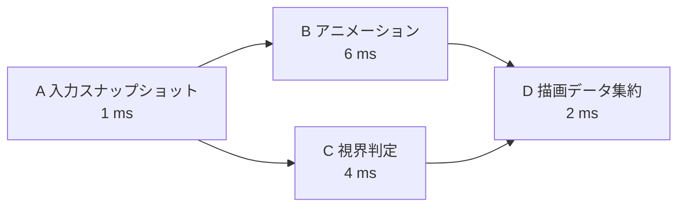

# ジョブシステムとワークスティーリング — 依存グラフをワーカーで実行する

フレーム中にアニメーションと視界判定を並行して進め、両方の結果がそろったら描画データをまとめるとします。**ジョブシステム**は、処理を小さな仕事に分け、各仕事の前提がそろった時点でワーカーに割り当てます。ワーカーは仕事を待ち受けるスレッドです。毎回スレッドを作る費用を避けるため、複数のワーカーを使い回す**スレッドプール**を使います。

## 依存を数えて、実行できる仕事だけを渡す

ジョブを頂点、「先の処理が終わってから次へ進む」という関係を辺として表します。この依存グラフは循環がないDAGです。各ジョブの未完了の前提数を数え、前提のジョブが完了するたびに1減らします。0になったジョブをワーカーが取れるキューへ入れます。



図ではAが終わるとBとCが実行可能になります。Dの前提数は初期状態で2なので、片方だけが完了しても実行できません。全ジョブの処理時間を足した総仕事量は13 msです。最も長い依存経路はA→B→Dの9 msなので、ワーカーを増やしても、このグラフをそのまま実行する限り9 msより短くできません。スケジューリングの費用やリソースの競合はこの計算に含めていません。

依存の辺は、書いたデータをいつ読めるかも表します。例えばBとCは結果を別々の領域に書けます。Dは両方の書き込みが完了して見えるように同期してから読みます。同じオブジェクトに順序なく書くジョブを並べると、キューが正しくてもデータ競合になります。[スレッドと同期](/runtime/thread-synchronization.html)

## ワークスティーリング — 空いたワーカーが他の仕事を取る

ワーカーごとに両端キューを置く方式では、仕事を生成したワーカーは自身のキューの末尾へ追加し、そこから次の仕事を取ります。手元が空いたワーカーは他のキューの先頭から取ります。この動作を**ワークスティーリング**と呼びます。生成元が最近触れたデータを引き続き処理しやすく、手元の仕事が少ないワーカーも余った仕事に参加できます。どちらの端を使うかや一度に移す個数は実装によって異なります。

| 状況 | 待ち時間を減らすために見る箇所 |
| --- | --- |
| 一部のワーカーに仕事が偏る | スティール回数や成功率、ジョブの大きさ |
| 全ワーカーが前提の完了を待つ | 依存グラフの最長経路と、途中にある直列処理 |
| 小さなジョブが大量に並ぶ | キュー操作、同期、通知に使う時間。複数要素をまとめて処理するバッチの大きさ |
| ワーカーが別のジョブを同期的に待つ | 待たれる側が実行できるか。全ワーカーが待つ前に、依存の辺や継続処理として表せるか |

古典的な解析では、条件を満たすfully strictな計算に対するBlumofeとLeisersonのスケジューラーの期待実行時間は $T_1/P+O(T_\infty)$ です。$T_1$ は総仕事量、$P$ はプロセッサ数、$T_\infty$ は最長の依存経路の長さです。ゲームのジョブが共有メモリやI/Oを待つ場合には、その待ちやジョブ間の競合を実測に含めます。

## コード例 — 前提が0のジョブをワーカーに渡す

C++20の単体プログラムです。`cl /std:c++20 /EHsc jobs.cpp` でコンパイルできます。Aを先にキューへ入れ、各ジョブの完了時に後続の前提数を減らします。キューと前提数は読みやすさを優先して一つのミューテックスで保護し、ジョブ本体はロックの外で実行します。図の数値は処理時間の例です。プログラムは待ち時間を挿入せず、Aが10を作り、Bが11、Cが12を作って、Dで23にまとめます。

```cpp
#include <algorithm>
#include <array>
#include <condition_variable>
#include <cstddef>
#include <deque>
#include <iostream>
#include <mutex>
#include <thread>

int main()
{
    using JobId = std::size_t;
    constexpr std::size_t workerCount = 2;
    constexpr std::size_t jobCount = 4;
    constexpr JobId input = 0, animation = 1, culling = 2, aggregate = 3;

    std::array<std::deque<JobId>, workerCount> ready;
    ready[0].push_back(input);
    std::array<int, jobCount> pending{0, 1, 1, 2};
    std::array<int, jobCount> result{};
    std::size_t unfinished = jobCount;
    std::mutex schedulerMutex;
    std::condition_variable changed;

    const auto execute = [&](JobId job) {
        switch (job) {
        case input:     result[input] = 10; break;
        case animation: result[animation] = result[input] + 1; break;
        case culling:   result[culling] = result[input] + 2; break;
        case aggregate: result[aggregate] = result[animation] + result[culling]; break;
        }
    };

    const auto worker = [&](std::size_t index) {
        while (true) {
            JobId job;
            {
                std::unique_lock lock(schedulerMutex);
                changed.wait(lock, [&] {
                    return unfinished == 0
                        || std::any_of(ready.begin(), ready.end(),
                                       [](const auto& queue) { return !queue.empty(); });
                });
                if (unfinished == 0) {
                    return;
                }
                auto& local = ready[index];
                if (!local.empty()) {
                    job = local.back();
                    local.pop_back();
                } else {
                    auto& other = ready[1 - index];
                    job = other.front();
                    other.pop_front();
                }
            }

            execute(job);

            {
                std::lock_guard lock(schedulerMutex);
                const auto release = [&](JobId next) {
                    if (--pending[next] == 0) {
                        ready[index].push_back(next);
                    }
                };
                if (job == input) {
                    release(animation);
                    release(culling);
                } else if (job == animation || job == culling) {
                    release(aggregate);
                }
                --unfinished;
            }
            changed.notify_all();
        }
    };

    {
        std::jthread first(worker, 0);
        std::jthread second(worker, 1);
    }
    std::cout << "Final result: " << result[aggregate] << '\n';
    return result[aggregate] == 23 ? 0 : 1;
}
```

このプログラムでは、先行ジョブの結果の書き込みは、完了処理のロック解放より前に実行されます。後続を取るワーカーは同じミューテックスを取得してから実行するため、先行ジョブの書き込みが後続の読み込みに先行します。ワーカーの終了と結果の表示は、`std::jthread` のデストラクターによるjoinで順序付けます。

## UnityとUnreal Engineでは何に対応するか

| エンジンと版 | 仕事と依存の表し方 |
| --- | --- |
| Unity 6.3 LTS | `IJobParallelFor` で独立した添字の仕事をバッチに分け、`Schedule` に前提の `JobHandle` を渡す。Unityの資料では、先に終えたワーカー側が他の残りのバッチを取ると説明されている |
| Unreal Engine 5.8 | `UE::Tasks::Launch` に `Prerequisites` を指定してDAGを作る。Tasks SystemはTaskGraphとスケジューラーとワーカースレッドを共有する |

Unityでは、結果が必要になる時点より早く `Complete` を呼ぶと、別の処理と重ねられた時間を待ちに使う場合があります。Unreal Engineの`UE::Tasks` では、前提タスクは実行開始前の依存、ネストされたタスクは親の完了に対する依存です。どちらも、前提が何で、結果が最初に必要になるのがどこかをグラフで確認すると待ち時間を追いやすくなります。

### Unity 6.3 LTS — IJob、IJobFor、バッチ

| 形 | スケジューリングと向いている処理 |
| --- | --- |
| `IJob.Execute()` | `Schedule(dependency)` で 1 件として予約。複数ジョブが作った値をまとめる処理や、一つの直列処理に使う |
| `IJobFor.Execute(index)` と `Schedule(length, dependency)` | 添字ごとに `Execute` を呼ぶ仕事を直列で予約。添字付きの処理を並列版と同じ形で持てる |
| `IJobFor.Execute(index)` と `ScheduleParallel(length, batchSize, dependency)` | 添字の仕事を複数ワーカーへ分ける。各反復で書く場所を分け、他の反復が先に終わることを前提にしない |

`ScheduleParallel` のバッチサイズは、仕事を分割し、ワークスティーリングの対象にする反復のまとまりです。例えば 1024 要素に対して 64 要素ずつを目安にすると 16 まとまりになります。すべての反復が同じ費用なら大きめのバッチでスケジューリングの費用を抑えやすく、要素ごとの差が大きい場合は小さく分けると他のワーカーが残りを引き受けやすくなります。バッチと実行するワーカーの対応や、複数バッチを取る順序は実装に任せます。数要素の仕事から始め、スケジューリングや同期の費用が本体を超えるようならまとめます。[Unity 6.3、Jobs overview](https://docs.unity.com/en-us/engine/6000.3/manual/scripting/programming-distribute-work-threads/job-system/jobs)、[IJobForExtensions](https://docs.unity.com/en-us/engine/6000.3/script-reference/unity/jobs/ijobforextensions)

### NativeContainer の検査と Burst

`NativeArray<T>` のような NativeContainer は、ジョブに渡した構造体をコピーしても、同じネイティブ領域を参照します。標準の安全性検査を使うと、同じ領域を読むジョブどうしは同時に実行でき、書き込みを含む競合には依存を要求します。読み取り専用のフィールドには `[ReadOnly]` を付けます。二つのジョブが同じ配列を読み、別々の配列へ結果を書くなら並行に予約できます。両方の結果を読むジョブには、`JobHandle.CombineDependencies` で二つをまとめて前提にします。メインスレッドが結果を読むときや配列を解放するときは、利用中のジョブが完了するようにします。[Unity 6.3、Introduction to NativeContainer](https://docs.unity.com/en-us/engine/6000.3/manual/scripting/programming-distribute-work-threads/job-system/thread-safe-types/native-container)、[Job dependencies](https://docs.unity.com/en-us/engine/6000.3/manual/scripting/programming-distribute-work-threads/job-system/job-dependencies)

Unity 6.3 向けの Burst 1.8 系は、`[BurstCompile]` を付けたジョブなどの対応コードからネイティブコードを生成します。Editor の Play Mode では JIT、Player のビルドでは AOT です。ジョブの実行先や依存の管理は Job System が担当し、Burst はジョブ本体の機械語を最適化します。Burst Inspector では、ループがベクトル化されたかを対象アーキテクチャの逆アセンブリで確認できます。参照型のゲームオブジェクトなどに触れる処理はメインスレッドに置き、ジョブは数値や NativeContainer に対する計算を受け持ちます。安全性検査を無効にしてもアクセス競合は解消されません。読み書きの範囲と寿命は、検査の有無にかかわらず依存グラフとデータ配置で保証します。[Unity 6.3、Burst パッケージ](https://docs.unity3d.com/6000.3/Documentation/Manual/com.unity.burst.html)、[Burst 1.8、Compilation overview](https://docs.unity.cn/Packages/com.unity.burst%401.8/manual/compilation-overview.html)、[Burst Inspector](https://docs.unity3d.com/Packages/com.unity.burst@1.8/manual/editor-burst-inspector.html)

### コード例 — 添字ごとに計算してから一つにまとめる

Unity 6.3 LTS と Burst 1.8 系を対象にした C# です。8 件を 2 倍する `IJobFor` と、結果を合計する `IJob` をつなぎます。先にメインスレッドで `Complete` せず、先行ジョブの `JobHandle` を集約ジョブに渡します。例の `Start` では表示時に終端を待ちます。フレーム内で重ねられる仕事があれば、実際には値を使う位置まで待機を遅らせます。配列はこの呼び出しの中で完了と解放を行うので `TempJob` を使います。

```csharp
using Unity.Burst;
using Unity.Collections;
using Unity.Jobs;
using UnityEngine;

public sealed class StudyJobDependencies : MonoBehaviour
{
    [BurstCompile]
    private struct ScaleJob : IJobFor
    {
        [ReadOnly] public NativeArray<int> Input;
        [WriteOnly] public NativeArray<int> Output;

        public void Execute(int index)
        {
            Output[index] = Input[index] * 2;
        }
    }

    [BurstCompile]
    private struct SumJob : IJob
    {
        [ReadOnly] public NativeArray<int> Input;
        [WriteOnly] public NativeArray<int> Total;

        public void Execute()
        {
            int sum = 0;
            for (int i = 0; i < Input.Length; ++i)
                sum += Input[i];

            Total[0] = sum;
        }
    }

    private void Start()
    {
        using var input = new NativeArray<int>(
            new[] { 1, 2, 3, 4, 5, 6, 7, 8 }, Allocator.TempJob);
        using var scaled = new NativeArray<int>(input.Length, Allocator.TempJob);
        using var total = new NativeArray<int>(1, Allocator.TempJob);

        JobHandle tail = default;
        try
        {
            tail = new ScaleJob { Input = input, Output = scaled }
                .ScheduleParallel(input.Length, 4, tail);
            tail = new SumJob { Input = scaled, Total = total }.Schedule(tail);
        }
        finally
        {
            tail.Complete();
        }

        Debug.Log($"Sum: {total[0]}");
    }
}
```

合計は $2\times(1+\dots+8)=2\times36=72$ です。生成する結果は、各反復が別々の要素に書くため、どのバッチが先に終わっても同じです。集約側が巨大な配列を読み、ここが最長経路になる場合は、各バッチが部分和を書き、最後に部分和だけを足す構成と比べます。

### Unreal Engine 5.8 — TaskGraph と FGraphEvent

既存の TaskGraph を読むときは、`FFunctionGraphTask::CreateAndDispatchWhenReady` のような API が返す `FGraphEventRef` に注目します。UE 5.8 の API リファレンスでは `FGraphEvent` は `FBaseGraphTask` の別名で、`FGraphEventRef` は後続へ渡せる完了参照です。例えば B と C を作って得た参照を `FGraphEventArray` にまとめ、それを D の前提として渡せば、D は両方が完了してから実行できます。別のタスクの完了まで自分の完了を延ばす場合、`FBaseGraphTask::DontCompleteUntil` にその参照を渡します。[Epic Games、Core API の型一覧](https://dev.epicgames.com/documentation/en-us/unreal-engine/API/Runtime/Core)、[FBaseGraphTask](https://dev.epicgames.com/documentation/unreal-engine/API/Runtime/Core/FBaseGraphTask?lang=en-US)、[FFunctionGraphTask](https://dev.epicgames.com/documentation/unreal-engine/API/Runtime/Core/FFunctionGraphTask)

Game Thread で結果を今すぐ使う境界には、TaskGraph の `FTaskGraphInterface::WaitUntilTaskCompletes` や `WaitUntilTasksComplete` があります。例えば B の直後に Game Thread が待ち始めると、D を必要とするまでに重ねられたはずの処理が止まる場合があります。D の依存として B、C を登録し、結果を消費する時点で待つと、待機位置を減らせます。Game Thread 上で実行する必要がある継続は、依存に加えて実行先も指定します。タスクを登録するときは、ラムダが参照するデータの寿命を完了まで確保します。[Epic Games、WaitUntilTasksComplete](https://dev.epicgames.com/documentation/unreal-engine/API/Runtime/Core/FTaskGraphInterface/WaitUntilTasksComplete)

`UE::Tasks` 側では、実行完了を前提に渡すハンドルが `FTask`、結果値を持つ場合は `TTask<T>` です。実行できる時点を外部から通知したいときは、`FTaskEvent` を前提に登録し、通知元が `Trigger` します。タスクのタイムラインを読むときは、前提が未完了でまだキューに入っていない時間、キューに入ってからワーカーを得るまでの時間、処理本体、最後の同期待ちを順に確認します。ワーカー数を増やしても、前提を待つ時間や Game Thread に残した直列処理の時間は減らない場合があります。[Epic Games、Tasks System References](https://dev.epicgames.com/documentation/unreal-engine/tasks-system-references-in-unreal-engine?lang=en-US)

## 理解度チェック

1. 図でBだけが完了し、Cが処理中のとき、Dはキューに入りますか。
2. キューが空のワーカーが、他のワーカーの未実行ジョブを取ると何が改善しますか。
3. ワーカーを4本に増やしても図の処理が9 msを下回らないのはなぜですか。
4. Unity で二つのジョブが同じ配列を読み、異なる配列に書きます。集約するジョブには何を渡しますか。
5. Unreal の TaskGraph で B と C の完了後に D を実行するとき、D の前提として何を渡しますか。

::: details 解答
1. 入りません。Dの未完了の前提数はまだ1です。
2. 他のワーカーに偏った実行可能なジョブを引き受けられるため、空いているワーカーの時間を使えます。
3. A、B、Dはその順に処理する必要があり、3つの合計が9 msだからです。
4. 共通の入力には両方で `[ReadOnly]` を付けます。二つの `JobHandle` を `CombineDependencies` でまとめ、集約ジョブの前提に渡します。
5. B と C の `FGraphEventRef` を前提の配列へ入れます。
:::

## 関連項目

- [スレッドと同期](/runtime/thread-synchronization.html)
- [キューとデック](/algorithms/queues-and-deques.html)
- [CPUプロファイリング](/tools/profiling/cpu-profiling.html)

## 参考資料

- [Robert D. Blumofe・Charles E. Leiserson、Scheduling Multithreaded Computations by Work Stealing（1999年）](https://www.cs.utexas.edu/~venkatar/sys_perf_analysis/ws_theory.pdf)
- [C++20最終草案 N4861、条件変数](https://timsong-cpp.github.io/cppwp/n4861/thread.condition.condvar)
- [C++20最終草案 N4861、ミューテックスの同期](https://timsong-cpp.github.io/cppwp/n4861/thread.mutex.requirements.mutex)
- [C++20最終草案 N4861、jthreadのコンストラクターとデストラクター](https://timsong-cpp.github.io/cppwp/n4861/thread.jthread.cons)
- [Unity、Parallel jobs（Unity 6.3 LTS）](https://docs.unity.com/en-us/engine/6000.3/manual/scripting/programming-distribute-work-threads/job-system/parallel-for-jobs)
- [Unity、IJobParallelForExtensions.Schedule（Unity 6.3 LTS）](https://docs.unity.com/en-us/engine/6000.3/script-reference/unity/jobs/ijobparallelforextensions/schedule)
- [Epic Games、Tasks Systems in Unreal Engine（Unreal Engine 5.8）](https://dev.epicgames.com/documentation/unreal-engine/tasks-systems-in-unreal-engine?application_version=5.8)
- [Unity、Jobs overview（Unity 6.3 LTS）](https://docs.unity.com/en-us/engine/6000.3/manual/scripting/programming-distribute-work-threads/job-system/jobs)
- [Unity、IJobForExtensions（Unity 6.3 LTS）](https://docs.unity.com/en-us/engine/6000.3/script-reference/unity/jobs/ijobforextensions)
- [Unity、Introduction to NativeContainer（Unity 6.3 LTS）](https://docs.unity.com/en-us/engine/6000.3/manual/scripting/programming-distribute-work-threads/job-system/thread-safe-types/native-container)
- [Unity、Burst 1.8 の Compilation overview](https://docs.unity.cn/Packages/com.unity.burst%401.8/manual/compilation-overview.html)
- [Epic Games、FBaseGraphTask（Unreal Engine 5.8）](https://dev.epicgames.com/documentation/unreal-engine/API/Runtime/Core/FBaseGraphTask?lang=en-US)
- [Epic Games、Tasks System References（Unreal Engine 5.8）](https://dev.epicgames.com/documentation/unreal-engine/tasks-system-references-in-unreal-engine?lang=en-US)
