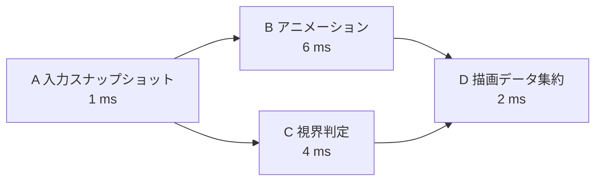

# ジョブシステムとワークスティーリング — 依存グラフをワーカーで実行する

フレーム中にアニメーションと視界判定を並行して進め、両方の結果がそろったら描画データをまとめるとします。**ジョブシステム**は、処理を小さな仕事に分け、各仕事の前提がそろった時点でワーカーに割り当てます。ワーカーは仕事を待ち受けるスレッドです。毎回スレッドを作る費用を避けるため、複数のワーカーを使い回す**スレッドプール**を使います。

## 依存を数えて、実行できる仕事だけを渡す

ジョブを頂点、「先の処理が終わってから次へ進む」という関係を辺として表します。この依存グラフは循環がないDAGです。各ジョブの未完了の前提数を数え、前提のジョブが完了するたびに1減らします。0になったジョブをワーカーが取れるキューへ入れます。



図ではAが終わるとBとCが実行可能になります。Dの前提数は初期状態で2なので、片方だけが完了しても実行できません。全ジョブの処理時間を足した総仕事量は13 msです。最も長い依存経路はA→B→Dの9 msなので、ワーカーを増やしても、このグラフをそのまま実行する限り9 msより短くできません。スケジューリングの費用やリソースの競合はこの計算に含めていません。

依存の辺は、書いたデータをいつ読めるかも表します。例えばBとCは結果を別々の領域に書けます。Dは両方の書き込みが完了して見えるように同期してから読みます。同じオブジェクトに順序なく書くジョブを並べると、キューが正しくてもデータ競合になります。[スレッドと同期](/runtime/thread-synchronization.html)

## ワークスティーリング — 空いたワーカーが他の仕事を取る

ワーカーごとに両端キューを置く方式では、仕事を生成したワーカーは自身のキューの末尾へ追加し、そこから次の仕事を取ります。手元が空いたワーカーは他のキューの先頭から取ります。この動作を**ワークスティーリング**と呼びます。生成元が最近触れたデータを引き続き処理しやすく、手元の仕事が少ないワーカーも余った仕事に参加できます。どちらの端を使うかや一度に移す個数は実装によって異なります。

| 状況 | 待ち時間を減らすために見る箇所 |
| --- | --- |
| 一部のワーカーに仕事が偏る | スティール回数や成功率、ジョブの大きさ |
| 全ワーカーが前提の完了を待つ | 依存グラフの最長経路と、途中にある直列処理 |
| 小さなジョブが大量に並ぶ | キュー操作、同期、通知に使う時間。複数要素をまとめて処理するバッチの大きさ |
| ワーカーが別のジョブを同期的に待つ | 待たれる側が実行できるか。全ワーカーが待つ前に、依存の辺や継続処理として表せるか |

古典的な解析では、条件を満たすfully strictな計算に対するBlumofeとLeisersonのスケジューラーの期待実行時間は $T_1/P+O(T_\infty)$ です。$T_1$ は総仕事量、$P$ はプロセッサ数、$T_\infty$ は最長の依存経路の長さです。ゲームのジョブが共有メモリやI/Oを待つ場合には、その待ちやジョブ間の競合を実測に含めます。

## コード例 — 前提が0のジョブをワーカーに渡す

C++20の単体プログラムです。`cl /std:c++20 /EHsc jobs.cpp` でコンパイルできます。Aを先にキューへ入れ、各ジョブの完了時に後続の前提数を減らします。キューと前提数は読みやすさを優先して一つのミューテックスで保護し、ジョブ本体はロックの外で実行します。図の数値は処理時間の例です。プログラムは待ち時間を挿入せず、Aが10を作り、Bが11、Cが12を作って、Dで23にまとめます。

```cpp
#include <algorithm>
#include <array>
#include <condition_variable>
#include <cstddef>
#include <deque>
#include <iostream>
#include <mutex>
#include <thread>

int main()
{
    using JobId = std::size_t;
    constexpr std::size_t workerCount = 2;
    constexpr std::size_t jobCount = 4;
    constexpr JobId input = 0, animation = 1, culling = 2, aggregate = 3;

    std::array<std::deque<JobId>, workerCount> ready;
    ready[0].push_back(input);
    std::array<int, jobCount> pending{0, 1, 1, 2};
    std::array<int, jobCount> result{};
    std::size_t unfinished = jobCount;
    std::mutex schedulerMutex;
    std::condition_variable changed;

    const auto execute = [&](JobId job) {
        switch (job) {
        case input:     result[input] = 10; break;
        case animation: result[animation] = result[input] + 1; break;
        case culling:   result[culling] = result[input] + 2; break;
        case aggregate: result[aggregate] = result[animation] + result[culling]; break;
        }
    };

    const auto worker = [&](std::size_t index) {
        while (true) {
            JobId job;
            {
                std::unique_lock lock(schedulerMutex);
                changed.wait(lock, [&] {
                    return unfinished == 0
                        || std::any_of(ready.begin(), ready.end(),
                                       [](const auto& queue) { return !queue.empty(); });
                });
                if (unfinished == 0) {
                    return;
                }
                auto& local = ready[index];
                if (!local.empty()) {
                    job = local.back();
                    local.pop_back();
                } else {
                    auto& other = ready[1 - index];
                    job = other.front();
                    other.pop_front();
                }
            }

            execute(job);

            {
                std::lock_guard lock(schedulerMutex);
                const auto release = [&](JobId next) {
                    if (--pending[next] == 0) {
                        ready[index].push_back(next);
                    }
                };
                if (job == input) {
                    release(animation);
                    release(culling);
                } else if (job == animation || job == culling) {
                    release(aggregate);
                }
                --unfinished;
            }
            changed.notify_all();
        }
    };

    {
        std::jthread first(worker, 0);
        std::jthread second(worker, 1);
    }
    std::cout << "Final result: " << result[aggregate] << '\n';
    return result[aggregate] == 23 ? 0 : 1;
}
```

このプログラムでは、先行ジョブの結果の書き込みは、完了処理のロック解放より前に実行されます。後続を取るワーカーは同じミューテックスを取得してから実行するため、先行ジョブの書き込みが後続の読み込みに先行します。ワーカーの終了と結果の表示は、`std::jthread` のデストラクターによるjoinで順序付けます。

## UnityとUnreal Engineでは何に対応するか

| エンジンと版 | 仕事と依存の表し方 |
| --- | --- |
| Unity 6.3 LTS | `IJobParallelFor` で独立した添字の仕事をバッチに分け、`Schedule` に前提の `JobHandle` を渡す。Unityの資料では、先に終えたワーカー側が他の残りのバッチを取ると説明されている |
| Unreal Engine 5.8 | `UE::Tasks::Launch` に `Prerequisites` を指定してDAGを作る。Tasks SystemはTaskGraphとスケジューラーとワーカースレッドを共有する |

Unityでは、結果が必要になる時点より早く `Complete` を呼ぶと、別の処理と重ねられた時間を待ちに使う場合があります。Unreal Engineの`UE::Tasks` では、前提タスクは実行開始前の依存、ネストされたタスクは親の完了に対する依存です。どちらも、前提が何で、結果が最初に必要になるのがどこかをグラフで確認すると待ち時間を追いやすくなります。

## 理解度チェック

1. 図でBだけが完了し、Cが処理中のとき、Dはキューに入りますか。
2. キューが空のワーカーが、他のワーカーの未実行ジョブを取ると何が改善しますか。
3. ワーカーを4本に増やしても図の処理が9 msを下回らないのはなぜですか。

::: details 解答
1. 入りません。Dの未完了の前提数はまだ1です。
2. 他のワーカーに偏った実行可能なジョブを引き受けられるため、空いているワーカーの時間を使えます。
3. A、B、Dはその順に処理する必要があり、3つの合計が9 msだからです。
:::

## 関連項目

- [スレッドと同期](/runtime/thread-synchronization.html)
- [キューとデック](/algorithms/queues-and-deques.html)
- [CPUプロファイリング](/tools/profiling/cpu-profiling.html)

## 参考資料

- [Robert D. Blumofe・Charles E. Leiserson、Scheduling Multithreaded Computations by Work Stealing（1999年）](https://www.cs.utexas.edu/~venkatar/sys_perf_analysis/ws_theory.pdf)
- [C++20最終草案 N4861、条件変数](https://timsong-cpp.github.io/cppwp/n4861/thread.condition.condvar)
- [C++20最終草案 N4861、ミューテックスの同期](https://timsong-cpp.github.io/cppwp/n4861/thread.mutex.requirements.mutex)
- [C++20最終草案 N4861、jthreadのコンストラクターとデストラクター](https://timsong-cpp.github.io/cppwp/n4861/thread.jthread.cons)
- [Unity、Parallel jobs（Unity 6.3 LTS）](https://docs.unity.com/en-us/engine/6000.3/manual/scripting/programming-distribute-work-threads/job-system/parallel-for-jobs)
- [Unity、IJobParallelForExtensions.Schedule（Unity 6.3 LTS）](https://docs.unity.com/en-us/engine/6000.3/script-reference/unity/jobs/ijobparallelforextensions/schedule)
- [Epic Games、Tasks Systems in Unreal Engine（Unreal Engine 5.8）](https://dev.epicgames.com/documentation/unreal-engine/tasks-systems-in-unreal-engine?application_version=5.8)
