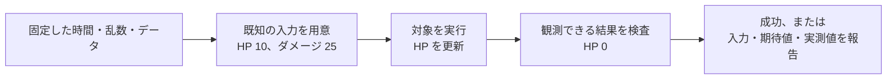

# 自動テストの基礎 — C++ と Unity でゲームの規則を検証する

「攻撃を受けたら HP が減り、0 で止まる」という規則は、毎回エディターでシーンを開かなくても確かめられる。入力と期待する結果を決め、同じ操作を繰り返して機械的に判定する。物理やライフサイクルと組み合わさったときだけ見つかる問題には、その境界を含むテストを使う。



## テストがどこまで責任を持つか

| 確認したいこと | テストに含める範囲 |
| --- | --- |
| HP が 0 未満にならない | HP の規則だけを呼ぶ単体テスト |
| 物理の接触を受けて HP が一度だけ減る | シーンやコンポーネントを含めた結合テスト |
| 配布用ビルドが起動して最初の画面まで進む | 実際のビルドで行う短い動作確認 |

単体テストでは、通常値、境界値、仕様で許さない値を分ける。たとえばこの例ではダメージ 0、HP を超えるダメージ、負のダメージを確認する。テスト名で入力と期待する結果を示すと、失敗の原因をたどりやすい。

時間の経過を使う処理には経過時間を引数として渡す。乱数を使う選択は、制御できる乱数源や種を用意する。シーンの読込やネットワーク越しの応答は、毎回同じ時間で返るとは限らない。完了を観測してから結果を調べ、タイムアウト時には待っていた条件を報告する。個々の処理が別のテストの実行順や共有データに依存しないようにする。

## GoogleTest と Unity Test Framework

**GoogleTest 1.18.0** では `TEST` でテストを定義し、`EXPECT_EQ` などで値を比較する。`EXPECT_*` の失敗後は同じテストを続け、`ASSERT_*` はそのテスト関数の先を打ち切る。例えば戻り値のポインターを参照する前に `ASSERT_NE` で null を弾くと、原因を失敗メッセージに残せる。

**Unity 6.3 LTS の Unity Test Framework** では、Unity を動かしながら Editor 用処理や独立した規則を確かめる **Edit Mode** と、ゲームを再生する状態でコンポーネントやフレーム経過を確かめる **Play Mode** がある。`[Test]` で同期的なテストを書ける。フレームの経過を待つ Unity のテストには `[UnityTest]` とコルーチンを使える。

## コード例 — HP が負にならないことを確認する

まず外部ライブラリなしでコンパイルできる C++20 の例。ゲームロジックの規則を `apply_damage` に置き、テストの期待値は呼び出し側に置く。テスト失敗時にプロセスを非 0 で終えるため、`NDEBUG` で消える `assert` に結果を任せない。

```cpp
#include <iostream>
#include <string_view>

constexpr int apply_damage(int hp, int damage)
{
    if (hp <= 0 || damage >= hp)
        return 0;

    return damage <= 0 ? hp : hp - damage;
}

int main()
{
    int failures = 0;
    const auto expect = [&failures](std::string_view label, int actual, int expected) {
        if (actual != expected)
        {
            std::cerr << label << ": expected " << expected
                      << ", got " << actual << '\n';
            ++failures;
        }
    };
    expect("ordinary damage", apply_damage(10, 3), 7);
    expect("overkill", apply_damage(10, 25), 0);
    expect("zero damage", apply_damage(10, 0), 10);
    expect("negative damage", apply_damage(10, -2), 10);
    std::cout << failures << " failed\n";
    return failures == 0 ? 0 : 1;
}
```

GoogleTest なら、同じ期待値を `TEST(HealthTest, OverkillStopsAtZero)` の中で `EXPECT_EQ(apply_damage(10, 25), 0)` と書ける。テスト側を `GTest::gtest_main` にリンクするとテスト実行用の `main` が提供される。

Unity 側では Test Framework 1.6.0 の **Edit Mode のテストアセンブリ**に次の C# を置ける。関数のテストは UnityEngine のオブジェクトを作らずに実行できる。接触やフレームを経由して HP が減る処理は、同じ関数のテストにまとめず Play Mode で確認する。

```csharp
using NUnit.Framework;

public class HealthTests
{
    private static int ApplyDamage(int hp, int damage)
    {
        if (hp <= 0 || damage >= hp)
            return 0;

        return damage <= 0 ? hp : hp - damage;
    }

    [TestCase(10, 3, 7)]
    [TestCase(10, 25, 0)]
    [TestCase(10, 0, 10)]
    [TestCase(10, -2, 10)]
    public void DamageChangesHpWithinBounds(int hp, int damage, int expected)
    {
        Assert.That(ApplyDamage(hp, damage), Is.EqualTo(expected));
    }
}
```

### コード例 — 時間を入力にした規則を GoogleTest で確かめる

クールダウンの規則に、直前に観測した実時間を内部で読ませると、テストの境界値が実行速度で変わる。更新時に経過時間をミリ秒で渡す設計なら、残り 1 ms、ちょうど 0、期限を越えた場合を、待機なしで確かめられる。入力は非負の整数ミリ秒とする。ゲーム側では、ポーズで止める時間か実時間かを選ぶ処理を呼び出し元に置く。

```cpp
#include <algorithm>
#include <gtest/gtest.h>

class Cooldown
{
public:
    explicit Cooldown(unsigned remaining_ms) : remaining_ms_(remaining_ms) {}

    void advance(unsigned elapsed_ms)
    {
        remaining_ms_ -= std::min(elapsed_ms, remaining_ms_);
    }

    bool ready() const { return remaining_ms_ == 0; }

private:
    unsigned remaining_ms_;
};

TEST(CooldownTest, BecomesReadyAtDeadline)
{
    Cooldown cooldown(3000);
    cooldown.advance(2999);
    EXPECT_FALSE(cooldown.ready());
    cooldown.advance(1);
    EXPECT_TRUE(cooldown.ready());
}

TEST(CooldownTest, StaysReadyPastDeadline)
{
    Cooldown cooldown(3000);
    cooldown.advance(5000);
    ASSERT_TRUE(cooldown.ready());
    cooldown.advance(20);
    EXPECT_TRUE(cooldown.ready());
}
```

この翻訳単位を C++20 でビルドし、GoogleTest 1.18.0 の `GTest::gtest_main` にリンクすると、2 件のテストを実行できる。MSVC の C++20 モードで実行し、2 件とも通過することを確認した。`gtest_discover_tests` で CTest に登録する方法は [CI とビルド自動化](ci-and-build-automation.md) を参照。乱数を使う処理でも、規則に抽選結果や制御できる乱数源を渡すと境界を再現できる。例えばドロップ率の比較条件はしきい値の直前と一致点を固定入力でテストし、長期間の出現率は別の統計テストで扱う。 [GoogleTest Primer](https://google.github.io/googletest/primer.html)

## 理解度チェック

1. ダメージを適用する純粋な規則と、Trigger に入ったときの通知を確かめるには、テスト範囲をどう分けるか。
2. GoogleTest で、失敗後にその値を参照するとテスト自体が壊れる場合、`EXPECT_*` と `ASSERT_*` のどちらを使うか。
3. 3 秒経つと効果が切れる規則を、実際に 3 秒待たずにテストするにはどうするか。

::: details 解答

1. 規則は単体テストにし、物理イベントから規則が呼ばれる経路はシーンを含む結合テストにする。
2. `ASSERT_*`。前提が崩れた箇所で、そのテスト関数の後続を止める。
3. 規則が経過時間を入力で受け取れるようにし、直前・ちょうど・直後の値を与える。

:::

## 関連項目

- [CI とビルド自動化](ci-and-build-automation.md)
- [ビルド構成](build/build-configurations.md)
- [ゲームの状態とポーズ](../game/basics/game-states-and-pause.md)

## 参考資料

- Google, [GoogleTest 1.18.0](https://github.com/google/googletest/releases/tag/v1.18.0)・[Assertions Reference](https://google.github.io/googletest/reference/assertions.html)・[CMake Quickstart](https://google.github.io/googletest/quickstart-cmake.html)
- Unity Technologies, [Unity 6.3 LTS — Unity Test Framework](https://docs.unity.com/en-us/engine/6000.3/manual/packages-list/packages-all/pack-core/com-unity-test-framework)・[Get started with Unity Test Framework](https://docs.unity.com/en-us/engine/6000.3/manual/programming-environment/test-framework-introduction/getting-started)・[PlayMode tests](https://docs.unity.com/en-us/engine/6000.3/manual/programming-environment/test-framework-introduction/overview/general-introduction/play-mode-tests)
