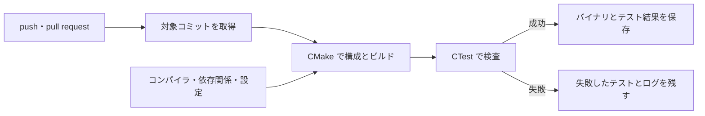

# CI とビルド自動化 — 同じ変更からテスト結果と成果物を作る

CI（継続的インテグレーション）は、変更を共有するたびに、プロジェクトを組み立ててテストする。失敗したときに再現するには、どのソース、依存関係、コンパイラ、ビルド構成を使ったかが分かる必要がある。ゲームのパッケージやシンボル、テスト結果も、作ったジョブから取得できるようにする。



## ローカルと CI で検証の手順をそろえる

プロジェクトの構成、コンパイルとリンク、テストの実行を分ける。構成時の失敗は依存ライブラリやコンパイラの検出、ビルド時の失敗はソースやリンク、テスト時の失敗は実行条件や期待値を順に調べられる。[CMake](build/build-tools-cmake.md)と[ビルド構成](build/build-configurations.md)も参照。

CI 専用のコマンドを増やしすぎると、手元で同じ失敗を再現しにくい。両方から同じスクリプトやプリセットを呼び、ビルド構成とターゲットを明示する。ランナーの OS、コンパイラや SDK の版、アセットの入力はログに残す。OS のラベルを固定しても、ランナーに入っているツールの更新までは止まらない。

## 保存する成果物とキャッシュ

| ファイル | 用途 |
| --- | --- |
| 実行ファイル・パッケージ・デバッグシンボル | 対象コミットの実行やクラッシュ解析に使う |
| テスト結果 XML・ログ | どの検査が、どの入力で失敗したかを確認する |
| 依存関係や再生成できる中間ファイル | キャッシュから復元し、なければ取得または再生成する |

長く残す配布物と、一時的な CI 成果物には別々の保存期間を設定できる。例えばパッケージ名に対象 OS と構成を含め、コミットは成果物を作った実行の情報から確認する。キャッシュに含まれた内容が成果物の取り違えにつながらないよう、コンパイラや依存関係が変わったらキーも変える。

### 依存パッケージをキャッシュする設定例

Node.js 24 と npm を使う補助ツールがリポジトリのルートにある場合の例。`actions/checkout` の後に次のステップを置く。`cache: npm` で npm のダウンロードキャッシュを再利用し、`npm ci` はロックファイルに従って依存関係をインストールする。キャッシュがない実行でも同じ手順でビルドできる。テスト結果や配布バイナリは、上の表のように成果物として保存する。

```yaml
- uses: actions/setup-node@v6
  with:
    node-version: '24'
    cache: npm
    cache-dependency-path: package-lock.json
- run: npm ci
```

[GitHub — setup-node v6](https://github.com/actions/setup-node/tree/v6)・[依存関係のキャッシュ](https://docs.github.com/en/actions/reference/workflows-and-actions/dependency-caching)

## コード例 — 小さな C++20 プロジェクトをビルドして保存する

次の二つのファイルで、境界値を検査する実行ファイルを作る。テストは Release でも終了コードで結果を返す。

```cpp
// bounds_check.cpp
#include <algorithm>
#include <iostream>

bool check_damage(int hp, int damage, int expected)
{
    const int actual = std::max(0, hp - damage);
    if (actual != expected)
    {
        std::cerr << "expected " << expected << ", got " << actual << '\n';
        return false;
    }
    return true;
}

int main()
{
    return check_damage(8, 12, 0) ? 0 : 1;
}
```

```cmake
# CMakeLists.txt
cmake_minimum_required(VERSION 3.26)
project(BoundsCheck LANGUAGES CXX)

enable_testing()
add_executable(bounds_check bounds_check.cpp)
target_compile_features(bounds_check PRIVATE cxx_std_20)
add_test(NAME bounds_check COMMAND bounds_check)
```

**GitHub.com の Actions** で走らせる例。Ubuntu 24.04 のホストランナーを使い、CMake 3.26 以降を前提とする。以下を `.github/workflows/build.yml` に置くと、成功時はバイナリとテスト結果を保存する。テストが失敗した場合も、XML が生成されていればテスト結果を保存する。

```yaml
name: C++ build
on: [push, pull_request]

permissions:
  contents: read

jobs:
  build:
    runs-on: ubuntu-24.04
    steps:
      - uses: actions/checkout@v6.0.2
      - run: cmake -S . -B build -DCMAKE_BUILD_TYPE=Release
      - run: cmake --build build --parallel
      - run: ctest --test-dir build --no-tests=error --output-on-failure --output-junit "$GITHUB_WORKSPACE/build/tests.xml"
      - name: Store test report
        if: always()
        uses: actions/upload-artifact@v7.0.2
        with:
          name: test-report-ubuntu-24.04
          path: build/tests.xml
          if-no-files-found: ignore
          retention-days: 7
      - name: Store executable
        uses: actions/upload-artifact@v7.0.2
        with:
          name: bounds-check-ubuntu-24.04-release
          path: build/bounds_check
          if-no-files-found: error
          retention-days: 7
```

`--no-tests=error` はテストが登録されていない場合にも失敗にする。CTest 3.26.3 でリポジトリのルートから `--test-dir build --output-junit tests.xml` を実行すると、JUnit XML は `build/tests.xml` に出力された。例では GitHub Actions の作業ディレクトリを示す `GITHUB_WORKSPACE` から絶対パスを組み立て、アップロード先の指定と対応させている。Windows の Visual Studio のような複数構成を持つジェネレーターを使う場合は、ビルドに `--config Release`、CTest に `-C Release` を渡す。

## 理解度チェック

1. CTest の結果が「検査 0 件」でも CI が成功していた。何を設定し、どの段階を調べるか。
2. コンパイル済み実行ファイルと再取得できる依存ライブラリは、通常どう保存するか。
3. CI でだけ再現するビルド失敗を調べるとき、ソースのほかに何をそろえるか。

::: details 解答

1. `--no-tests=error` で失敗にし、CMake が対象構成でテストを登録しているか確認する。
2. 実行ファイルは成果物、依存ライブラリは再取得できるキャッシュとして扱える。
3. ランナー環境、コンパイラ・SDK・依存関係の版、構成、ビルド対象などを確認する。

:::

## 関連項目

- [自動テストの基礎](automated-testing.md)
- [CMake](build/build-tools-cmake.md)
- [ビルド構成](build/build-configurations.md)
- [Git の基本](git-basics.md)

## 参考資料

- Kitware, [CMake 3.26 — cmake](https://cmake.org/cmake/help/v3.26/manual/cmake.1.html)・[ctest](https://cmake.org/cmake/help/v3.26/manual/ctest.1.html)・[add_test](https://cmake.org/cmake/help/v3.26/command/add_test.html)
- GitHub, [Workflow syntax](https://docs.github.com/en/actions/reference/workflows-and-actions/workflow-syntax)・[Workflow artifacts](https://docs.github.com/en/actions/concepts/workflows-and-actions/workflow-artifacts)・[Dependency caching](https://docs.github.com/en/actions/concepts/workflows-and-actions/dependency-caching)・[既定の環境変数](https://docs.github.com/en/actions/reference/workflows-and-actions/variables#default-environment-variables)
- GitHub, [actions/checkout 6.0.2](https://github.com/actions/checkout/releases/tag/v6.0.2)・[actions/upload-artifact 7.0.2](https://github.com/actions/upload-artifact/releases/tag/v7.0.2)・[ホストランナーのイメージ](https://github.com/actions/runner-images)
