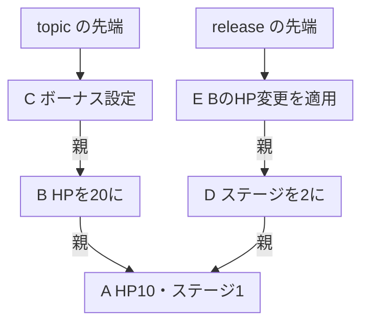

# Gitのcherry-pick — コミットではなく変更を別の履歴へ取り込む

開発ブランチでは敵のHPを調整したあと、ボーナス設定も追加しました。リリース用のブランチにはHP調整だけを取り込みたいとします。`cherry-pick` は指定したコミットが導入した変更を、現在のブランチに適用します。HP調整は取り込まれますが、後から加えたボーナス設定も一緒に取り込む指定ではありません。[Git公式のcherry-pickマニュアル](https://git-scm.com/docs/git-cherry-pick#_description)

## 元の親との差を、取り込み先で組み合わせる

両方のブランチはAから始まります。開発用の `topic` では、Bで敵のHPを10から20に変え、Cで `bonus.txt` を追加しました。`release` ではDでステージ番号を1から2に変えました。`release` にいる状態でBを選ぶと、GitはBとその親Aを比較し、HP調整を現在の先端Dに取り込んでEを作ります。Dにあるステージ番号2はそのままです。

図の矢印は、コミットから親へ向きます。Eの親はDです。`topic` はCを指し、Cの親は元のBのままです。



Git 2.39.2の通常の単親コミットの処理では、Aを基準としてBとDの内容を照合します。基準のAにはHP10、BにはHP20、DにはHP10があります。この行ではB側だけが変更を加えています。ステージ番号はD側だけが変えています。取り込み先が別の状態なら、照合する内容も変わります。基準にするのは選んだコミットBの親で、この例のAは共通祖先でもあります。[Git 2.39.2のcherry-pick実装](https://github.com/git/git/blob/v2.39.2/sequencer.c#L2219-L2305)

## 同じHP変更でも、親とコミットIDは違う

コミットにはスナップショットと親のIDが記録されます。この例でBの親はA、Eの親はDです。HP変更の内容とコミットメッセージが同じでも、EはBと異なるIDを持ちます。Eにはステージ番号2も含まれるため、BとEのスナップショット全体も違います。`release` から親をたどる経路はE、D、Aで、BとCは `topic` 側の履歴に残ります。[Git公式のcommit-treeマニュアル](https://git-scm.com/docs/git-commit-tree#_description) · [Gitの保存モデル](/tools/git-objects.html)

次は検証用リポジトリでの実測です。`release` で `git cherry-pick ae44d29` を実行してから、元のBと適用後のEを読みました。ログはコミットの短いID、親の短いIDの順です。Eの `enemy.txt` は `hp=20`、`stage.txt` は `stage=2` で、Eのファイル一覧に `bonus.txt` はありません。

```text
$ git log -1 --format='%h %p' ae44d29
ae44d29 e723252
$ git log -1 --format='%h %p'
8359b6e d12d579
$ git show HEAD:enemy.txt
hp=20
$ git show HEAD:stage.txt
stage=2
$ git ls-tree --name-only HEAD
enemy.txt
stage.txt
```

## 競合と、仕様上の不整合

取り込み先でも同じHP行を10から30に変えていた場合、GitはHP20とHP30のどちらを使うかを自動で決められないことがあります。検証例では競合で止まり、`HEAD` は取り込み前のコミットを指し、`CHERRY_PICK_HEAD` が適用元のBを指しました。[Git公式のcherry-pickマニュアル](https://git-scm.com/docs/git-cherry-pick#_description)

別の例では、取り込み先の `bonus.txt` に「HPが20以上ならボーナス対象」という条件がすでにあります。HP調整はテキストの競合なしに適用され、HPが10から20になりました。結果の設定値で条件を評価すると、対象外から対象へ変わります。ゲームの要件に合うかは、取り込み先の設定と合わせて確認する必要があります。

## merge・rebaseとの関係

- **cherry-pick** は指定したコミットの変更を、現在の先端に取り込みます。この例ではBの変更を選び、`release` をEへ進めました。
- **merge** でこの二つの分岐を統合する場合は、それぞれの先端が出発点です。`topic` を通常の3-way mergeで取り込むなら、結果のマージコミットにはDとCを親として記録します。Cの変更も統合の対象になります。[Gitのマージ](/tools/git-three-way-merge.html) · [Git公式のmergeマニュアル](https://git-scm.com/docs/git-merge#_description)
- **rebase** は対象となる変更を指定した基準の上に順に再適用し、対象ブランチの先端を更新します。たとえば `topic` のBとCをDの上に載せ直すといった場面です。変更を一つずつ再適用する点はcherry-pickに似ています。[Gitのrebase](/tools/git-rebase.html) · [Git公式のrebaseマニュアル](https://git-scm.com/docs/git-rebase#_description)

ここでのcherry-pickは、分岐した先端で単親のBを取り込む通常の実行です。`--ff` で現在の先端が選んだコミットの親と一致すれば元のコミットへ進む場合があり、`--no-commit` は変更を適用する段階で止めます。マージコミットのcherry-pickでは、`-m` が差分の基準にする親を指定します。[Git公式のcherry-pickオプション](https://git-scm.com/docs/git-cherry-pick#_options)

## 理解度チェック

::: details この例でEの親は、変更を取り込んだBになる？
Eの親は、取り込み直前の `release` の先端Dです。Bの変更はEに反映され、元のBは `topic` 側に残ります。
:::

::: details Bだけを選ぶと、Cのボーナス設定も入る？
入りません。BがAに対して導入したのはHP調整です。`bonus.txt` はCで追加されたため、Bの変更にはありません。
:::

::: details 競合なしで適用できたら、HP調整の影響も元のブランチと同じ？
取り込み先に異なるルールがあれば影響も変わります。この例では、既存のボーナス条件を満たすようになりました。
:::

## 検証範囲

2026年11月17日に、WindowsのGit 2.39.2.windows.1と独立したSHA-1リポジトリ3つを使いました。作業ツリーに未コミットの変更がない状態で、分岐した二つの履歴の間で単親コミットをcherry-pickしました。競合した例と、競合せずボーナス条件の結果が変わる例は別のリポジトリで確認しました。ボーナス判定は設定ファイルを読む検査です。ゲームエンジンでの動作、比較に挙げたmergeとrebase、`--ff`、`--no-commit`、マージコミットや空になる変更の取り込み、競合解消後の結果は実測範囲外です。

## 関連項目

- [Gitの保存モデル](/tools/git-objects.html) — コミットのスナップショット、親、参照を確認する。
- [Gitのマージ](/tools/git-three-way-merge.html) — 二つの先端を統合する場合の親関係をたどる。
- [Gitのrebase](/tools/git-rebase.html) — 複数の変更を違う基準から再適用する仕組みを読む。
- [Gitのrevert](/tools/git-revert.html) — 過去の変更を逆向きに適用する場合と比べる。

## 参考資料

- [Git公式 — git-cherry-pick](https://git-scm.com/docs/git-cherry-pick)
- [Git 2.39.2 — cherry-pickとrevertの適用処理](https://github.com/git/git/blob/v2.39.2/sequencer.c#L2219-L2305)
- [Git公式 — git-commit-tree](https://git-scm.com/docs/git-commit-tree#_description)
- [Git公式 — git-merge](https://git-scm.com/docs/git-merge#_description)
- [Git公式 — git-rebase](https://git-scm.com/docs/git-rebase#_description)
