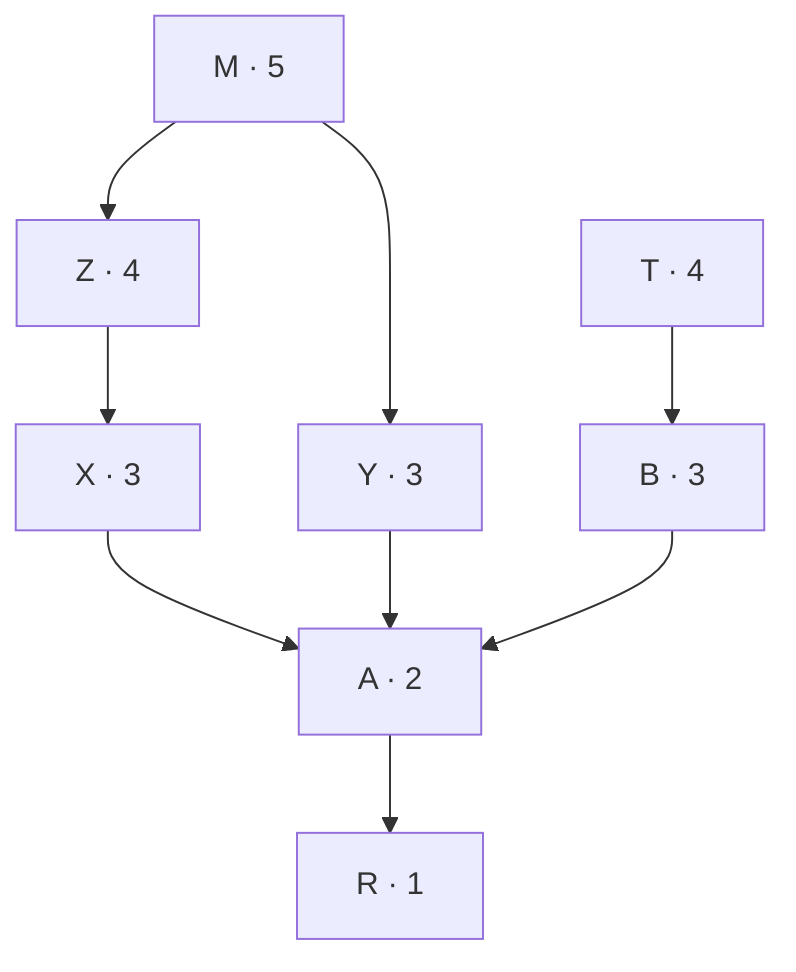

# Gitのcommit-graph：なぜ履歴探索で、読まないコミットを増やせるのか

別ブランチで修正を入れたコミット `T` が、配布候補のマージコミット `M` の履歴に含まれるかを確かめます。`M` から親をたどって `T` に届けば、`T` は `M` の祖先です。履歴が長いと、コミットを開いて親を読む作業が繰り返されます。Gitの **commit-graph** は、親を手早く読むための索引です。さらに世代番号を使うと、親をたどる必要がない箇所を見分けられます。[Gitのcommit-graph設計文書](https://git-scm.com/docs/commit-graph)

## この記事で分かること

commitオブジェクトと再生成できる索引の違いを説明できます。分岐とマージを含む図で、世代番号からどの枝を打ち切れるか、時刻が逆転しても判定できる理由を追えます。

## commitオブジェクトと索引で、何を読むか

commitオブジェクトは、親のオブジェクトID（OID）、ルートtree、作者やコミッター、メッセージなどを持ちます。Gitはオブジェクトを展開して読み取れば、親をたどれます。commit-graphには、探索でよく使う親・ルートtree・コミッター時刻と世代番号がまとまっています。Gitは最初のコミットをOIDの順に並べた表から探し、以後は親が指す表の行番号で次の情報を読めます。索引に載ったコミットでは、親を調べるたびに元のオブジェクトを展開して解析する費用を省けます。[Gitのcommit-graph設計文書](https://git-scm.com/docs/commit-graph) · [Gitのcommit-graphファイル形式](https://git-scm.com/docs/gitformat-commit-graph)

索引を削除しても、元のオブジェクトとブランチの参照が残っていれば、履歴やコミットIDは変わりません。Gitは索引なしでもオブジェクトから親を読めます。たとえば `git commit-graph write --reachable` は、参照から到達できるコミットをもとに索引を作り直せます。逆に、索引だけからコミットメッセージやファイル内容を復元することはできません。[Gitのcommit-graph設計文書](https://git-scm.com/docs/commit-graph) · [git commit-graphコマンド](https://git-scm.com/docs/git-commit-graph)

## 分岐とマージから、親をたどらない枝を見つける

図の矢印は子から親に向きます。`M` は親が2つあるマージコミットです。履歴は、矢印に向きがあり同じ頂点に戻る道がない **DAG**（有向非巡回グラフ）です。数字は世代番号v1です。親のない `R` は1、ほかは最も大きい親の世代に1を足します。たとえば `M` は `Z` の4と `Y` の3を比べて、`max(4, 3) + 1 = 5` です。[Gitのcommit-graph設計文書](https://git-scm.com/docs/commit-graph)

`T`（世代4）が `M` の祖先かを調べます。世代が4未満のコミットまで来たら、その先へ親をたどっても4には戻れません。ここでは全コミットの世代が計算済みです。次の流れは、候補より小さい世代で打ち切る考え方を示す概念例です。[Gitのcommit-graph設計文書](https://git-scm.com/docs/commit-graph)

1. `M`（5）の親を調べます。`Y`（3）はそこで打ち切り、`Z`（4）を調べます。
2. `Z` のOIDは `T` と異なります。`Z` の親 `X`（3）も打ち切れるため、`A` や `R` まで進む必要はありません。
3. どの枝にも `T` はありません。候補が `Z` なら、1の時点でOIDが一致して見つかります。世代が同じだけでは、一致したことにはなりません。

索引にまだ載っていないコミットや、v1の値が上限に達したコミットもあります。Gitの設計文書は、そのような場合も扱うため、世代の比較だけで打ち切る一般条件を「候補より小さい」としています。図の探索順はGitが内部で実際に読んだ順番を表していません。[Gitのcommit-graph設計文書](https://git-scm.com/docs/commit-graph)

## 時計がずれても、親子の順序は変わらない

別の端末でコミットすると、時計のずれによって子のコミッター時刻が親より古くなることがあります。図の `A`、`B`、`T` を例にします。時刻は同一の正の基準時刻からの秒数です。`B` の時刻105は親 `A` の110より小さいので、元の時刻だけを使うと `B` から `A` に届かないと誤判定します。v1は時刻を使いません。[Gitのcommit-graph設計文書](https://git-scm.com/docs/commit-graph)

| コミット | 元の時刻 | v2（補正後） |
| --- | ---: | ---: |
| `R` | 100 | 100 |
| `A` | 110 | 110 |
| `B` | 105 | 111 |
| `T` | 103 | 112 |

世代番号v2は、元の時刻と「最も大きい親のv2に1秒を足した値」の大きい方です。`B` は `max(105, 110 + 1) = 111`、`T` は `max(103, 111 + 1) = 112` になります。親のないコミットは通常その元の時刻を使います（時刻0は未計算の印と区別するため1）。補正は索引の値にだけ適用され、オブジェクトに記録した時刻やOIDは変わりません。v1・v2は世代番号の定義で、索引ファイル自体の形式バージョンとは別です。[Gitのcommit-graph設計文書](https://git-scm.com/docs/commit-graph) · [Gitのcommit-graphファイル形式](https://git-scm.com/docs/gitformat-commit-graph)

## 特定パスの変更を探すときは別の最適化がある

索引には、第1親との差で変わったパスの **Bloom filter** を追加できます。たとえば `git log -- player.cpp` が調べる途中で、対象パスは変わっていないと分かれば比較を省けます。フィルターが「変更の可能性あり」と返した場合には、実際の比較で確かめます。世代番号が答えるのは、親をたどって候補に届く可能性です。[Gitのcommit-graphファイル形式](https://git-scm.com/docs/gitformat-commit-graph) · [git commit-graphの `--changed-paths`](https://git-scm.com/docs/git-commit-graph)

## 要点

- commit-graphは、元のオブジェクトから再生成できる索引です。親の位置を直接引けるので、オブジェクトの展開と解析を省けます。
- 祖先候補より世代番号が小さい地点に来たら、その向こうの親を調べる必要はありません。世代が同じときはコミットIDで一致を確かめます。
- v1は親関係から求め、v2は親子の順序を保つようコミッター時刻を補正します。元のコミット時刻は変わりません。
- 変更パスのBloom filterが省くのはファイルの変更有無を調べる比較です。

## 理解度チェック

::: details `M` から `T` を探すとき、`Y` の親を読む必要がないのはなぜ？
`Y` の世代は3で、`T` の4より小さいためです。親をたどるほど図の世代番号は小さくなります。
:::

::: details `B` の時刻が親 `A` より古いとき、v2は元の時刻を書き換える？
元の時刻とOIDはそのままです。索引で使う `B` のv2は、`A` のv2に1秒を足した111になります。
:::

## 検証範囲

2026年11月21日にGit公式資料を確認しました。Git for Windows 2.39.2.windows.1で、図と同じ8コミットを独立したSHA-1のリポジトリに作り、全64組の祖先判定を `git merge-base --is-ancestor` で比較しました。索引の生成前・生成後・退避後・再生成後で結果は一致しました。`git commit-graph verify` が通り、索引ファイルから読み出した親の位置とv1・v2も図の親関係と計算結果に一致しました。実際の読み出し回数や処理時間、Bloom filterの効果は測定していません。

## 関連項目

- [Gitのchanged-path Bloom filter](/tools/git-changed-path-bloom-filter.html) — 特定のファイルの履歴を探すとき、第1親とのtree比較を省ける条件を読む。
- [Gitの保存モデル](/tools/git-objects.html) — commitオブジェクトが親やtreeをどう参照するかを読む。
- [Gitのマージ](/tools/git-three-way-merge.html) — 共通祖先を使ってマージの基準を探す場面を追う。
- [Gitのreflog](/tools/git-reflog.html) — 参照の移動の記録と、コミットの親をたどる履歴を区別する。

## 参考資料

- [Git — commit-graph設計文書](https://git-scm.com/docs/commit-graph) — 親の探索、世代番号、探索を打ち切る条件。
- [Git — gitformat-commit-graph](https://git-scm.com/docs/gitformat-commit-graph) — OIDと親の位置、世代番号、パスのBloom filterのファイル形式。
- [Git — git commit-graph](https://git-scm.com/docs/git-commit-graph) · [git merge-base](https://git-scm.com/docs/git-merge-base) — 索引の生成・検証と祖先判定。
