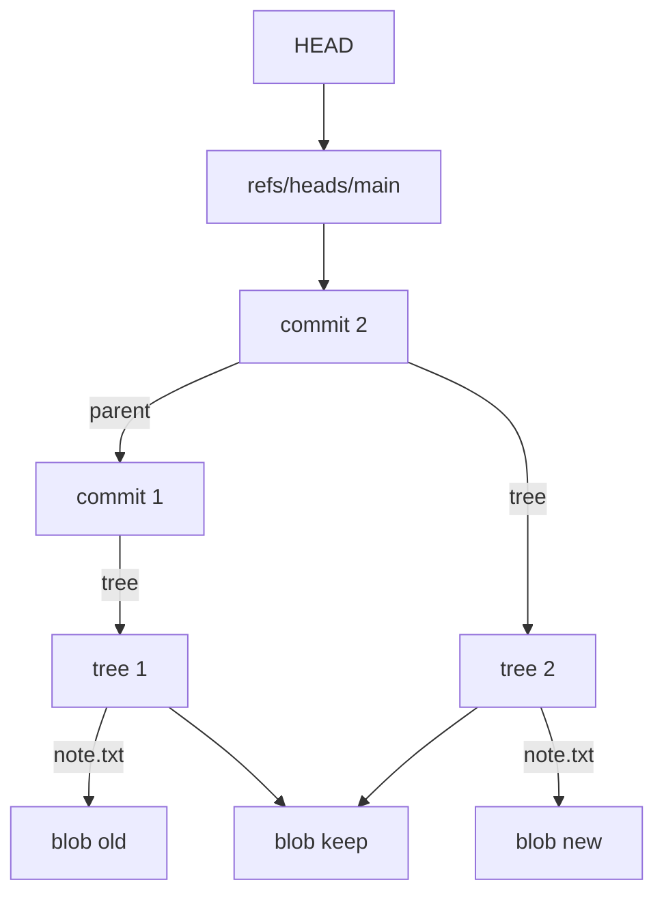

# Gitの保存モデル — blob・tree・commitとrefs／HEAD

`note.txt` の1行だけを変えてコミットし、`git diff 'HEAD^' HEAD` で前後を比べると、`note.txt` の変更が表示されます。そのコミットを指定すれば、変更していない `keep.txt` も取り出せます。Gitが各コミットに結び付けるのは、追跡対象のファイルがその時点でどう並び、どんな内容だったかというスナップショットです。変更が少ないときは、複数のスナップショットで同じオブジェクトを参照できます。[Pro GitのGitオブジェクト解説](https://git-scm.com/book/en/v2/Git-Internals-Git-Objects)

## 内容・名前・履歴はどこにあるか

| オブジェクト | 何を持つか |
| --- | --- |
| blob | ファイルとして保存したバイト列。ファイル名はtreeにあります。 |
| tree | ディレクトリ内の各項目の名前、モード、オブジェクトID。通常のファイルはblob、サブディレクトリは別のtreeを参照します。 |
| commit | ルートtreeのID、親コミットのID、作者・コミッターや日時、メッセージなど。最初のコミットに親はなく、マージコミットは複数の親を持てます。 |

この分け方なら、ファイル名だけが変わり、Gitが保存するバイト列が同じ場合、treeは新しい名前の項目から同じblobを指せます。commitのルートtreeから名前と内容をたどり、commitの親から履歴をたどります。[Pro GitのGitオブジェクト解説](https://git-scm.com/book/en/v2/Git-Internals-Git-Objects)

## 2コミットで変わるID、共有するID

最初のコミットでは `keep.txt` に `keep`、`note.txt` に `old` を保存しました。次のコミットでは `note.txt` だけを `new` に変えました。図では矢印の先が参照先です。2つのtreeが `keep.txt` に同じblobを使っています。



### コマンドで図の参照を確認する

以下は独立した検証リポジトリの出力です。オブジェクトIDは先頭8桁に縮め、`cat-file -p` の作者情報などは省略しました。`HEAD^` はこの例では `HEAD` の第1親、`HEAD^{tree}` は今のコミットのルートtreeです。[gitrevisions](https://git-scm.com/docs/gitrevisions) · [git-rev-parse](https://git-scm.com/docs/git-rev-parse) · [git-cat-file](https://git-scm.com/docs/git-cat-file)

```text
$ git rev-parse --show-object-format
sha1
$ git rev-parse HEAD 'HEAD^' 'HEAD^{tree}'
e5b25d89
07367563
8f993730
$ git cat-file -t HEAD
commit
$ git cat-file -p HEAD
tree 8f993730
parent 07367563
…
```

`ls-tree` は、各項目をモード・型・ID・名前の順に表示します。`keep.txt` は両方で `2fa992c0` を指し、`note.txt` のIDだけが変わっています。`cat-file -p` でそのblobを読むと、保存したバイト列が返ります。[git-ls-tree](https://git-scm.com/docs/git-ls-tree) · [git-cat-file](https://git-scm.com/docs/git-cat-file)

```text
$ git ls-tree 'HEAD^'
100644 blob 2fa992c0  keep.txt
100644 blob 3367afdb  note.txt
$ git ls-tree HEAD
100644 blob 2fa992c0  keep.txt
100644 blob 3e757656  note.txt
$ git cat-file -p 'HEAD:note.txt'
new
```

## HEADとブランチは履歴のどこを指すか

通常の状態では `HEAD` が現在のブランチ参照を指し、ブランチ参照がコミットを指します。例では `git symbolic-ref HEAD` の結果が `refs/heads/main` で、`git rev-parse refs/heads/main` の結果が図のコミット2を表す `e5b25d89…` です。`main` 上で新しいコミットを作ると `main` の参照先が進みます。コミット1は引き続きコミット2の親からたどれます。detached HEADでは、`HEAD` がブランチ名を介さずにコミットを直接指します。[Pro GitのGitの参照](https://git-scm.com/book/en/v2/Git-Internals-Git-References) · [git-symbolic-ref](https://git-scm.com/docs/git-symbolic-ref)

図は参照の論理的な関係です。Gitの対応版では、`files` 形式は個別の参照ファイルや `packed-refs` を使い、`reftable` 形式は別の保存方式を使います。オブジェクトIDもリポジトリの形式に依存し、今回の例はSHA-1です。対応するGitではSHA-256形式も選べます。IDを読むときは桁数を決め打ちせず、`git rev-parse --show-object-format` で形式を確認できます。[git-init](https://git-scm.com/docs/git-init) · [git-rev-parse](https://git-scm.com/docs/git-rev-parse)

## スナップショット、差分表示、packは何が違うか

`git diff 'HEAD^' HEAD` は、指定した2つのスナップショットから差分を作る表示です。この例では `note.txt` の `-old` と `+new` が出ます。commitには親のIDがあり、その時点の内容はルートtreeからたどれます。親との差分を順番につなげて、コミットの内容を求める構造とは異なります。[git-diff](https://git-scm.com/docs/git-diff) · [Pro GitのGitオブジェクト解説](https://git-scm.com/book/en/v2/Git-Internals-Git-Objects)

一方、packはオブジェクトをまとめて保存・転送する形式です。オブジェクトを圧縮して収めるほか、似たオブジェクトを基底にして、そこから本体を復元するための**デルタ**を収める場合があります。基底の選び方は履歴の親子関係とは別で、画面に出る `git diff` のテキストとも別です。packから取り出した型と本体は、元の論理オブジェクトに戻ります。[Gitのpack形式仕様](https://git-scm.com/docs/gitformat-pack) · [Pro GitのPackfiles](https://git-scm.com/book/en/v2/Git-Internals-Packfiles)

検証用リポジトリをpack化すると、個別に保存されていた7オブジェクトが1つのpackに入りました。この小さな例では7個ともデルタを使わず、pack化する前後で、上のIDや `ls-tree`、blobの内容、`git diff` の出力は同じでした。packに入っていることと、デルタ表現で入っていることは区別できます。

## 理解度チェック

::: details 同じバイト列のファイルを別名へ変えると、どこが変わる？
ファイル名を持つtreeが変わり、その状態を記録する新しいcommitは新しいtreeを参照します。バイト列が変わっていないなら、同じblobを使えます。
:::

::: details HEADから今の note.txt の内容まで、どの順にたどる？
図の状態では、HEADから `refs/heads/main`、コミット2、ルートtree、`note.txt` の項目、`new` を持つblobの順です。
:::

## 検証範囲

2026年11月17日にWindowsのGit 2.39.2.windows.1で、SHA-1形式の独立したリポジトリに2コミットを作成して観察しました。`git cat-file`、`git ls-tree`、`git rev-parse`、`git symbolic-ref`、`git diff` とpack化の前後を照合しました。2026年11月20日には同じ版で別々のSHA-1とSHA-256の練習用リポジトリを作り、`--show-object-format` がそれぞれ `sha1`、`sha256` を返すことを確認しました。SHA-256でのpack化、reftable、デルタを使うpackの実測は対象外です。

## 関連項目

- 次のコミットのtreeを作るために、indexが名前やblobのIDをどう保持するかを確かめる。[Gitのステージング — 作業ツリー・index・HEAD](/tools/git-staging-index.html)
- マージコミットが指す二つの親と、統合の基準になる共通祖先を図でたどる。[Gitのマージ — 共通祖先と3-way merge](/tools/git-three-way-merge.html)
- 別の親の上に変更を適用し直すと、コミットIDがどう変わるかを確かめる。[Gitのrebase — コミットの再適用と履歴の書き換え](/tools/git-rebase.html)
- 同じ修正を別の親の上に記録し、元のコミットと新しいコミットのIDを比べる。[Gitのcherry-pick — コミットではなく変更を別の履歴へ取り込む](/tools/git-cherry-pick.html)
- 変更を打ち消したあとのtreeと、元のコミットを含む親のつながりを比べる。[Gitのrevert — 履歴を消さずに変更を打ち消す仕組み](/tools/git-revert.html)
- ブランチが以前どのコミットを指していたか、ローカルの参照の移動記録からたどる。[Gitのreflog — 履歴から見えなくなったコミットはどこにあるのか](/tools/git-reflog.html)
- `refs/heads/main` と `refs/remotes/origin/main` が、ローカルにあるどの情報を表すかを確かめる。[Gitのリモート追跡ブランチ — origin/mainはサーバーそのものではない](/tools/git-remote-tracking.html)
- [Gitの基本](/tools/git-basics.html) — 作業ツリー、ステージング、コミットの操作と差分の見方を確認する。
- [用語集のブランチ](/glossary/programming.html#branch) — ブランチやマージなど、履歴を扱う用語を引く。

## 参考資料

- [Pro Git — Git Objects](https://git-scm.com/book/en/v2/Git-Internals-Git-Objects)
- [Pro Git — Git References](https://git-scm.com/book/en/v2/Git-Internals-Git-References)
- [Pro Git — Packfiles](https://git-scm.com/book/en/v2/Git-Internals-Packfiles)
- [Git公式 — gitrevisions](https://git-scm.com/docs/gitrevisions) · [git-init](https://git-scm.com/docs/git-init) · [gitformat-pack](https://git-scm.com/docs/gitformat-pack)
