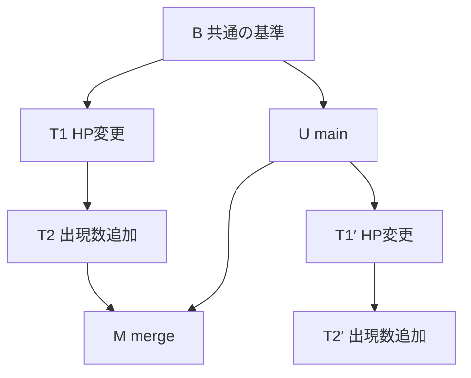
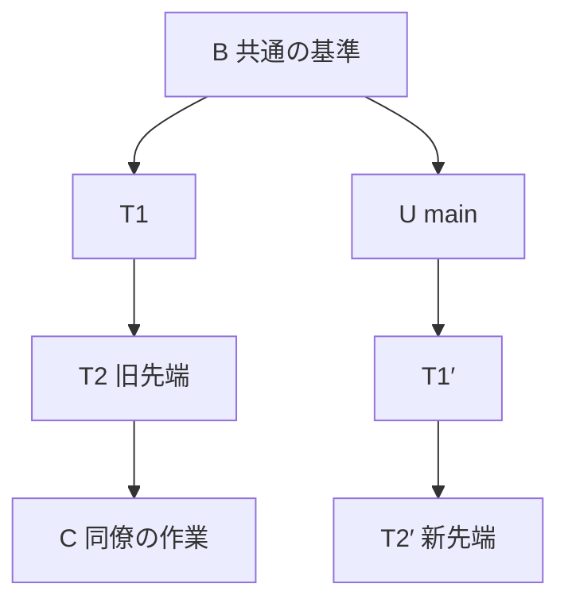

# Gitのrebase — コミットの再適用と履歴の書き換え

ゲームの `stage.txt` を更新する間に、別のブランチで敵のHPと出現数を変更したとします。これらの変更はmergeでもrebaseでも取り込めます。この例では、出来上がるファイルは同じでも、どのコミットを親としてたどれるかが変わります。[Pro Gitのrebaseの解説](https://git-scm.com/book/en/v2/Git-Branching-Rebasing#_rebasing)

## rebaseは新しい基準の上で変更を再適用する

共通のコミットBから、`main` ではUでゲーム内のステージ番号を `2` に変えました。`topic` ではT1で敵のHPを `20` に変え、T2で出現数 `3` の `spawn.txt` を追加しました。図の矢印は親から子へ向いています。mergeとrebaseは元の分岐から別々に実行した結果です。



Bは分岐をたどった先で共通になる**マージベース**で、Uは今回のrebaseで選んだ**載せ替え先**です。`rebased` にいる状態で `git rebase --merge main` とすると、`main` の先端Uの上へ `rebased` 側の変更を載せ替えます。`--onto` を使う形式では、再適用する範囲を選ぶ上流の参照と、載せ替え先を別々に指定できます。[Git 2.39のrebaseマニュアル](https://git-scm.com/docs/git-rebase/2.39.0#_description)

mergeではUとT2の変更を統合し、二つを親とするMを作ります。rebaseではT1の変更をUの状態に再適用してT1′を作り、続いてT2の変更をT1′の状態に再適用してT2′を作ります。検証では、Uから作った `merged` をmergeで、T2から作った `rebased` をrebaseで更新しました。[Gitの3-way merge](/tools/git-three-way-merge.html) · [Git 2.39のrebaseマニュアル](https://git-scm.com/docs/git-rebase/2.39.0#_description)

## 新しい親によってコミットIDが変わる

コミットオブジェクトには、スナップショットを指すルートtreeと親コミットのIDの両方があります。元のT1の親はBですが、T1′の親はUです。変更の意図やメッセージが同じでも、親のIDが変わるとコミットオブジェクトの内容が変わります。その内容に基づいてIDを計算するため、この例ではT1′に別のIDが付き、T2′も新しい親T1′を参照します。[Gitの保存モデル](/tools/git-objects.html) · [Pro Gitのコミットオブジェクト](https://git-scm.com/book/en/v2/Git-Internals-Git-Objects#_git_commit_objects)

次は元のT1（`topic~1`）、再適用したT1′（`rebased~1`）、再適用後の先端T2′（`rebased`）、マージ結果M（`merged`）の順に並べた実測結果です。各行はコミットID、親のID、ルートtreeのIDの順です。Mの行には親が二つあるので、IDが一つ多く並びます。

```text
$ git show --no-patch '--format=%h %p %t' 'topic~1' 'rebased~1' rebased merged
887cbcd 89b71e0 b878b3e
15dcdfb 1523c8d f19a852
3ec0e69 15dcdfb 3512673
822401e 1523c8d 22e6717 3512673
```

## 同じファイルに着地しても、親は違う

独立した検証リポジトリでは、MとT2′のファイルはどちらも `stage.txt` が `stage=2`、`enemy.txt` が `hp=20`、`spawn.txt` が `count=3` でした。ルートtreeのIDも一致し、二つのコミットを比較する `git diff` には差分がありませんでした。Mの親はUとT2、T2′の親はT1′です。tree IDがそろっても、コミットの親と履歴は別々に確認できます。[Gitの `git diff` マニュアル](https://git-scm.com/docs/git-diff#_description) · [Pro Gitのrebaseの解説](https://git-scm.com/book/en/v2/Git-Branching-Rebasing#_rebasing)

ここでは、互いに別のファイルへの単純な変更を使っています。変更が重なると、rebaseは途中のコミットを再適用する時点で止まることがあります。上流との重複や再適用後に空になる変更の扱いも、rebaseのオプションなどによって変わります。[Git 2.39のrebaseマニュアル](https://git-scm.com/docs/git-rebase/2.39.0#_options)

## 共有済みの履歴に積んだ作業はどこに残るか

同僚が元のT2を取得して、その上にCを作ったとします。図の矢印は親から子を示します。その後、共有ブランチがT2′を指すように更新されても、Cの親はT2です。新しい先端と同僚の作業は別々の系列に分かれます。



検証では共有をローカルの別ブランチで再現しました。T2はCの祖先ですが、T2′の祖先には含まれず、CとT2′のマージベースはBでした。古い系列をそのまま新しい系列へマージすると、再適用前と再適用後の両方のコミットが履歴に入る場合があります。共有済みの先端を置き換えるときは、その上に積まれた作業の扱いを共同作業者とそろえる必要があります。[Pro Gitの共有済み履歴のrebase](https://git-scm.com/book/en/v2/Git-Branching-Rebasing#_rebase_peril) · [Gitの上流rebase後の復旧に関する解説](https://git-scm.com/docs/git-rebase/2.39.0#_recovering_from_upstream_rebase)

## 理解度チェック

::: details mergeとrebaseの最終treeが一致したら、コミットIDも一致する？
この例では一致しません。MはUとT2を親に持ち、T2′はT1′を親に持ちます。親IDもコミットオブジェクトの一部です。
:::

::: details Cまで作業した同僚は、新しい共有先端を取得すればCの親も自動で変わる？
Cは引き続き元のT2を親に持ちます。新しいT2′の上で作業を続けるなら、Cで加えた変更をどう取り込むかを決めます。
:::

## 検証範囲

2026年11月17日にWindowsのGit 2.39.2.windows.1で、独立したSHA-1リポジトリを使いました。マージは `-s ort --no-ff`、rebaseは `--merge` を指定し、二つの直線的なトピックコミットを競合なく再適用しました。競合時、空の変更、マージコミットの再適用、共有リモートの更新は実測範囲外です。[Git 2.39のrebaseマニュアル](https://git-scm.com/docs/git-rebase/2.39.0)

## 関連項目

- rebase前の先端を参照の移動記録からたどり、いつまで探せるかを確認する。[Gitのreflog — 履歴から見えなくなったコミットはどこにあるのか](/tools/git-reflog.html)
- 共有済みの変更を打ち消すコミットが、既存の履歴にどうつながるかを読む。[Gitのrevert — 履歴を消さずに変更を打ち消す仕組み](/tools/git-revert.html)
- [Gitの保存モデル](/tools/git-objects.html) — 親IDとtreeがコミットに入る仕組みを読む。
- [Gitのマージ](/tools/git-three-way-merge.html) — 共通祖先と二つの先端を使って結果を作る方法を確認する。
- 別のブランチから特定の修正を選び、現在の先端に適用する仕組みを読む。[Gitのcherry-pick — コミットではなく変更を別の履歴へ取り込む](/tools/git-cherry-pick.html)
- rebaseの基準に `origin/main` を選ぶとき、その参照がいつ更新されるかを確かめる。[Gitのリモート追跡ブランチ — origin/mainはサーバーそのものではない](/tools/git-remote-tracking.html)

## 参考資料

- [Git公式 — git-rebase 2.39](https://git-scm.com/docs/git-rebase/2.39.0)
- [Git公式 — git-commit-tree](https://git-scm.com/docs/git-commit-tree)
- [Pro Git — Rebasing](https://git-scm.com/book/en/v2/Git-Branching-Rebasing)
- [Pro Git — Git Objects](https://git-scm.com/book/en/v2/Git-Internals-Git-Objects#_git_commit_objects)
