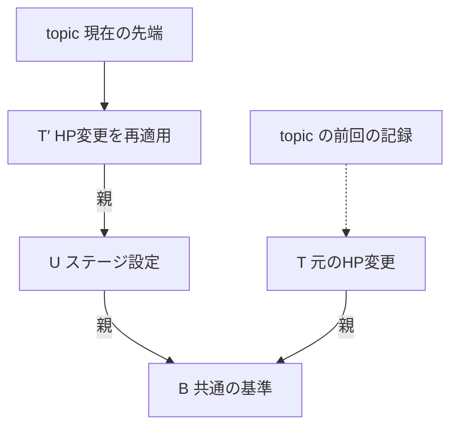

# Gitのreflog — 履歴から見えなくなったコミットはどこにあるのか

敵のHPを変更したブランチをrebaseすると、変更を再適用した新しいコミットが作られることがあります。元のコミットが `git log` に出なくなっても、その時点でGitがオブジェクトを消したとは限りません。前の先端を覚えているのが **reflog（参照ログ）** です。[Gitのrebase](/tools/git-rebase.html) · [Git公式のreflogマニュアル](https://git-scm.com/docs/git-reflog/2.39.0#_description)

## コミットの親と、参照が以前指していた先

共通のコミットBから、`main` ではUでステージ設定を変更し、`topic` ではTで `enemy.txt` の `hp=1` を `hp=2` にしました。`topic` を `main` の上にrebaseすると、HPの変更がUの上に再適用され、T′ができます。図では実線が「現在の参照が指す先」または「コミットが持つ親」、破線が「reflogに記録されている以前の先端」です。



`git log topic` はT′から親をたどります。そこにTはありません。reflogが記録するのは、このブランチの参照がTからT′に更新されたことです。`topic^` は「現在の先端T′の第1親」なのでU、`topic@{1}` は「この参照の一つ前の値」なので、この例ではTを指します。`@{1}` は親の数ではなく記録の位置です。参照がまた更新されると、同じ式が指す先も変わります。[Git公式のリビジョン指定](https://git-scm.com/docs/gitrevisions) · [Git公式のrev-listマニュアル](https://git-scm.com/docs/git-rev-list#_description)

## 親をたどれなくても、旧コミットは読める

次は独立したリポジトリでの実測です。`--all` は `HEAD` と `refs/` 以下の現在の参照を起点にして親をたどります。`--reflog` を加えると、reflogに記録されているコミットも起点に加わります。Tの `715d10a` が後者にだけ現れ、記録からTの `enemy.txt` も読めました。

```text
$ git rev-list --all --abbrev-commit
f44ccab
bee910d
507779d
$ git rev-list --all --reflog --abbrev-commit
f44ccab
715d10a
bee910d
507779d
$ git rev-parse --short 'topic@{1}'
715d10a
$ git show 'topic@{1}:enemy.txt'
hp=2
```

この例にはTを指す別のブランチやタグがありません。それらがあれば、Tは `--all` でも見つかります。検証直後は `ORIG_HEAD` もTを指していましたが、これは別の操作で上書きされ得る値で、`--all` の起点には含まれません。reflogはコミットの写しを保存する場所ではなく、リポジトリ内にまだ存在するオブジェクトを探す手掛かりです。[Gitの保存モデル](/tools/git-objects.html) · [Git公式のrebaseマニュアル](https://git-scm.com/docs/git-rebase#_description)

## reflogはリポジトリごとの記録

同じブランチでも、各リポジトリが記録するのはそこで起きた参照の更新です。通常のcloneで元のリポジトリのreflogは引き継がれません。別のPCで同じ `topic@{1}` が同じコミットを指すとは限らず、その位置に記録がないこともあります。`HEAD` のreflogにはブランチの切り替えも記録されるので、`HEAD@{1}` を `topic@{1}` の代わりにはできません。[Git公式のreflogマニュアル](https://git-scm.com/docs/git-reflog/2.39.0#_description) · [Pro GitのReflog Shortnames](https://git-scm.com/book/en/v2/Git-Tools-Revision-Selection#_git_reflog)

検証では、rebase後のリポジトリを `git clone --no-local --branch topic` で別のローカルリポジトリに複製しました。`topic` はどちらも `f44ccab` を指しますが、複製先の `git reflog show topic` にあったのはclone時の記録1件だけでした。

## 記録の期限とオブジェクトの回収は別

Gitでは、ブランチやタグなどから親をたどって見つかるコミットを、その起点から**到達可能**と呼びます。rebase後のTに現在の先端から届かなくても、Tを含むreflogの記録が残っていれば、その記録からたどれる間は回収対象になりません。reflogの記録を取り除く条件と、オブジェクトを回収する条件は別です。[Git公式のgcマニュアルの設定と注意事項](https://git-scm.com/docs/git-gc#_configuration)

| 何の期限か | Git 2.39の既定 | 何に対する設定か |
| --- | --- | --- |
| reflogの通常の期限 | 90日 | 記録が古くなったとき、保守処理で取り除く基準。 |
| reflogの短い期限 | 30日 | ブランチのreflogでは、現在の先端から到達できないコミットを含む古い記録に適用される。 |
| オブジェクト回収の猶予 | 2週間前より古いもの | 回収の対象となる古さの基準。記録を失った日から2週間を数える設定ではない。 |

設定名は上から順に `gc.reflogExpire`、`gc.reflogExpireUnreachable`、`gc.pruneExpire` です。実際の保持期間は設定や保守処理の実行時期で変わります。一つの記録が期限切れになっても、別の参照やreflogがコミットを保持することがあります。どこからも保護されなくなったオブジェクトはガベージコレクション（GC）の回収対象になり得ます。そのため、既定の日数だけでは「いつまで戻せるか」は決まりません。[Git公式のgcマニュアルの注意事項](https://git-scm.com/docs/git-gc#_notes)

## 未コミットの編集はどこまで探せるか

作業ツリーで `hp=3` に書き換えただけなら、参照は動かず、reflogにその編集は記録されません。`git add` した版はコミット前でもblobとして残ることがありますが、reflogはindexの変更を記録しないので、その版を指す記録ができるわけではありません。まだGitに保存されていない作業ツリーの内容は、reflogからは読み出せません。[Gitのステージング](/tools/git-staging-index.html) · [Git User Manualのdangling objects](https://git-scm.com/docs/user-manual#dangling-objects)

## 理解度チェック

::: details rebase直後の `topic^` と `topic@{1}` は、この例ではどこを指す？
`topic^` はT′の第1親であるU、`topic@{1}` は参照の前回の値であるTを指します。TはT′の親ではありません。
:::

::: details Tを指すreflogの記録が期限切れになったら、その場でTも消える？
記録が消えることとオブジェクトの回収は別です。別の参照や記録がTを保持する場合があり、回収時期も保守設定と実行状況で変わります。
:::

::: details `git add` したあとで編集した内容もreflogに記録される？
作業ツリーとindexの更新だけでは参照は動きません。ステージした版のblobが残る場合はありますが、編集内容がreflogに記録されるわけではありません。
:::

## 検証範囲

2026年11月17日に、WindowsのGit 2.39.2.windows.1と独立したSHA-1リポジトリを使い、reflogを有効にして、競合のない1コミットを `git rebase --merge` で再適用しました。新旧コミットの親、reflogを探索に含めるかどうかによる違い、旧コミットのファイル内容、ローカル転送で複製したリポジトリの記録を確認しました。複製先では `hp=3` をステージしてから `hp=4` に再編集し、indexには `hp=3` のblobが残り、`HEAD` と `topic` のreflogは変わらないことも確認しました。

reflogの期限切れ処理やGCは実行していません。実際の回収時期、異なる参照保存形式やGitの版、ホスティングサービス上での動作は実測していません。

## 関連項目

- [Gitのrebase](/tools/git-rebase.html) — 新しい親の上で変更を再適用し、旧コミットと新コミットが別のIDを持つ理由を読む。
- resetで先端が動くとき、コミット済みの内容と未コミットの編集がどう扱われるかを確認する。[Gitのreset — HEAD・index・作業ツリーはどう変わるのか](/tools/git-reset.html)
- [Gitの保存モデル](/tools/git-objects.html) — 参照、親コミット、tree、blobの関係を確認する。
- `refs/stash` とそのreflogが、退避した作業の一覧にどう使われるかを読む。[Git stashの内部構造 — 作業ツリーとindexの退避・再適用を追う](/tools/git-stash.html)
- [Gitのマージ](/tools/git-three-way-merge.html) — 二つの先端を親に持つ場合と比較する。

## 参考資料

- [Git公式 — git-reflog 2.39](https://git-scm.com/docs/git-reflog/2.39.0)
- [Git公式 — gitrevisions](https://git-scm.com/docs/gitrevisions)
- [Git公式 — git-rev-list](https://git-scm.com/docs/git-rev-list)
- [Git公式 — git-gc](https://git-scm.com/docs/git-gc)
- [Git 2.39.2 — gcの設定](https://github.com/git/git/blob/v2.39.2/Documentation/config/gc.txt)
- [Git User Manual — Dangling objects](https://git-scm.com/docs/user-manual#dangling-objects)
- [Pro Git — Reflog Shortnames](https://git-scm.com/book/en/v2/Git-Tools-Revision-Selection#_git_reflog)
