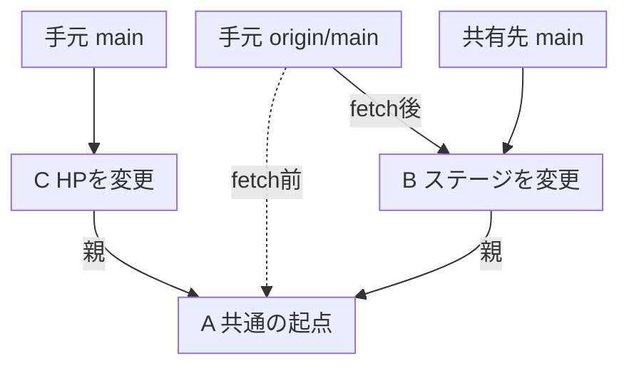

# Gitのリモート追跡ブランチ — origin/mainはサーバーそのものではない

同僚が共有先にステージの変更をpushしたとします。手元で `git status` を見ると、ステージの変更をまだ取り込んでいないのに、`behind` は表示されません。この例で `git status` が比較するのは、手元の `main` と、共有先の先端を最後に記録した手元の `origin/main` です。その記録が更新されると、作業ファイルの内容が同じでも進み・遅れの表示が変わります。[Pro GitのRemote Branches](https://git-scm.com/book/en/v2/Git-Branching-Remote-Branches)

## 二つのリポジトリに三つの参照がある

`origin` は手元のGitに登録した接続先の名前です。通常のcloneが付ける名前で、別の名前にもできます。次の三つの参照は別々の操作で更新されます。[Gitの保存モデル](/tools/git-objects.html) · [Git公式の用語集](https://git-scm.com/docs/gitglossary#def_remote_tracking_branch)

- **手元の `main`** (`refs/heads/main`) は、自分の作業ブランチの先端です。`main` 上でコミットすると、この参照が進みます。
- **手元の `origin/main`** (`refs/remotes/origin/main`) は、接続先 `origin` の `main` がどこを指していたかを手元に記録するリモート追跡ブランチです。
- **共有先の `main`** (`refs/heads/main`) は、共有先リポジトリにあるブランチの先端です。共有先が受け付けたpushなどで更新されます。

## fetchで `origin/main` が更新される

Aの時点では、三つの参照が同じコミットを指していました。そこから同僚がステージ番号を `stage=2` にするコミットBを共有先にpushし、自分はAから敵のHPを `hp=2` にするコミットCを手元で作りました。fetch前の `origin/main` は、まだAを指しています。



この例の `git fetch origin` は、共有先のBを読むために必要なオブジェクトを取得し、手元の `origin/main` をBへ更新します。手元の `main` はCのままです。GitはBの設定を `origin/main:stage.txt` として読めますが、作業ツリーの `stage.txt` は `stage=1` のままです。indexにもBの変更は入りません。[Git公式のfetchマニュアル](https://git-scm.com/docs/git-fetch#_description) · [Gitのステージング](/tools/git-staging-index.html)

全ブランチを対象とする通常のcloneでは `remote.origin.fetch` に `+refs/heads/*:refs/remotes/origin/*` が設定されます。コロンの左が共有先から取得する参照の範囲で、右が手元で更新する参照の場所です。この対応なら共有先の `refs/heads/main` の値が、手元の `refs/remotes/origin/main` に記録されます。実際に取得・更新される参照は設定やfetchの引数で変わります。[Git公式のfetchの参照対応](https://git-scm.com/docs/git-fetch#CRTB)

## ahead/behindは二つの手元の履歴を数える

`git status` は、現在の作業ブランチと、設定された上流ブランチ（upstream）を比較します。この例で `main` のupstreamは `origin/main` です。aheadは `main` だけからたどれるコミット数、behindは `origin/main` だけからたどれるコミット数です。Aのように両方からたどれるコミットや、コミットしていない編集は数に入りません。[Git公式のstatusマニュアル](https://git-scm.com/docs/git-status#_options) · [Git公式のrev-listマニュアル](https://git-scm.com/docs/git-rev-list)

| 参照と比較結果 | fetch前 | fetch後 |
| --- | --- | --- |
| 手元の `main` | C | C |
| 手元の `origin/main` | A | B |
| 共有先の `main` | B | B |
| ahead / behind | 1 / 0 | 1 / 1 |

fetch前はCとAを比較するので ahead 1 / behind 0 です。fetchすると比較相手がBに変わり、CとBがそれぞれ片側だけにあるため ahead 1 / behind 1 になります。`git status` 自体は共有先に問い合わせません。新しいfetchで基準を更新した直後でも、共有先に次のpushが届けば差が生まれます。また、手元でコミットすれば、共有先が進まなくても数は変わります。[Pro Gitの追跡ブランチ](https://git-scm.com/book/en/v2/Git-Branching-Remote-Branches)

次は手元の作業用リポジトリでの実測です。`git ls-remote` で共有先へ問い合わせると、BのIDは `54d6232` から始まります。その問い合わせだけでは手元の `origin/main` はAのままです。`rev-list` は `main` 側、`origin/main` 側の順で、片側だけからたどれるコミットを数えます。fetchの出力は更新を示す行だけを載せています。[Git公式のls-remoteマニュアル](https://git-scm.com/docs/git-ls-remote)

```text
$ git ls-remote --refs origin refs/heads/main
54d623297de0346e7577bf338ae92d7efc6068bb	refs/heads/main
$ git rev-parse --short origin/main
4a7d0c7
$ git rev-list --left-right --count main...origin/main
1	0
$ git fetch origin
   4a7d0c7..54d6232  main       -> origin/main
$ git rev-list --left-right --count main...origin/main
1	1
$ git status --short --branch
## main...origin/main [ahead 1, behind 1]
$ git show origin/main:stage.txt
stage=2
```

## 取得と統合は別の操作

Bを作業ブランチに取り込むには、取得したコミットを統合する操作が続きます。fast-forwardで先端をCからBへ移すには、BがCの子孫であることが条件です。この例のBとCはAから分岐しています。mergeなら二つの先端を親とする結果を作る方法があり、rebaseならCの変更をBの上に再適用する方法があります。`git pull` はfetchの後に統合を試みます。統合方法や、分岐したときに停止するかは設定やオプションで決まります。[Git公式のpullマニュアル](https://git-scm.com/docs/git-pull#_description) · [Gitのマージ](/tools/git-three-way-merge.html) · [Gitのrebase](/tools/git-rebase.html)

## 理解度チェック

::: details 共有先の `main` が進んでも、手元では遅れ0件になることはある？
あります。この例のfetch前は、追跡参照がAを指しています。共有先はBまで進んでいますが、手元の比較にはまだBが含まれません。
:::

::: details fetch後、`origin/main:stage.txt` に `stage=2` があると、作業ツリーもその内容になる？
この例の作業ツリーは `stage=1` のままです。`origin/main:stage.txt` はBのスナップショットを読み、作業ツリーは手元の `main` 上で編集しているファイルです。
:::

## 検証範囲

2026年11月17日に、WindowsのGit 2.39.2.windows.1を使い、SHA-1のbareリポジトリをローカルの共有先にして二つの作業用リポジトリで確認しました。通常のfetchの参照対応と `main` のupstreamを使い、共有先への通常のpush後と、もう一方のリポジトリでfetchした後の参照・コミット数・index・作業ファイルを比較しました。HTTPSやSSHの転送、浅いclone、独自の参照対応、共有先の履歴の書き換えは実測範囲外です。

## 関連項目

- [Gitの基本](/tools/git-basics.html) — 状態表示とコミットを確認する。
- [Gitの保存モデル](/tools/git-objects.html) — 参照とコミットオブジェクトの関係を読む。
- [Gitのマージ](/tools/git-three-way-merge.html) · [Gitのrebase](/tools/git-rebase.html) — 取得したコミットを作業に統合する二つの考え方を比べる。
- [Gitのreflog](/tools/git-reflog.html) — 手元で起きた参照の移動をたどる。

## 参考資料

- [Git公式 — gitglossaryのremote-tracking branch](https://git-scm.com/docs/gitglossary#def_remote_tracking_branch)
- [Git公式 — git-fetch](https://git-scm.com/docs/git-fetch#CRTB)
- [Git公式 — git-status](https://git-scm.com/docs/git-status#_options)
- [Git公式 — git-rev-list](https://git-scm.com/docs/git-rev-list)
- [Git公式 — git-ls-remote](https://git-scm.com/docs/git-ls-remote)
- [Git公式 — git-pull](https://git-scm.com/docs/git-pull#_description)
- [Pro Git — Remote Branches](https://git-scm.com/book/en/v2/Git-Branching-Remote-Branches)
