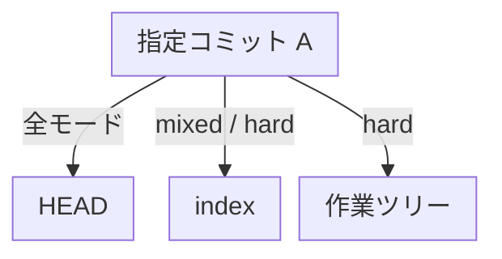

# Gitのreset — HEAD・index・作業ツリーはどう変わるのか

敵のHPを20にしたコミットがあります。そのあとHPを30にしてステージし、作業ファイルはさらに40まで編集しました。ここで一つ前のコミットをreset先に選ぶと、soft・mixed・hardのいずれも、HP10のコミットが先端になります。次にコミットする予定の内容と、実際に編集中のファイルはモードによって変わります。[Git公式のresetマニュアル](https://git-scm.com/docs/git-reset#_description)

## 三つの状態のうち、何を揃えるか

`HEAD` は現在のコミットを特定する参照です。ブランチ上では `HEAD` はブランチを指し、ブランチがコミットを指します。そのコミットのスナップショットが、差分を測る基準になります。indexは次のコミットに使うファイルの内容を持ち、作業ツリーにはいま開いて編集しているファイルがあります。`git add` のあとに再編集すれば、この三つに同じファイルの別々の版がある状態になります。[Gitの保存モデル](/tools/git-objects.html) · [Gitのステージング](/tools/git-staging-index.html)

コミットAを指定するresetでは、モードによってAに合わせる範囲が広がります。図の矢印は更新される対象を示します。



- **`--soft`** はブランチの先端をAに移します。indexと作業ファイルには、実行前の版が残ります。
- **`--mixed`** は先端を移し、indexをAの内容に揃えます。作業ファイルはそのままです。コミットを指定し、モードを省いた場合の既定です。
- **`--hard`** は先端とindexをAに揃え、作業ツリーにもAの追跡ファイルを書き出します。Aにない追跡ファイルは取り除かれます。書き出しを妨げるパスでは未追跡のファイルやディレクトリも失われる場合があります。別の検証例では、同じパスにあった未追跡の `enemy.txt` が上書きされ、無関係な未追跡ファイルの `notes.txt` は残りました。[Git公式のresetマニュアル](https://git-scm.com/docs/git-reset#_description)

図は `main` 上での例です。ブランチ上では `HEAD` が指すブランチの先端が更新されます。detached HEADでは `HEAD` がコミットを直接指すので、その直接の参照先が変わります。[Git公式のsymbolic-refマニュアル](https://git-scm.com/docs/git-symbolic-ref#_description) · [Git公式のupdate-refマニュアル](https://git-scm.com/docs/git-update-ref#_description)

## HPの値と差分表示で比べる

同じ初期状態を持つ3つの使い捨てリポジトリで、`enemy.txt` が `hp=10` のコミットAを指定しました。開始時の `main` は `hp=20` のBを指し、indexは `hp=30`、作業ツリーは `hp=40` でした。各行はそれぞれ別のリポジトリでの観察です。

| 状態 | HEADのHP | index / 作業ツリーのHP |
| --- | --- | --- |
| 実行前 | Bの20 | 30 / 40 |
| `--soft` | Aの10 | 30 / 40 |
| `--mixed` | Aの10 | 10 / 40 |
| `--hard` | Aの10 | 10 / 10 |

`--soft` を実行したリポジトリで三つの値を読んだ出力です。`a57b882` がAで、実行前のBは `70e721f` でした。`git show ':enemy.txt'` はindexの版を読みます。[Git公式のリビジョン指定](https://git-scm.com/docs/gitrevisions)

```text
PS> git rev-parse --short HEAD
a57b882
PS> git show ':enemy.txt'
hp=30
PS> Get-Content -LiteralPath enemy.txt
hp=40
PS> git status --short
MM enemy.txt
```

この例のように競合していない追跡ファイルでは、`git status --short` の1文字目はHEADとindex、2文字目はindexと作業ツリーの違いです。このファイルはsoftのあと `MM`、mixedのあと ` M` になり、hardのあと表示から消えました。実行前も `MM` でしたが、softのあとにステージ済みとして表示される差分はHP20→30からHP10→30に変わります。indexの内容は30のままで、比較の基準がBからAに移った結果です。[Git公式のstatusマニュアル](https://git-scm.com/docs/git-status#_short_format) · [Gitのステージング](/tools/git-staging-index.html)

## パスを指定するresetと、revertの違い

`git reset -- enemy.txt` は、現在のHEADからそのファイルの内容をindexに写します。読み出し元のコミットも指定できます。別の検証例で `git reset a57b882 -- enemy.txt` を実行すると、indexはAの `hp=10` になり、HEADはB、作業ファイルは `hp=40` のままでした。パスを指定する形式では、指定したパスのindexだけを更新します。[Git公式のresetマニュアル](https://git-scm.com/docs/git-reset#_description)

AからBへ進んだ履歴でコミット指定のresetをすると、ブランチの先端をAへ動かします。Bはそのブランチの先端からたどれなくなります。Bをrevertする場合は、Bの変更を打ち消す新しいコミットをBの先に追加します。取得済みの履歴と親がつながるため、共有ブランチでBの変更を取り消すときにも使えます。[Git公式のreset・restore・revertの解説](https://git-scm.com/docs/git#_reset_restore_and_revert) · [Gitのrevert](/tools/git-revert.html)

resetで先端が動いた記録は、reflogがあれば旧コミットを探す手掛かりになります。一方、作業ツリーにしかなかった `hp=40` は、先端の履歴を戻しても取り出せません。[Gitのreflog](/tools/git-reflog.html)

## 理解度チェック

::: details softで先端だけ動かしたとき、ステージ済みの差分表示も変わる？
変わります。indexはHP30のままですが、HEADがHP20のBからHP10のAに変わるため、HEADとindexを比較した差分が変わります。
:::

::: details mixedのあと、作業ファイルのHP40はどこに残る？
作業ツリーに残ります。HEADとindexはAのHP10に揃うため、HP40は未ステージの編集として表示されます。
:::

::: details Bの変更をあとから打ち消した記録を履歴に残すのはどちら？
revertです。変更を打ち消す新しいコミットを作るので、元のBも親をたどって見つかります。
:::

## 検証範囲

2026年11月17日に、WindowsのGit 2.39.2.windows.1とSHA-1の使い捨てリポジトリを使いました。`main` にいる状態で、1つの追跡ファイルにステージ済みと未ステージの編集を作り、各モードの参照先・index・作業ファイルと差分表示を確認しました。パス指定と未追跡ファイルの上書きは、それぞれ別のリポジトリで検証しました。detached HEAD、進行中のmerge、サブモジュール、スパースチェックアウトは実行していません。

## 関連項目

- [Gitのステージング](/tools/git-staging-index.html) — HEAD、index、作業ツリーの比較対象を確認する。
- パスを指定して、どの版からindexや作業ツリーへ内容を復元するかを確かめる。[Git restoreの仕組み — 履歴を動かさず、復元元と復元先を選ぶ](/tools/git-restore.html)
- [Gitの保存モデル](/tools/git-objects.html) — 参照とスナップショットの関係を読む。
- [Gitのrevert](/tools/git-revert.html) — 親を残したまま、変更を打ち消す新しいコミットを作る仕組みを読む。
- [Gitのreflog](/tools/git-reflog.html) — 先端が以前指していたコミットの探し方と限界を確認する。

## 参考資料

- [Git公式 — git-reset](https://git-scm.com/docs/git-reset#_description)
- [Git公式 — git-statusのshort形式](https://git-scm.com/docs/git-status#_short_format)
- [Git公式 — Reset, restore and revert](https://git-scm.com/docs/git#_reset_restore_and_revert)
- [Pro Git — Reset Demystified](https://git-scm.com/book/en/v2/Git-Tools-Reset-Demystified)
