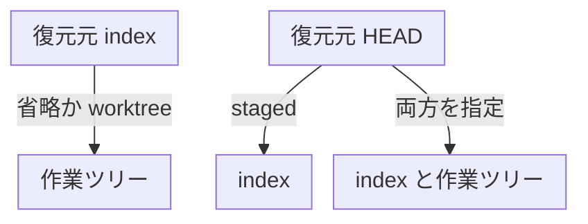

# Git restoreの仕組み — 履歴を動かさず、復元元と復元先を選ぶ

敵のHPが、最後のコミットでは20、ステージ済みの版では30、編集中のファイルでは40だとします。`git restore` でそのファイルを指定するだけなら、編集中のHPは30になります。ステージ済みの版を復元元にするためです。編集中のHP40は上書きされます。[Git公式のrestoreマニュアル](https://git-scm.com/docs/git-restore#_description)

## この記事で分かること

`git restore` がどの版を読み、次のコミットの候補や作業ファイルのどこに写すか説明できます。ステージだけを外したいときに、作業中の編集まで上書きする指定を見分けられます。

**どんなときに使うか**　編集したファイルやステージ済みの内容を、選んだ版に戻したいときです。

## パス・復元元・復元先を決める

`git restore` は、指定したパスの内容を、選んだ版から復元先へ写します。復元先は **index**（次のコミットの内容を用意する場所）と **作業ツリー**（いま編集しているファイル）です。その一方または両方を選べます。**`HEAD`** は現在のコミットを示す参照で、復元元にも使えます。操作の前後でブランチの先端と、`HEAD` が指すコミットは同じです。[Gitのステージング](/tools/git-staging-index.html) · [Git公式のreset・restore・revertの比較](https://git-scm.com/docs/git#_reset_restore_and_revert)

図は `--source` を省略したときの流れです。復元先としてindexを指定する `--staged` には、既定の復元元を `HEAD` に変える働きもあります。



- 復元先を省略するか `--worktree` だけを指定すると、既定の復元元は **index** です。
- `--staged` だけを指定すると、既定では **HEADからindex** へ写します。作業ファイルには手を加えません。
- `--staged --worktree` を指定すると、既定では **HEADから両方** に写します。
- `--source` では、コミットやタグなどが指すツリーを復元元に指定できます。復元先は引き続き `--staged` と `--worktree` で決まります。[Git公式のrestoreオプション](https://git-scm.com/docs/git-restore#_options)

## 同じファイルを、どの版からどこへ戻すか

`enemy.txt` が `hp=10` のコミットAの次に、`hp=20` のコミットBを作りました。`main` の先端はBです。同じファイルを `hp=30` にしてステージしたあと、作業ツリーだけ `hp=40` に編集しました。

表の各行では、この状態を用意した別々の使い捨てリポジトリで `enemy.txt` を復元しています。すべての行で `HEAD` はHP20のBを指します。Aを復元元にする例では `--source=a57b882` を使いました。

| やりたいことと指定 | index | 作業ツリー |
| --- | --- | --- |
| 未ステージの編集を戻す<br>オプション省略、または `--worktree` | 30 | 30 |
| 編集を残してステージを外す<br>`--staged` | 20 | 40 |
| 両方を最後のコミットに揃える<br>`--staged --worktree` | 20 | 20 |
| 作業ファイルだけAの版にする<br>Aを `--source` に指定し、`--worktree` | 30 | 10 |
| 両方をAの版にする<br>Aを `--source` に指定し、`--staged --worktree` | 10 | 10 |

作業ツリーへ復元する行では、未ステージのHP40が上書きされます。残したい編集がある場合は、作業ツリーとindexの差分を確認してから復元先を選びます。[Git公式のrestoreマニュアル](https://git-scm.com/docs/git-restore#_options)

オプションなしで `git restore -- enemy.txt` を実行した直後の出力です。`70e721f` が元の先端Bです。`git show ':enemy.txt'` はindexから読み、PowerShellの `Get-Content` は作業ファイルを読みます。[Git公式のリビジョン指定](https://git-scm.com/docs/gitrevisions)

```text
PS> git rev-parse --short HEAD
70e721f
PS> git show ':enemy.txt'
hp=30
PS> Get-Content -LiteralPath enemy.txt
hp=30
```

この例では、先端BのHP20に対して、indexにはHP30の変更が残っています。作業ツリーとindexはともにHP30なので、未ステージのHP40はなくなりました。`--staged` だけを使った例では、HP40が作業ファイルに残り、HEADのHP20がindexに入りました。[Git公式のrestoreマニュアル](https://git-scm.com/docs/git-restore#_description)

## 上書きした変更をどこまで探せるか

復元先に変更があれば、復元元の内容で上書きされます。追跡対象のパスが復元元にない場合、既定では復元先から取り除かれます。[Git公式のrestoreマニュアル](https://git-scm.com/docs/git-restore#_description)

この検証でHP40は作業ツリーにしかなく、対応する **blob**（保存したファイルのバイト列）はGitのオブジェクトデータベースにありませんでした。**reflog** が記録するのは参照の移動です。作業ツリーをHP30で上書きしたあと、以前のHP40をreflogから取り出すことはできません。[Gitのreflog](/tools/git-reflog.html) · [Git User Manualのdangling objects](https://git-scm.com/docs/user-manual#dangling-objects)

## reset・revertとの関係

コミットを指定する `reset` は、ブランチの先端を指定のコミットへ動かし、モードによってindexや作業ツリーも更新します。パスを指定する `reset` は、`restore --staged` と同じく、指定パスのindexを更新する使い方があります。`revert` は変更を打ち消す新しいコミットを作ります。`restore` で作業ファイルやindexを更新した結果を履歴に残すときは、その結果を別にコミットします。[Git公式のreset・restore・revertの比較](https://git-scm.com/docs/git#_reset_restore_and_revert) · [Gitのreset](/tools/git-reset.html) · [Gitのrevert](/tools/git-revert.html)

## 補足

新しいファイルをステージしたあと、`HEAD` からそのパスのindexを復元する場合を考えます。`HEAD` にそのパスがなければindexから外れ、作業ファイルは未追跡として残ります。この削除条件は公式資料で確認しました。

別の `--staged` の例では、HP30がindexから外れたあとも、`git add` で作られたblobが残りました。ステージした版を後から探し出せるかは、オブジェクトが残っているかどうかなどに依存します。

## 要点

- `git restore` は、指定したパスのindexや作業ツリーを更新します。HEADとブランチの先端は動きません。
- オプション省略時はindexから作業ツリーへ写します。`--staged` を含む場合の既定の復元元はHEADです。
- 作業ツリーへの復元で未ステージの編集が失われることがあります。作業ツリーにしかなかった内容をreflogからは取り出せません。

## 理解度チェック

::: details HP20をコミットしたあと、HP30をステージし、HP40に再編集した。オプションを省いたrestoreで作業ファイルはどの値になる？
HP30です。既定ではindexから作業ツリーへ写します。
:::

::: details `--staged --worktree` を指定し、`--source` を省略した。indexと作業ファイルはどこから戻る？
両方ともHEADから復元されます。この例ではHP20です。
:::

::: details `--source` に古いコミットを指定したら、ブランチの先端も古いコミットへ移る？
ブランチの先端はそのままです。古いコミットのツリーは復元元として読まれます。
:::

## 検証範囲

2026年11月17日に、WindowsのGit 2.39.2.windows.1と独立したSHA-1リポジトリ6つを使いました。`main` 上の追跡テキスト1ファイルで、表の組み合わせを実行しました。各実行前後で、`main` と `HEAD` の参照先、コミット履歴、indexと作業ファイルの内容を比較しました。復元元にパスがない場合は公式資料に基づく説明です。競合中のindex、`--patch`、サブモジュール、スパースチェックアウトは実行していません。

## 関連項目

- [Gitのステージング](/tools/git-staging-index.html) — HEAD・index・作業ツリーの内容を比べる。
- 編集途中の内容を保存し、後から作業ツリーやindexに再適用する仕組みを読む。[Git stashの内部構造 — 作業ツリーとindexの退避・再適用を追う](/tools/git-stash.html)
- [Gitのreset](/tools/git-reset.html) — コミットを指定した形式とパスを指定した形式を比べる。
- [Gitのrevert](/tools/git-revert.html) — 履歴に変更を打ち消した記録を残す仕組みを読む。
- [Gitのreflog](/tools/git-reflog.html) — 参照の移動の記録で探せる範囲を確認する。

## 参考資料

- [Git公式 — git-restore](https://git-scm.com/docs/git-restore)
- [Git公式 — Reset, restore and revert](https://git-scm.com/docs/git#_reset_restore_and_revert)
- [Git公式 — gitrevisions](https://git-scm.com/docs/gitrevisions)
- [Git User Manual — Dangling objects](https://git-scm.com/docs/user-manual#dangling-objects)
