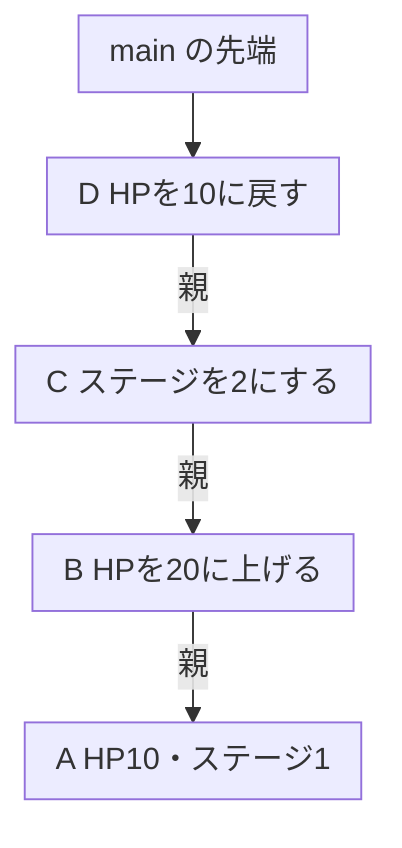

# Gitのrevert — 履歴を消さずに変更を打ち消す仕組み

敵のHPを上げたあと、別のコミットでステージ番号を変えたとします。HPだけを前の値に戻したいなら、Gitの `revert` でHPを下げる変更を新しいコミットとして積めます。後から履歴を読むと、HPを上げた経緯と取り消した経緯の両方が分かります。[Git公式のrevertマニュアル](https://git-scm.com/docs/git-revert#_description)

## 親との差を逆向きにし、現在の先端へ適用する

通常のコミットBが一つの親Aを持つとき、Bが導入した変更はAからBへの差として表せます。GitはBをrevertするとき、BからAへの逆向きの変更を、実行時の先端Cに適用しようとします。適用が成功して逆変更が生じると、通常の実行ではCを親とするDが作られます。後からCで加えた変更も結果に残り得ます。[Git公式のrevertマニュアル](https://git-scm.com/docs/git-revert#_description) · [Gitの保存モデル](/tools/git-objects.html)

図の矢印は、コミットからその親へ向きます。最初は `main` がCを指していて、revert後はDを指します。Dから親をたどるとC、B、Aの順に到達します。



ブランチの履歴からBを抜くためにCをAの上に作り直せば、Cの親が変わるので別のコミットになります。共有済みの履歴でその先端を置き換えると、元のCを取得した他の人との履歴が分かれます。revertでDを積む場合はDがCの子なので、共有先がCにいるなら、履歴上は先端を前に進める更新です。[Gitのrebase](/tools/git-rebase.html) · [Gitのリモート追跡ブランチ](/tools/git-remote-tracking.html)

## HPを戻しても、ステージ番号は残る

Bが `enemy.txt` だけを変え、Cが `stage.txt` だけを変えた場合の実測です。Dの `enemy.txt` はAと同じ `hp=10` ですが、`stage.txt` はCで設定した `stage=2` です。AとDを比べると、ステージ番号に差が残ります。

| コミット | `enemy.txt` | `stage.txt` |
| --- | --- | --- |
| A 当初の状態 | `hp=10` | `stage=1` |
| B HPを上げる | `hp=20` | `stage=1` |
| C ステージを変える | `hp=20` | `stage=2` |
| D Bをrevertする | `hp=10` | `stage=2` |

revert後の履歴とファイルを読んだ出力です。先頭にDが加わり、Bはその下に残っています。`git merge-base --is-ancestor 72445d2 HEAD` の終了コードは `0` で、Bが現在の先端の祖先であることも確かめられました。[Git公式のmerge-baseマニュアル](https://git-scm.com/docs/git-merge-base#_operation_modes)

```text
$ git log -4 --format='%h %s'
f49a284 Revert "B: Raise enemy HP"
0eb6c8c C: Advance stage
72445d2 B: Raise enemy HP
63fe8c4 A: Initial enemy and stage
$ git show HEAD:enemy.txt
hp=10
$ git show HEAD:stage.txt
stage=2
$ git diff --name-only 63fe8c4 HEAD
stage.txt
```

## 競合と、ゲームの仕様上の不整合

### 後続コミットが同じ行を変えた場合

Cの代わりに、Bの後で同じ行を `hp=30` にしたとします。Bの逆変更は、HPを `20` から `10` に変えるものです。現在の `30` と逆変更で求める `10` のどちらを残すかは、変更箇所の意図によって決まります。独立した例では、Gitが `enemy.txt` の競合を報告して停止し、新しいコミットは作られませんでした。[Git公式のrevertマニュアル](https://git-scm.com/docs/git-revert) · [Git公式の競合表示](https://git-scm.com/docs/git-merge#_how_conflicts_are_presented)

### 別のファイルが元の変更を前提にしていた場合

Bで敵のHPを `20` に上げたあと、別の設定ファイル `bonus.txt` に「HPが20以上の敵だけがボーナス対象」という条件（`min_hp=20`）を追加したとします。Bをrevertすると、Gitは `enemy.txt` のHPを `10` に戻し、条件の設定は残します。テキストの競合がなくても、この敵を対象にするという設計上の意図は満たせなくなります。別の検証例では、二つの設定値を読み、`hp >= min_hp` がrevert前に `true`、revert後に `false` になることを確かめました。

## マージコミットでは基準の親を選ぶ

マージコミットMには複数の親があります。`git revert -m 1 M` の `1` は、Mがその第1親に対して導入した変更を打ち消す、という指定です。第1親も第2親も元の親関係に残ります。あとで同じ作業ブランチを再びmergeしても、すでに祖先にあるコミットの変更が自動的にもう一度入るとは限りません。どの変更が入るかは、後続のコミットとマージベースによって変わります。このケースは公式資料での確認にとどめました。[Git公式の `--mainline`](https://git-scm.com/docs/git-revert#_options) · [Git公式のマージ取り消し解説](https://github.com/git/git/blob/v2.39.2/Documentation/howto/revert-a-faulty-merge.txt) · [Gitのマージ](/tools/git-three-way-merge.html)

## 理解度チェック

::: details Dを作ったあと、元のBはどこにある？
Dから親をたどるとCの次がBです。Bの変更を打ち消した操作は、Cの先にDとして記録されています。
:::

::: details Bを取り消すとステージ番号も1に戻る？
この例では `stage=2` のままです。Bが変えたのは `enemy.txt` で、ステージ番号の変更はCにあります。
:::

::: details テキストの競合がなければ、ゲームの仕様も保たれる？
別の設定が打ち消された変更を前提にしている場合は、Gitがコミットを作れてもその前提が崩れます。HPが10に戻ると、HP20以上という条件を満たさなくなります。
:::

## 検証範囲

2026年11月17日に、WindowsのGit 2.39.2.windows.1と独立したSHA-1リポジトリ3つを使いました。クリーンな作業ツリーで、親が一つのコミットを `git revert --no-edit` で取り消しました。別ファイルの後続変更を保持する例、同じ行で競合する例、競合なく適用できても仕様上の条件が崩れる例を確認しました。ボーナスの判定は設定ファイルを読む簡単な検査で、ゲームエンジン上の挙動、マージコミットのrevertとその後のmerge、競合解消後の結果、複数コミットを一度に取り消す場合は未検証です。

## 関連項目

- [Gitの基本](/tools/git-basics.html) — 差分とコミットの関係を読む。
- [Gitの保存モデル](/tools/git-objects.html) — スナップショットと親IDがコミットに入る仕組みを確認する。
- 変更を打ち消すコミットを積む場合と、ブランチの先端を動かす場合を比べる。[Gitのreset — HEAD・index・作業ツリーはどう変わるのか](/tools/git-reset.html)
- [Gitのマージ](/tools/git-three-way-merge.html) — テキストの競合と意味上の不整合を比べる。
- [Gitのrebase](/tools/git-rebase.html) — 親を変えてコミットを作り直したときの履歴を読む。

## 参考資料

- [Git公式 — git-revert](https://git-scm.com/docs/git-revert)
- [Git公式 — git-merge-base](https://git-scm.com/docs/git-merge-base#_operation_modes)
- [Git公式 — git-merge](https://git-scm.com/docs/git-merge#_how_conflicts_are_presented)
- [Git公式 — Revert a faulty merge（Git 2.39.2）](https://github.com/git/git/blob/v2.39.2/Documentation/howto/revert-a-faulty-merge.txt)
