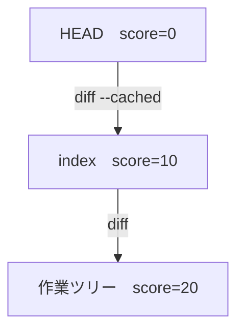

# Gitのステージング — 作業ツリー・index・HEAD

ゲームの検証用の `score.txt` を `score=0` から `score=10` に変え、`git add` したとします。その後で `score=20` に変えても、通常のコミットに入るのは `score=10` です。次のコミットがファイル名や内容をどう参照するか、この例で見ていきます。[Gitの基本](/tools/git-basics.html)

## この記事で分かること

同じファイルについて、編集中・ステージ済み・コミット済みのどの版を見ているか説明できます。差分で何と何を比べているか、次のコミットに何が入るかを判断できます。

**どんなときに使うか**　`git add` のあとで編集を続けて、次のコミットに入る版を確かめたいときです。

## 同じパスに3つの版がある

- **作業ツリー**は、エディターで編集・保存する場所です。ここでは `score=20` です。
- **index**（ステージング領域）は、次のコミットに入れる候補を持ちます。`git add` したときの `score=10` を指します。
- **HEAD** は現在のコミットを示す参照です。そのコミットの **tree**（ファイル名と内容を結び付ける記録）をたどると `score=0` が読めます。

`git add` はindexを更新します。再編集後の内容も入れたいときは、もう一度ステージします。[git-add](https://git-scm.com/docs/git-add#_description) · [Git公式のデータモデル](https://git-scm.com/docs/gitdatamodel#index)



図の矢印は、差分の比較元から比較先へ向いています。

- `git diff -- score.txt` ではindexの `score=10` が `-`、作業ツリーの `score=20` が `+` です。
- `git diff --cached -- score.txt` ではHEADの `score=0` が `-`、indexの `score=10` が `+` です。比較するコミットを省略し、HEADにコミットがある場合の説明です。[git-diff](https://git-scm.com/docs/git-diff#_description)

このとき `git status --short` は、`score.txt` に `MM`、作業ツリーにだけある `bonus.txt` に `??` を表示しました。競合のない例で、左の `M` はHEADとindexの間、右の `M` はindexと作業ツリーの間に変更があるという意味です。この `bonus.txt` は未追跡で、indexのコミット候補に登録されていません。通常の `git diff` と `git diff --cached` にもこの新規ファイルの内容は出ません。[git-statusの短縮形式](https://git-scm.com/docs/git-status#_short_format) · [git-diff](https://git-scm.com/docs/git-diff#_description)

## indexは次のスナップショットの項目を持つ

indexには、次のコミットで使うパスと保存内容の対応が入ります。通常のファイルの項目には、パス、モード、blob IDなどがあります。**blob** は保存したファイルのバイト列です。

`git ls-files --stage` はモード、オブジェクトID、ステージ番号、パスの順に表示します。この例の `0` は競合していない項目です。`git show ':score.txt'` はindexが指すblobを、`git show 'HEAD:score.txt'` は現在のコミットが指すblobを読みます。[Git公式のデータモデル](https://git-scm.com/docs/gitdatamodel#index) · [git-ls-files](https://git-scm.com/docs/git-ls-files#_output) · [gitrevisions](https://git-scm.com/docs/gitrevisions#_specifying_revisions)

競合時のステージ番号は補足で扱います。具体例はマージの記事にあります。[Gitのマージ](/tools/git-three-way-merge.html)

```text
$ git ls-files --stage
100644 2fa992c0 0  keep.txt
100644 05cbe44d 0  score.txt
$ git show ':score.txt'
score=10
$ git show 'HEAD:score.txt'
score=0
```

表示したオブジェクトIDは先頭8桁です。

初回のコミットから変更していない `keep.txt` もindexにあります。次のtreeでもこのパスから同じblobを参照するので、変更のないファイルもスナップショットに含まれます。作業ツリーだけの `bonus.txt` は一覧にありません。`score.txt` の項目からは、差分を適用しなくてもステージした `score=10` を読み取れます。[Gitの保存モデル](/tools/git-objects.html)

## 次のコミットに入る内容を確かめる

独立した検証リポジトリでは、コミットする前に `git write-tree` で現在のindexからtreeを書き出しました。このコマンドが作るのはtreeオブジェクトで、HEADは進みません。そのまま、内容を選ぶオプションやパス指定を付けずにコミットすると、新しい `HEAD^{tree}` は先ほど作ったtreeと同じIDになりました。[git-write-tree](https://git-scm.com/docs/git-write-tree) · [git-commit](https://git-scm.com/docs/git-commit#_description)

コミット前の `git write-tree` と、コミット後の `git rev-parse 'HEAD^{tree}'` は、どちらも `255aed01…` を返しました。`git ls-tree HEAD` で新しいtreeを読むと、`keep.txt` と `score.txt` の2項目があり、上のindexと同じblob IDを指しています。

コミット後、HEADとindexは `score=10`、作業ツリーには `score=20` が残りました。このため `git diff --cached` は空になり、`git diff` には `10 → 20` が残ります。`keep.txt` は新しいtreeにもあり、`bonus.txt` は未追跡のままです。[git-diff](https://git-scm.com/docs/git-diff#_description) · [git-commit](https://git-scm.com/docs/git-commit#_description)

## 補足

`git diff --staged` は `git diff --cached` と同じ意味です。

マージ競合中のステージ番号1〜3は、基準・現在側・相手側の版を区別します。

`git commit -a` を使うと、Gitがすでに追跡しているファイルの変更や削除を先にステージします。新規の未追跡ファイルは `-a` の対象外です。コミット時に既知のパスを指定する方法にも別の規則があるので、この例ではindexをそのまま採用する場合に絞っています。[git-commit](https://git-scm.com/docs/git-commit#_description)

## 要点

- `git add` のあとに再編集すると、HEAD・index・作業ツリーに別々の版が残ります。
- `git diff` はindexと作業ツリーを、`git diff --cached` はここではHEADとindexを比べます。
- 通常のコミットはindexを使います。変更していない追跡ファイルも次のスナップショットに含まれ、未追跡ファイルは入りません。

## 理解度チェック

::: details score=20を保存した直後、通常のコミットに入る値は？
最後にステージした `score=10` です。`score=20` は作業ツリー側にあり、`git diff` でその差を確認できます。
:::

::: details なぜ変更していない keep.txt も index にある？
indexの項目は次のtreeを組み立てるために使います。変更していないパスも次のスナップショットに含まれ、元と同じblobを参照できます。
:::

## 検証範囲

2026年11月17日にWindowsのGit 2.39.2.windows.1で、LFのテキストファイルを置いた独立した検証リポジトリを使いました。`git ls-files --stage`、2種類の `git diff`、`git status --short`、`git show`、コミット前後のtreeと作業ツリーを照合しました。競合や `git commit -a`・パス指定の動作は、今回の実測には含めていません。

## 関連項目

- [Gitの基本](/tools/git-basics.html) — 作業ツリーとステージングを操作し、差分を読んでみる。
- [Gitの保存モデル](/tools/git-objects.html) — 次のスナップショットが、treeとblobとしてどう保存されるかを読む。
- indexと作業ツリーに異なる版がある途中状態を、退避して再適用する仕組みを読む。[Git stashの内部構造 — 作業ツリーとindexの退避・再適用を追う](/tools/git-stash.html)
- 同じパスの内容をHEADからindexへ、indexから作業ツリーへ戻す場合を比べる。[Git restoreの仕組み — 履歴を動かさず、復元元と復元先を選ぶ](/tools/git-restore.html)
- ブランチの先端を動かすとき、indexと作業ツリーをどこまで更新するかを比べる。[Gitのreset — HEAD・index・作業ツリーはどう変わるのか](/tools/git-reset.html)
- 同じ行を編集したマージ競合の例で、共通祖先と両側の内容をindexのステージ1・2・3から読む。[Gitのマージ — 共通祖先と3-way merge](/tools/git-three-way-merge.html)

## 参考資料

- [Git公式 — データモデルのindex](https://git-scm.com/docs/gitdatamodel#index)
- [Git公式 — git-add](https://git-scm.com/docs/git-add#_description) · [git-ls-files](https://git-scm.com/docs/git-ls-files#_output)
- [Git公式 — git-diff](https://git-scm.com/docs/git-diff#_description) · [git-status](https://git-scm.com/docs/git-status#_short_format)
- [Git公式 — git-write-tree](https://git-scm.com/docs/git-write-tree) · [git-commit](https://git-scm.com/docs/git-commit#_description)
