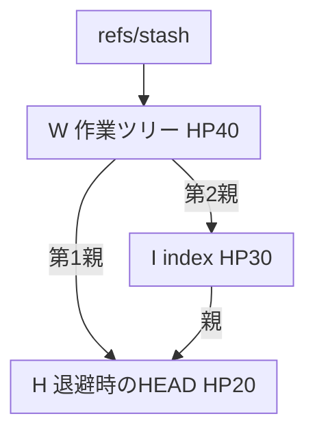

# Git stashの内部構造 — 作業ツリーとindexの退避・再適用を追う

敵のHPを20から30にしてステージし、そのあと作業ファイルだけ40に編集しました。別の修正に移るため、途中の状態を `git stash push` で退避すると、GitはHP30とHP40の両方を保存します。どこまでステージしていたかも、保存される情報の一部です。[Git公式のstashマニュアル](https://git-scm.com/docs/git-stash#_description)

## H・I・Wのコミットで二つの途中状態を表す

通常の `git stash push` で作った退避をWと呼びます。Wのtreeには、追跡ファイルの作業ツリーの状態が入ります。Wの第1親Hは退避時のHEADで、第2親Iはindexの内容を保存したコミットです。Iの親もHです。この構造から、退避したファイルの内容と、その作業を始めた基準を一緒に読めます。[Git公式のstashの構造](https://git-scm.com/docs/git-stash#_discussion) · [Gitの保存モデル](/tools/git-objects.html)

図の矢印は、参照からコミットへ、またはコミットから親へ向いています。この例の `main` はHを指し続けます。



最新の退避は `refs/stash` が指します。以前の退避はこの参照のreflogから `stash@{1}` などでたどります。図のWが親として持つのは、その作業の基準HとindexのIです。以前のstashを探す経路は `refs/stash` のreflogです。[Git公式のstashマニュアル](https://git-scm.com/docs/git-stash#_description) · [Gitのreflog](/tools/git-reflog.html)

次は独立した検証リポジトリで、stashを作った直後に読んだ結果です。`log` の出力は先頭がコミットID、そのあとが親のIDです。`stash@{0}^1` がH、`stash@{0}^2` がIです。作業中の `main` とHのIDはともに `08d40dd` でした。通常の `stash push` 後、indexと作業ファイルのHPは20に戻り、元のHP30とHP40は退避から読めます。

```text
$ git log -1 --format='%h %p' 'stash@{0}'
85de67c 08d40dd 8d53360
$ git log -1 --format='%h %p' 'stash@{0}^2'
8d53360 08d40dd
$ git show 'stash@{0}:enemy.txt'
hp=40
$ git show 'stash@{0}^2:enemy.txt'
hp=30
$ git show 'stash@{0}^1:enemy.txt'
hp=20
```

## 未追跡ファイルを含めるかで対象が変わる

この例では、未追跡の `notes.txt` も置いていました。通常の `stash push` ではこのファイルは退避に含まれず、作業ツリーに残りました。Wのファイル一覧に入っていたのは、追跡していた `enemy.txt` と `stage.txt` だけです。[Git公式のstashオプション](https://git-scm.com/docs/git-stash#_options)

`--include-untracked`（`-u`）なら、無視対象以外の未追跡ファイルも保存して作業ツリーから取り除きます。別の検証ではWに第3親ができ、そのコミットのtreeから `notes.txt` を読めました。`--all`（`-a`）は無視対象のファイルも含める指定です。`--all` は公式資料での確認にとどめました。[Git公式のstashオプション](https://git-scm.com/docs/git-stash#_options)

## applyとpopで何が戻るか

Hの状態に退避を再適用すると、HP40を作業ファイルに戻せます。検証したGit 2.39.2の通常の `apply` では、indexはHP20、作業ツリーはHP40になりました。`--index` を指定すると、ステージ済みの区切りも戻そうとするので、indexはHP30、作業ツリーはHP40になりました。新規ファイルや競合がある場合のindexの扱いは、ここで用いた既存の追跡ファイル1つの例とは条件が異なります。[Git公式のstashオプション](https://git-scm.com/docs/git-stash#_options) · [Gitのステージング](/tools/git-staging-index.html)

| Hに再適用した操作 | indexのHP | 作業ツリーのHP |
| --- | --- | --- |
| `apply` | 20 | 40 |
| `apply --index` | 30 | 40 |
| `pop` | 20 | 40 |

Git 2.52以降には、applyやpopを `--index` 付きとして動かす `stash.index` 設定もあります。既定値は `false` です。表の結果を比べるときは、使っている版とこの設定も確認します。[Git 2.52のstash設定](https://github.com/git/git/blob/v2.52.0/Documentation/config/stash.adoc#L9-L11)

`apply` は適用後もstashの一覧に記録を残します。`pop` は適用に成功するとその記録を一覧から外します。検証でも、applyした2例ではWが残り、成功したpopの例では一覧が空になりました。これらはそれぞれ初期状態から作った別の検証例です。[Git公式のstashコマンド](https://git-scm.com/docs/git-stash#_commands)

## 再適用する場所が変わると競合する

退避後にHPを50にするコミットCを作ったとします。保存した作業はHのHP20からHP40への変更で、いまのCは同じ行をHP50に変えています。Gitは退避の基準H、保存したW、現在の状態を照合して適用します。同じ箇所で二つの値が競合すれば、どちらを使うかを解決する必要があります。[Git公式のstashコマンド](https://git-scm.com/docs/git-stash#_commands) · [Gitの3-way merge](/tools/git-three-way-merge.html)

この検証でCにpopすると、終了コードは1で `UU enemy.txt` と表示されました。競合したindexの3つの版は、基準のHP20、現在のHP50、退避したHP40でした。HEADはCにとどまり、Wは一覧に残りました。失敗時にも作業ツリーやindexには競合状態や適用できた変更が残り得ます。`--index` を使う場合も、ステージ済みの状態の復元が競合で失敗することがあります。[Git公式のstashマニュアル](https://git-scm.com/docs/git-stash#_commands)

## 退避の保持とバックアップの範囲

stashは、そのリポジトリ内のコミット、参照、reflogを使って途中状態を記録します。通常のブランチのpushやcloneでstashの一覧まで共有される仕組みではありません。Git 2.51以降には明示的な `export` と `import` もありますが、今回の検証対象には含めていません。[Git公式のstashマニュアル](https://git-scm.com/docs/git-stash#_commands)

通常の `stash push` に含まれない未追跡ファイルや無視対象ファイルは、保存したつもりでも退避の外に残ります。同じディスク上のリポジトリにだけ退避した場合、そのディスクの故障に対する別のコピーも作られません。また、pop成功やdropで一覧から外れた退避は、ほかの参照でも保持されなければオブジェクトの回収対象になり得ます。退避対象と保存先を確認せずに、プロジェクト全体のバックアップとして扱うことはできません。[Git公式のstashマニュアル](https://git-scm.com/docs/git-stash#_commands) · [Git公式のgcマニュアル](https://git-scm.com/docs/git-gc#_notes)

## 理解度チェック

::: details 退避時、indexがHP30、作業ファイルがHP40なら、どちらが保存される？
両方です。Wのtreeは作業ファイルのHP40を持ち、Wの第2親IのtreeはindexのHP30を持ちます。
:::

::: details popで競合したらstashの一覧からも消える？
この競合では記録が残ります。今回もWは一覧に残り、作業ツリーとindexは競合した状態になりました。
:::

::: details 通常のstash pushで未追跡のメモも退避される？
通常は含まれません。今回の `notes.txt` は作業ツリーに残りました。未追跡ファイルを含める `--include-untracked` では別のコミットに保存されました。
:::

## 検証範囲

2026年11月18日に、WindowsのGit 2.39.2.windows.1と独立したSHA-1リポジトリ6つを使いました。HP20をコミットし、HP30をステージしてHP40に再編集した状態から、通常の `stash push`、apply、applyの `--index`、成功するpop、HP50に変えたあとの競合するpop、`--include-untracked` の保存を、それぞれ使い捨て環境で確認しました。本文の既定のapplyは、この版と条件での観察です。`stash.index`、export/import、`--all`、`--keep-index`、部分退避、サブモジュール、複数ファイルの競合、オブジェクトの回収時期は実測していません。

## 関連項目

- [Gitのステージング](/tools/git-staging-index.html) — ステージ済みと未ステージの版を分けて読む。
- [Git restoreの仕組み](/tools/git-restore.html) — 保存元の版からindex・作業ツリーへ写す操作を確認する。
- [Gitのreflog](/tools/git-reflog.html) — 参照の更新記録とオブジェクトの保持の関係を読む。
- [Gitの保存モデル](/tools/git-objects.html) · [Gitの3-way merge](/tools/git-three-way-merge.html) — tree・親関係と、異なる変更を照合する仕組みを確認する。

## 参考資料

- [Git公式 — git-stash](https://git-scm.com/docs/git-stash)
- [Git公式 — gitrevisions](https://git-scm.com/docs/gitrevisions)
- [Git公式 — git-gc](https://git-scm.com/docs/git-gc#_notes)
- [Git 2.52 — stash.index設定](https://github.com/git/git/blob/v2.52.0/Documentation/config/stash.adoc#L9-L11)
