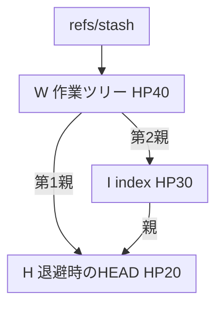

# Git stashの内部構造 — 作業ツリーとindexの退避・再適用を追う

敵のHPを20から30にしてステージし、そのあと作業ファイルだけ40に編集しました。別の修正に移るため、途中の状態を `git stash push` で退避すると、GitはHP30とHP40の両方を保存します。どこまでステージしていたかも、保存される情報の一部です。[Git公式のstashマニュアル](https://git-scm.com/docs/git-stash#_description)

## この記事で分かること

退避に入る内容と、戻したあと一覧に残るかどうかを判断できます。作業ファイルとステージ済みの版がどう保存され、再適用でなぜ競合するのかを説明できます。

**どんなときに使うか**　変更をコミットする前に、別の修正へ一時的に切り替えるときに使います。

## 退避する・一覧で確かめる・戻す

`git stash push` で追跡ファイルの途中状態を退避します。この例では、index（次のコミットに入れる内容を用意する場所）のHPは30、作業ツリー（手元の編集用ファイル）のHPは40です。通常の `stash push` 後は、どちらも退避時のHEAD（その時点のコミット）のHP20に戻ります。以下ではこのコミットをHと呼びます。

一覧で戻したい退避を確かめます。`stash@{0}` は最新の退避、`stash@{1}` はその一つ前です。波括弧の数字は、最新を0とする一覧での位置です。

選んだ退避の変更を、`apply` または `pop` で再適用します。`apply` は適用後も一覧に記録を残します。`pop` は適用に成功すると、その記録を一覧から外します。別々に初期状態から始めた検証で、applyした2例では記録が残り、成功したpopの例では一覧が空になりました。[Git公式のstashコマンド](https://git-scm.com/docs/git-stash#_commands)

## applyとpopで何が戻るか

Hの状態に退避を再適用すると、HP40を作業ファイルに戻せます。検証したGit 2.39.2では、通常の `apply` でindexはHP20、作業ツリーはHP40になりました。`--index` を指定すると、ステージ済みの区切りも戻そうとします。この例のindexはHP30、作業ツリーはHP40になりました。[Git公式のstashオプション](https://git-scm.com/docs/git-stash#_options)

| Hに再適用した操作 | indexのHP | 作業ツリーのHP |
| --- | --- | --- |
| `apply` | 20 | 40 |
| `apply --index` | 30 | 40 |
| `pop` | 20 | 40 |

表は既存の追跡ファイル1つを、この版のGitで確認した結果です。新規ファイルや競合がある場合には条件が異なります。版や設定によってもindexの扱いが変わります。

## 未追跡ファイルを含めるかで対象が変わる

この例では、Gitがまだ追跡していない `notes.txt` も置いていました。通常の `stash push` では退避に含まれず、作業ツリーに残りました。退避のファイル一覧には、追跡していた `enemy.txt` と `stage.txt` だけが入りました。[Git公式のstashオプション](https://git-scm.com/docs/git-stash#_options)

`--include-untracked`（`-u`）なら、無視対象以外の未追跡ファイルも保存して作業ツリーから取り除きます。`--all`（`-a`）は無視対象のファイルも含める指定です。今回、`--all` は公式資料で確認しました。[Git公式のstashオプション](https://git-scm.com/docs/git-stash#_options)

## H・I・Wのコミットで二つの途中状態を表す

通常の `git stash push` で作った退避をWと呼びます。Wのtree（ファイルの構成を表すデータ）から、追跡ファイルの作業ツリーの状態を読めます。Wの第1親は退避時のHEADであるHです。第2親のIはindexの内容を保存したコミットです。Iの親もHです。この構造から、退避したファイルの内容と、その作業を始めた基準を一緒に読めます。[Git公式のstashの構造](https://git-scm.com/docs/git-stash#_discussion) · [Gitの保存モデル](/tools/git-objects.html)

図の矢印は、参照からコミットへ、またはコミットから親へ向いています。この例の `main` はHを指し続けます。



最新の退避を指す参照が `refs/stash` です。reflogは、この参照が以前どこを指していたかの記録です。`stash@{1}` などの一覧の番号で、reflogから以前の退避をたどれます。図のWの親は、退避した作業の基準Hと、indexを保存したIです。[Git公式のstashマニュアル](https://git-scm.com/docs/git-stash#_description) · [Gitのreflog](/tools/git-reflog.html)

`stash@{0}^2` の `^2` は、一覧で選んだ最新の退避の第2親を指定します。この例では `stash@{0}^1` が第1親のH、`stash@{0}^2` が第2親のIです。

indexと作業ファイルに別の版が入る例は、ステージングの記事で確認できます。[Gitのステージング](/tools/git-staging-index.html)

次は独立した検証リポジトリで、stashを作った直後に読んだ結果です。`log` の出力は先頭がコミットID、そのあとが親のIDです。作業中の `main` とHのIDはともに `08d40dd` でした。indexと作業ファイルがHP20に戻ったあとも、元のHP30とHP40は退避から読めます。

```text
$ git log -1 --format='%h %p' 'stash@{0}'
85de67c 08d40dd 8d53360
$ git log -1 --format='%h %p' 'stash@{0}^2'
8d53360 08d40dd
$ git show 'stash@{0}:enemy.txt'
hp=40
$ git show 'stash@{0}^2:enemy.txt'
hp=30
$ git show 'stash@{0}^1:enemy.txt'
hp=20
```

## 再適用する場所が変わると競合する

退避後にHPを50にするコミットCを作ったとします。保存した作業はHのHP20からHP40への変更で、いまのCは同じ行をHP50に変えています。Gitは退避の基準H、保存したW、現在の状態を照合して適用します。同じ箇所で二つの値が競合すれば、どちらを使うかを解決する必要があります。[Git公式のstashコマンド](https://git-scm.com/docs/git-stash#_commands) · [Gitの3-way merge](/tools/git-three-way-merge.html)

この検証でCにpopすると、終了コードは1で `UU enemy.txt` と表示されました。競合したindexの3つの版は、基準のHP20、現在のHP50、退避したHP40でした。HEADはCにとどまり、Wは一覧に残りました。失敗時にも作業ツリーやindexには競合状態や適用できた変更が残り得ます。`--index` を使う場合も、ステージ済みの状態の復元が競合で失敗することがあります。[Git公式のstashマニュアル](https://git-scm.com/docs/git-stash#_commands)

## 退避の保持とバックアップの範囲

stashは、そのリポジトリ内のコミット、参照、reflogを使って途中状態を記録します。通常のブランチのpushやcloneでstashの一覧まで共有される仕組みではありません。

通常の `stash push` に含まれない未追跡ファイルや無視対象ファイルは、保存したつもりでも退避の外に残ります。同じディスク上のリポジトリにだけ退避した場合、そのディスクの故障に対する別のコピーも作られません。また、pop成功やdropで一覧から外れた退避は、ほかの参照でも保持されなければオブジェクトの回収対象になり得ます。退避対象と保存先を確認せずに、プロジェクト全体のバックアップとして扱うことはできません。[Git公式のstashマニュアル](https://git-scm.com/docs/git-stash#_commands) · [Git公式のgcマニュアル](https://git-scm.com/docs/git-gc#_notes)

## 補足

### Gitの版とindexの復元設定

表の `apply` と `pop` は、`stash.index` が導入される前のGit 2.39.2で、`--index` を付けずに実行した結果です。Git 2.52以降で `stash.index=true` を設定すると、`--index` を省略したapplyやpopでもindexの復元を試みます。この設定の既定値は `false` です。[Git 2.52のstash設定](https://git-scm.com/docs/git-stash/2.52.0#_configuration)

### 未追跡ファイルを保存したコミット

`--include-untracked` を使った別の検証ではWに第3親ができ、そのコミットのtreeから `notes.txt` を読めました。

### 退避の書き出しと読み込み

Git 2.51以降には明示的な `export` と `import` もありますが、今回の検証対象には含めていません。[Git公式のstashマニュアル](https://git-scm.com/docs/git-stash#_commands)

## 要点

- 通常の `stash push` は、追跡ファイルの作業ツリーとindexの状態を保存します。未追跡ファイルを含めるには指定が必要です。
- `stash@{0}` は最新の退避です。`^2` を付けると、その退避の第2親に保存したindexを指します。
- `apply` は一覧に記録を残し、`pop` は適用に成功すると一覧から外します。再適用が競合したときは、記録が残っても作業ツリーやindexの確認が必要です。
- 退避に入るファイルと保存先には範囲があります。通常のpushやcloneで退避は共有されません。

## 理解度チェック

::: details 退避時、indexがHP30、作業ファイルがHP40なら、どちらが保存される？
両方です。Wのtreeは作業ファイルのHP40を持ち、Wの第2親IのtreeはindexのHP30を持ちます。
:::

::: details popで競合したらstashの一覧からも消える？
この競合では記録が残ります。今回もWは一覧に残り、作業ツリーとindexは競合した状態になりました。
:::

::: details 通常のstash pushで未追跡のメモも退避される？
通常は含まれません。今回の `notes.txt` は作業ツリーに残りました。未追跡ファイルを含める `--include-untracked` では別のコミットに保存されました。
:::

## 検証範囲

2026年11月18日に、WindowsのGit 2.39.2.windows.1と独立したSHA-1リポジトリ6つを使いました。HP20をコミットし、HP30をステージしてHP40に再編集した状態から、通常の `stash push`、apply、applyの `--index`、成功するpop、HP50に変えたあとの競合するpop、`--include-untracked` の保存を、それぞれ使い捨て環境で確認しました。本文の既定のapplyは、この版と条件での観察です。`stash.index`、export/import、`--all`、`--keep-index`、部分退避、サブモジュール、複数ファイルの競合、オブジェクトの回収時期は実測していません。

## 関連項目

- [Gitのステージング](/tools/git-staging-index.html) — ステージ済みと未ステージの版を分けて読む。
- [Git restoreの仕組み](/tools/git-restore.html) — 保存元の版からindex・作業ツリーへ写す操作を確認する。
- [Gitのreflog](/tools/git-reflog.html) — 参照の更新記録とオブジェクトの保持の関係を読む。
- [Gitの保存モデル](/tools/git-objects.html) · [Gitの3-way merge](/tools/git-three-way-merge.html) — tree・親関係と、異なる変更を照合する仕組みを確認する。

## 参考資料

- [Git公式 — git-stash](https://git-scm.com/docs/git-stash)
- [Git公式 — gitrevisions](https://git-scm.com/docs/gitrevisions)
- [Git公式 — git-gc](https://git-scm.com/docs/git-gc#_notes)
- [Git 2.52 — stash.index設定](https://git-scm.com/docs/git-stash/2.52.0#_configuration)
