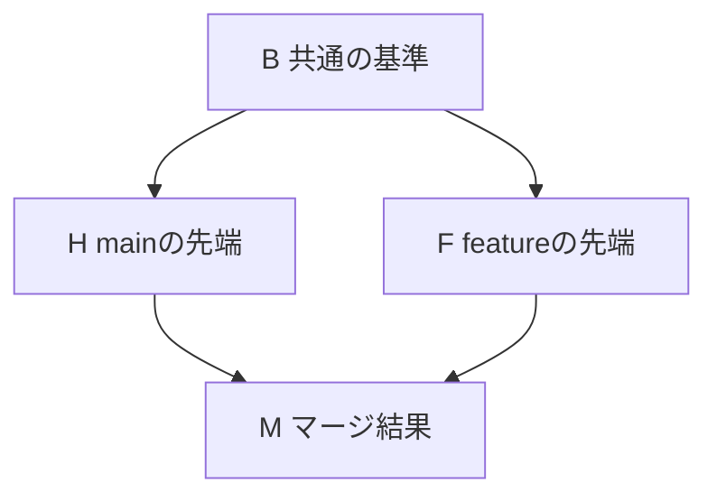
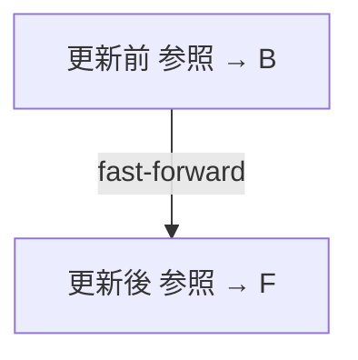

# Gitのマージ — 共通祖先と3-way merge

二人が同じゲームの設定を編集します。片方は選択中の装備を剣から盾に変え、もう片方は候補から盾を削除しました。どちらのブランチでも、選択中の装備は候補に含まれています。ところが、二つの変更を組み合わせると、選択中の盾が候補から消えます。Gitがどうやってこの組み合わせを作るかは、両方の先端に加えて、二人が編集を始めた時点を見ると分かります。

## この記事で分かること

Gitが三つの版を比較して変更を統合する仕組みを説明できます。マージ後の履歴と、設定として正しいかどうかを別々に確かめられます。

**どんなときに使うか**　別々のブランチで進めた作業を一つの履歴にまとめるときに使います。

## 比べるのは基準と二つの先端

コミットの親をたどって、二つの先端の両方から到達できるコミットが**共通祖先**です。そこから親子関係をもとに選んだ基準を**マージベース**と呼びます。この例の基準は一つです。マージ前の `git merge-base main feature` は図のBを返しました。[git merge-baseの公式マニュアル](https://git-scm.com/docs/git-merge-base#_description)



図の矢印は履歴の親から子へ向いています。HとFだけを見て `selected.txt` の内容が違っても、どちらが変更したかは分かりません。Bと比べると、Hが選択を `shield` に変え、Fは元の `sword` を残したことが分かります。`items.txt` ではFだけが候補を変更しています。

**3-way merge**は、B・H・Fの三つの状態を使って両側の変更を組み合わせます。分岐した両側を通常のマージコミットでつなぐと、Mには統合したファイルの構成を表すtreeと、H・Fの二つの親が記録されます。[Pro Gitのマージの解説](https://git-scm.com/book/en/v2/Git-Branching-Basic-Branching-and-Merging#_basic_merging) · [Git公式の `ort` の説明](https://git-scm.com/docs/git-merge/2.38.0#_merge_strategies)

## 自動で結合できても、設定として成立するとは限らない

この例のルールは「`selected.txt` の装備名が、`items.txt` に並ぶ候補のどれかと一致すること」です。表では候補を読点で区切っていますが、検証ファイルでは1行に1項目が入っています。

| コミット | `items.txt` | `selected.txt` |
| --- | --- | --- |
| B 共通の基準 | `sword`、`shield` | `sword` |
| H `main` | `sword`、`shield` | `shield` |
| F `feature` | `sword` | `sword` |
| M マージ結果 | `sword` | `shield` |

検証用リポジトリでマージは成功しました。次の出力では、Mの短いIDの後ろにHとFのIDが並びます。設定を読み取る小さな検査では、HとFはそれぞれ合格しました。Mは `shield` が候補にないため失敗しました。

```text
$ git show --no-patch --format='%h %p %s' main
f123ac5 b1ba17f 062a4fe Merge branch 'feature'
```

この例では、ファイルを合わせる処理は成功し、候補と選択を合わせて評価するテストは失敗します。テキスト上は衝突しなくても、組み合わせた内容がゲームのルールを破る**意味的な不整合**です。設定が複数ファイルにまたがる場合、今回のようなチェックをテストに置けます。[Sousa・Dillig・Lahiriの意味的なマージ競合に関する論文](https://arxiv.org/abs/1802.06551)

## 同じ行の変更を選べないとき

別の検証では、基準の `key.txt` にある `jump=Space` を、現在の側で `jump=J`、相手側で `jump=K` に変えました。どちらの変更を採用するかが決まらず、マージは競合で停止しました。現在のコミットを示すHEADは現在側に残ります。競合中のindex（次のコミットに入れる内容を用意する場所）を `git ls-files -u -- key.txt` で読むと、このパスにステージ1・2・3の項目がありました。[git mergeの競合時の動作](https://git-scm.com/docs/git-merge/2.38.0#_true_merge) · [git ls-files](https://git-scm.com/docs/git-ls-files/2.39.0#_output)

```text
$ git show ':1:key.txt'
jump=Space
$ git show ':2:key.txt'
jump=J
$ git show ':3:key.txt'
jump=K
```

ここでのステージ番号は、indexの中でどの版を表すかを示します。通常は、次にコミットする版がステージ0にあります。この競合中はステージ1が基準、2が現在側、3が相手側です。どの内容を残して結合するかは解消する人が決めます。[Gitのステージング](/tools/git-staging-index.html) · [git mergeの競合時の動作](https://git-scm.com/docs/git-merge/2.38.0#_true_merge)

このテキスト競合では、Git 2.39.2の `merge.conflictStyle=merge` で作業ツリーに次のマーカーが出ました。区切りより上が現在側、下が取り込み側です。

  ```text
  <<<<<<< HEAD
  jump=J
  =======
  jump=K
  >>>>>>> feature
  ```

練習用リポジトリではJを残すと決め、マーカーを含む全体を `jump=J` の1行に編集しました。結果を `git add` で確定し、ステージ済みの差分を確認してマージを記録します。[Git公式の競合表示と解消](https://git-scm.com/docs/git-merge#_how_conflicts_are_presented)

```shell
git add -- key.txt
git diff --cached --check
git commit --no-edit
```

`git diff --cached --check` が問題を報告した場合は、コミット前に内容を見直します。検証では `git ls-files -u -- key.txt` が空になり、マージコミットにはHとFが第1親・第2親として残りました。

## fast-forwardでは先端を進める

現在の先端が相手の先端の祖先にあたり、履歴がすでにつながっている場合は、現在のブランチ参照を相手のコミットまで進められます。これが **fast-forward** です。新しいマージコミットは作りません。検証用のブランチをBに置き、その子であるFを `git merge --ff-only feature` で取り込むと、更新後の先端は既存のFと同じIDになりました。HとFが分岐している図のケースでは、`--ff-only` はマージを拒否します。[git mergeのfast-forwardの説明](https://git-scm.com/docs/git-merge/2.38.0#_fast_forward_merge) · [git mergeのオプション](https://git-scm.com/docs/git-merge/2.38.0#_options)



## 補足

### マージベースの選び方と検証時の指定

共通祖先の候補から、別の共通祖先の祖先になっているものを除くと、マージベースが残ります。候補を絞る基準は履歴の親子関係です。

装備の検証はGit 2.39.2で、マージ戦略に `ort` を指定した `git merge -s ort --no-ff --no-edit feature` で行いました。

ファイルが片側に存在しない競合などでは、indexの全ステージがそろわない場合があります。

## 要点

- 3-way mergeでは、共通の基準と二つの先端を使って変更を組み合わせます。
- 分岐をマージコミットでつなぐと、二つの先端が親になります。fast-forwardでは既存のコミットへ先端を進めます。
- 競合を解消するときは、どの内容を残すかを人が決めます。
- テキスト上の競合がなくても、組み合わせた設定がゲームのルールを満たすかは別に確認します。

## 理解度チェック

::: details HとFだけを比べて違う値が見つかった。どちらが変更したかを知るには？
共通の基準Bの値も見ます。今回の `selected.txt` では、BとFが `sword`、Hが `shield` だったので、Hが変更したと分かります。
:::

::: details 競合なくマージが終わった。装備の設定は必ず成立する？
候補と選択の関係は別に確かめます。今回のMでは `selected.txt` の `shield` が `items.txt` にないため、ゲーム側の条件を満たしません。
:::

## 検証範囲

2026年11月17日にWindowsのGit 2.39.2.windows.1で、独立したリポジトリを使いました。共通の基準が一つで、二つの先端を `-s ort` で統合した場合と、`--ff-only` で参照を進めた場合を確認しました。2026年11月20日に同じ版の別の検証リポジトリで、1行のテキスト競合を上の手順で解消し、出力と親の順序を照合しました。マージベースが複数ある履歴では、`ort` は共通の基準となるtreeを組み立てる場合があります。改名・削除を含む競合、複数のマージベース、他の戦略やカスタムのマージドライバーは未検証です。[git merge-base](https://git-scm.com/docs/git-merge-base#_discussion) · [Git公式の `ort` の説明](https://git-scm.com/docs/git-merge/2.38.0#_merge_strategies)

## 関連項目

- [Gitの保存モデル](/tools/git-objects.html) — commit、tree、親、ブランチ参照の役割を整理する。
- 統合後のtreeが同じでも、親のつながりがどう変わるかを比べる。[Gitのrebase — コミットの再適用と履歴の書き換え](/tools/git-rebase.html)
- 二つの先端を統合する場合と、片側から特定の変更を選ぶ場合の履歴を比べる。[Gitのcherry-pick — コミットではなく変更を別の履歴へ取り込む](/tools/git-cherry-pick.html)
- [Gitのステージング](/tools/git-staging-index.html) — 競合のない場合にindexが次のtreeをどう作るかを読む。
- [自動テストの基礎](/tools/automated-testing.html) — 統合した設定やコードが満たす条件を検証する。

## 参考資料

- [Git公式 — git merge-base](https://git-scm.com/docs/git-merge-base)
- [Git公式 — git merge、戦略と競合時の動作](https://git-scm.com/docs/git-merge/2.38.0)
- [Git公式 — git ls-files](https://git-scm.com/docs/git-ls-files/2.39.0#_output)
- [Pro Git — Basic Branching and Merging](https://git-scm.com/book/en/v2/Git-Branching-Basic-Branching-and-Merging)
- [Sousa・Dillig・Lahiri — Verifying Semantic Conflict-Freedom in Three-Way Program Merges](https://arxiv.org/abs/1802.06551)
