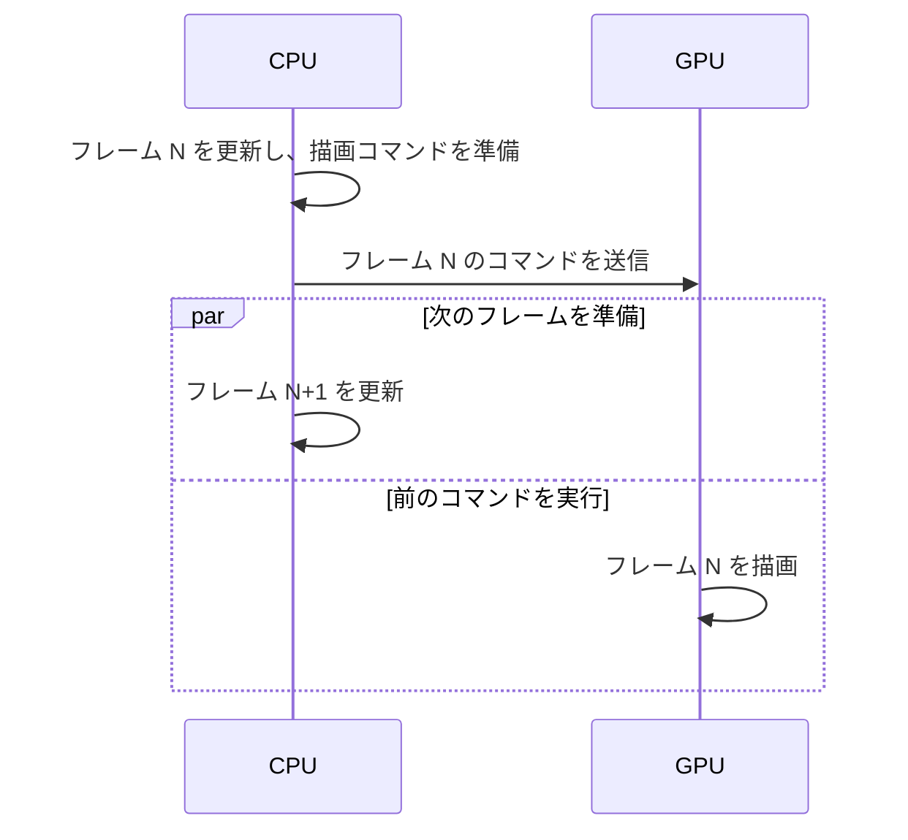

# CPU プロファイリング — サンプリングと計装でフレームを測る

ゲームが一瞬止まるときは、まず**遅かったフレーム**を選び、どのスレッドで何が進み、どこで待ったかを見ます。60 FPSの目安は1フレームあたり約16.67 msです。平均が予算内でも、マップ切り替えやカメラの移動時に予算を超えるフレームが続けば、引っかかりとして見えます。

## CPUとGPUのどちらが次のフレームを遅らせたか

CPUのゲームスレッドが更新し、描画スレッドがコマンドを準備し、GPUが実行します。CPUが次のフレームを準備する間に、GPUは前のフレームを処理できるので、CPUとGPUの所要時間を足した値が画面のフレーム間隔になるとは限りません。[フレームペーシング](/graphics/optimization/frame-pacing.html)で、表示間隔とフレーム生成の関係を確認できます。



フレームの目印を合わせて、ゲームスレッド、描画スレッド、GPUキュー、表示待ちの順に見ます。CPUが仕事を終えられずGPUに空きができるならCPU側、GPUキューが詰まってCPUが完了を待つならGPU側が候補です。フレーム上限や垂直同期が待ちを作ることもあります。長いCPUマーカーを見つけたら、処理を実行していたのか、別のスレッドやGPUの完了を待っていたのかをタイムラインで確かめます。

## サンプリングは実行中の場所を記録する

**サンプリング**は一定間隔などでスレッドのコールスタックを採取します。ある関数が多くのサンプルに現れるなら、その関数か呼び出し先が頻繁にCPUを使った可能性があります。全体を眺めて予想外の処理を見つけるのに向きます。短い処理は採取の間に終わることがあり、実行中のCPUだけを採る方式ではブロック中のスレッドの経過時間は別途調べる必要があります。関数名の解決にはビルドに対応するシンボルが要ります。

## 計装は区間の開始と終了を記録する

**計装（インストルメンテーション）**は、更新、ロード、ジョブといった区間の開始と終了をマーカーとして記録します。個々の呼び出しの時間を調べられ、開始から終了までの経過時間にはその間の待ちも入ります。マーカーを入れた範囲に観測が限られ、細かく置くほど記録処理も増えます。

親の区間の中に子の区間がある場合、**包括時間**は子を含む長さ、**自己時間**はその内側で計測した子を除いた長さです。子を計装していない範囲も親の自己時間に入ります。複数スレッドの区間は重なって進むため、各区間を合計してもフレームの経過時間にはなりません。

| 知りたいこと | 最初に見るもの |
| --- | --- |
| CPUを頻繁に使う呼び出し元 | サンプリングしたコールスタック |
| このフレームでロードが始まった時刻と終わった時刻 | ロード処理に付けたマーカー |
| スレッドがいつ実行を止め、何を待ったか | スケジューリング、待機、同期の記録 |

## Unity 6.0とUnreal Engine 5.6で見る

| 対象 | 道具 | 見る内容 |
| --- | --- | --- |
| Unity 6.0（6000.0） | Unity ProfilerのCPU Usage | Timelineでフレーム内のスレッドの並び、Hierarchyでマーカーの時間と呼び出し回数を確認する。 |
| Unity 6.0（6000.0） | Profile Analyzer 1.4.2 | 複数フレームのマーカーを集計し、変更前と変更後の記録を比較する。 |
| Unity 6.0（6000.0） | `Unity.Profiling.ProfilerMarker` | 自分の更新処理を名前付きで計測する。`using (marker.Auto())` でブロックの範囲をマークできる。 |
| Unreal Engine 5.6 | `stat unit` | Frame、Game、Draw、GPUなどの時間を見て、どの段階を掘り下げるか決める。 |
| Unreal Engine 5.6 | Unreal InsightsのTiming Insights | トレースを開き、CPUスレッドやGPUのタイムライン、計測イベントを追う。 |

Unityでは、対象端末のPlayerで問題が起きるなら、まずその端末で再現を記録します。Editorの計測にはEditor自身の仕事が混ざります。Unreal Engineの`stat unit`で突出する値を見つけたら、Unreal Insightsで該当する区間の処理と待ちを確認します。

## エンジンに依存しない道具を選ぶ

| 道具 | 調べられること |
| --- | --- |
| Tracy | アプリにフレームと区間のマーカーを入れ、スレッドごとの処理を並べて見る。 |
| Superluminal | サンプリングされたスタックとスレッドの実行・待機を調べる。 |
| PIX on WindowsのTiming Capture | CPUとGPUの実行、送信や同期の時系列を調べる。 |
| Windows Performance Recorder（WPR） | WindowsのETWイベントを記録し、Windows Performance Analyzer（WPA）でCPU使用やスケジューリング、I/Oを分析する。 |

## スパイクの原因をタイムラインで追う

同じシーン、端末、設定で数回記録し、遅いフレームを選びます。長い区間の前後と、それを待っているスレッドを見ます。

| 観察 | 次に確かめること |
| --- | --- |
| GCマーカーが長い | スパイクの前にどの処理が割り当てを増やしたか。 |
| シーン切り替えで更新が止まる | ファイルI/O、展開、メインスレッド上の生成や登録のうち、どれが遅れたか。 |
| ロック待ちの区間が長い | ロックを保持するスレッドが何を実行し、どれだけ保持したか。 |
| 一つのワーカーだけが長く残る | タスクの粒度や依存関係、他のワーカーの空き時間。 |

最適化の前後で、端末、ビルド構成、シーン、記録区間をそろえます。デバッグ構成、詳細な計装、シンボル不足などは見え方に影響します。特に計測が結果を変えていないかは、記録を軽くした状態でも比較します。平均に加えて、フレーム時間のp95、p99、最大値と、予算を超えたフレーム数を見ます。このページでは時間を昇順に並べ、p95を小さい方から `ceil(件数 * 0.95)` 番目と定義します。件数が少ないと上位パーセンタイルは最大値付近の数件で変わります。

## C++20で経過時間とp95を測る

次を `cpu_profiling.cpp` として保存し、`cl /std:c++20 /EHsc cpu_profiling.cpp` または `g++ -std=c++20 -pthread cpu_profiling.cpp -o cpu_profiling` でビルドできます。20フレームに相当する区間を計測し、最後の2回だけ待ち時間を長くします。`steady_clock` で測るのは経過時間です。`sleep_for` の待ちを含むため、この値からCPUが使った時間は求まりません。

```cpp
#include <algorithm>
#include <array>
#include <chrono>
#include <cmath>
#include <cstddef>
#include <iomanip>
#include <iostream>
#include <numeric>
#include <ratio>
#include <thread>

int main() {
    using Clock = std::chrono::steady_clock;
    using namespace std::chrono_literals;
    std::array<double, 20> elapsed_ms{};

    for (std::size_t frame = 0; frame < elapsed_ms.size(); ++frame) {
        const auto start = Clock::now();
        std::this_thread::sleep_for(frame < 18 ? 2ms : 30ms);
        const auto duration = Clock::now() - start;
        elapsed_ms[frame] = std::chrono::duration<double, std::milli>(duration).count();
    }

    const auto count = static_cast<double>(elapsed_ms.size());
    const double mean = std::accumulate(elapsed_ms.begin(), elapsed_ms.end(), 0.0) / count;
    const auto slow = std::count_if(elapsed_ms.begin(), elapsed_ms.end(),
                                    [](double ms) { return ms > 1000.0 / 60.0; });
    std::sort(elapsed_ms.begin(), elapsed_ms.end());
    const auto rank = static_cast<std::size_t>(std::ceil(count * 0.95));

    std::cout << std::fixed << std::setprecision(2)
              << "mean: " << mean << " ms\n"
              << "p95:  " << elapsed_ms[rank - 1] << " ms\n"
              << "max:  " << elapsed_ms.back() << " ms\n"
              << "over 60 FPS budget: " << slow << " / " << elapsed_ms.size() << '\n';
}
```

待ちが指定に近い環境では、平均は約5 ms、p95は約30 msになります。実測値はOSのスケジューリングによって変わります。記録を出力する処理は計測区間の外に置いてあります。

## 理解度チェック

1. GPUが動き続け、描画スレッドはGPU完了を待っています。最初にどこを調べますか。

   ::: details 解答
   GPUの長い区間とキューの詰まりを調べます。描画スレッドの待ち時間だけから、CPUの処理量が多いとは判断できません。
   :::

2. たまに発生するロード1回の開始時刻と終了時刻を知りたい場合、どちらの計測方式を使いますか。

   ::: details 解答
   ロード区間を計装します。待ちと実行を分けるには、スレッドのタイムラインも合わせて確認します。
   :::

3. 100フレームの平均が予算内でした。体感の引っかかりを調べるには何を見ますか。

   ::: details 解答
   p95、p99、最大値、予算を超えたフレーム数を見ます。スパイクが連続したかを時系列で確認し、そのフレームの処理と待ちを追います。
   :::

## 関連項目

- [フレームペーシング](/graphics/optimization/frame-pacing.html)で表示間隔が乱れる原因を確認する。
- [低レイヤーのデバッグと計測](/guide/low-level/debugging-and-profiling.html)で再現から計測へ進む手順を確認する。
- [スレッドと同期](/runtime/thread-synchronization.html)でロック待ちが起きる条件を確認する。
- [ゲームのアセット読み込み](/game/asset-loading.html)でロードをI/O、展開、登録に分けて調べる。

## 参考資料

- [Unity 6.0 — CPU Usage Profiler](https://docs.unity3d.com/6000.0/Documentation/Manual/ProfilerCPU.html)、[ProfilerMarker](https://docs.unity3d.com/6000.0/Documentation/ScriptReference/Unity.Profiling.ProfilerMarker.html)
- [Unity 6.0 — Profile Analyzerの対応版](https://docs.unity3d.com/6000.0/Documentation/Manual/com.unity.performance.profile-analyzer.html)、[Profile Analyzer 1.4マニュアル](https://docs.unity3d.com/Packages/com.unity.performance.profile-analyzer@1.4/manual/index.html)
- [Epic Games — Unreal Insights 5.6](https://dev.epicgames.com/documentation/en-us/unreal-engine/unreal-insights-in-unreal-engine?application_version=5.6)、[Stat Commands 5.6](https://dev.epicgames.com/documentation/en-us/unreal-engine/stat-commands-in-unreal-engine?application_version=5.6)
- [Tracy — 公式リポジトリとマニュアル](https://github.com/wolfpld/tracy)
- [Superluminal — 公式機能説明](https://superluminal.eu/)
- [Microsoft — PIX Timing Captures](https://devblogs.microsoft.com/pix/timing-captures/)、[Windows Performance Recorder](https://learn.microsoft.com/en-us/windows-hardware/test/wpt/windows-performance-recorder)
