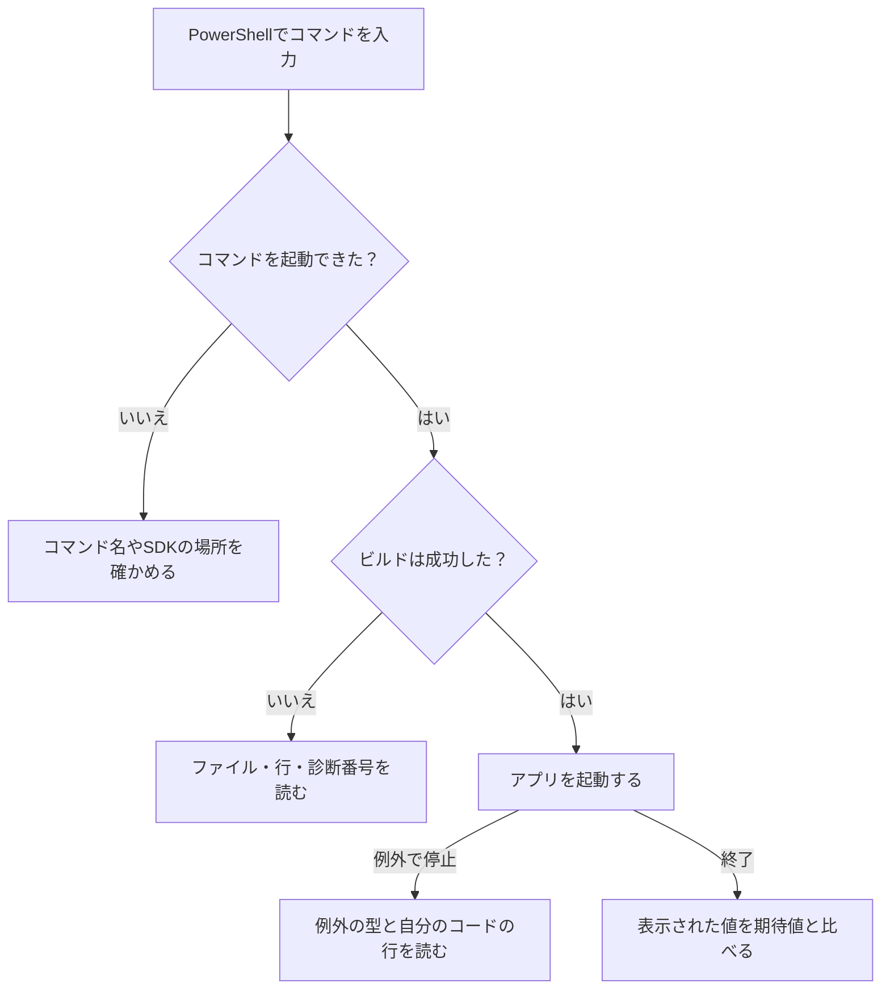

# エラーメッセージの読み方 — ビルド時と実行時を見分ける

C#でHPを表示する短いプログラムを使い、ビルド時と実行時に一度ずつエラーを起こします。失敗したコマンドを記録し、メッセージから修正候補を一か所選び、直した後に同じ操作で確かめます。

## どの段階で止まったかを見る



PowerShellが `dotnet` を見つけられない場合は、SDKを使う前の段階で止まっています。`dotnet build` が `error CS…` を出した場合は、C#コンパイラがコードを診断した段階です。アプリを起動した後で `Unhandled exception` と出た場合は、実行中に発生した例外が処理されずに終了したことを示します。今回は `dotnet build` と `dotnet run --no-build` を分けて、どちらの段階で止まるかを確かめます。[PowerShellがコマンドを探す順序](https://learn.microsoft.com/en-us/powershell/module/microsoft.powershell.core/about/about_command_precedence) · [dotnet build](https://learn.microsoft.com/en-us/dotnet/core/tools/dotnet-build) · [dotnet run](https://learn.microsoft.com/en-us/dotnet/core/tools/dotnet-run)

## 1. ビルドエラーの行を見つける

[開発環境の用意](/tools/setup-development-environment.html)と同じ.NET 10 SDKとPowerShellを使います。練習用の親フォルダーへ移動し、`ErrorStudy` がまだないことを確かめてから、新しいプロジェクトを作ります。

```powershell
dotnet new console --framework net10.0 --output ErrorStudy
Set-Location ErrorStudy
```

`Program.cs` を次の4行に置き換えて保存します。4行目の末尾のセミコロンは、エラーを起こすため省いています。

```csharp
using System;

int hp = 100;
Console.WriteLine(hp)
```

```powershell
dotnet build --nologo
```

次は従来のコンソールロガーの出力から診断の一行を抜き出し、フォルダー名を省略した例です。メッセージの言語は環境によって変わります。.NET 9以降のSDKは、対応する対話型ターミナルでは既定で Terminal Logger を使うため、診断行の末尾の `[...csproj]` が省かれるなど、表示形式が変わることがあります。下の形式で確認するには `dotnet build --nologo --tl:off` を実行します。[.NET 9でのロガーの変更](https://learn.microsoft.com/en-us/dotnet/core/compatibility/sdk/9.0/terminal-logger)

```text
...\ErrorStudy\Program.cs(4,22): error CS1002: ; が必要です [...\ErrorStudy\ErrorStudy.csproj]
```

| 出力の一部 | 読み取れること |
| --- | --- |
| `Program.cs` | コンパイラが診断したソースファイル |
| `(4,22)` | 4行目の22列目。この例では行末の閉じ括弧の直後 |
| `error CS1002` | C#コンパイラのエラー番号 |
| `; が必要です` | コンパイラがその場所で期待した記号 |
| `ErrorStudy.csproj`（行末に表示される場合） | ビルドしたプロジェクト |

複数の診断が出たら、自分が編集したファイルの最初のエラーから読みます。一つの記号が欠けると後続の診断も出る場合があります。報告された行で原因が見つからなければ、すぐ前の行も確かめます。この例では4行目の末尾に `;` を一つ足して保存し、同じビルドコマンドを実行します。[コンパイラエラーCS1002](https://learn.microsoft.com/en-us/dotnet/csharp/misc/cs1002)

ビルドが成功したら、`dotnet run --no-build` で今作ったアプリを起動します。`--no-build` は再ビルドを省く指定です。ビルドが失敗した状態で使うと、以前成功したときの出力を起動する場合があります。

```text
100
```

## 2. 実行中の例外をたどる

同じプロジェクトの `Program.cs` を次のコードに置き換えます。`int.Parse` は、文字列を整数に変換します。

```csharp
using System;

Console.WriteLine("Starting...");
string text = "abc";
int hp = int.Parse(text);
Console.WriteLine($"HP: {hp}");
```

`dotnet build --nologo` が成功したことを確かめ、`dotnet run --no-build` を実行します。次は出力の抜粋です。

```text
Starting...
Unhandled exception. System.FormatException: The input string 'abc' was not in a correct format.
   ...
   at System.Int32.Parse(String s)
   at Program.<Main>$(String[] args) in ...\ErrorStudy\Program.cs:line 5
```

`Starting...` はアプリの処理が始まったと分かる手掛かりです。例外の型は `System.FormatException` で、入力 `abc` の書式が整数として解釈できなかったと分かります。`at` で始まる行は、例外が発生した場所へつながる呼び出しの記録です。この**スタックトレース**から、自分のコードに当たる `Program.cs:line 5` を探すと、`int.Parse(text)` が見つかります。その呼び出しに渡した値は4行目で決まっています。[Int32.Parse](https://learn.microsoft.com/en-us/dotnet/api/system.int32.parse?view=net-10.0) · [例外のスタックトレース](https://learn.microsoft.com/en-us/dotnet/api/system.exception.stacktrace?view=net-10.0)

`"abc"` を `"30"` に変えて保存します。先ほどと同じ `dotnet build --nologo` と `dotnet run --no-build` を順に実行し、例外の表示が消え、最後の行まで実行されたことを確かめます。

```text
Starting...
HP: 30
```

ユーザーの入力を扱う場合は、数字に変換できない入力も想定します。`int.TryParse` なら、変換の成否を戻り値で受け取り、失敗したときに入力を案内できます。[Int32.TryParse](https://learn.microsoft.com/en-us/dotnet/api/system.int32.tryparse?view=net-10.0)

## 理解度チェック

1. `Program.cs(4,22): error CS1002` から、ファイル、行、列、診断番号をそれぞれ指せますか。
2. 実行時の例でビルドは成功しました。`Starting...`、`System.FormatException`、`Program.cs:line 5` はそれぞれ何を示していますか。
3. 例外が出るコードを一か所直したとき、どの操作を再実行し、何を確かめますか。

::: details 解答
1. ファイルは `Program.cs`、4行目の22列目、診断番号は `CS1002` です。
2. `Starting...` はアプリの処理が始まったこと、`System.FormatException` は入力の書式を変換できなかった例外の型、`Program.cs:line 5` は自分のコードが変換を呼んだ位置です。
3. `"abc"` を `"30"` に変えて保存します。ビルドが成功してから同じ実行コマンドを使い、例外が出ず `HP: 30` が表示されることを確かめます。
:::

## 関連項目

- [ロードマップの達成条件を確認する](/learn/roadmap.html?node=intro-errors#programming-intro)
- [開発環境の用意](/tools/setup-development-environment.html)
- [ビルドとは何か](/tools/build/what-is-build.html)
- [ブレークポイントとウォッチ](/tools/windows/debugger-breakpoints-and-watchpoints.html)
- [公式ドキュメントの読み方](/tools/reading-official-documentation.html)

## 参考資料

- [dotnet build](https://learn.microsoft.com/en-us/dotnet/core/tools/dotnet-build) · [dotnet run](https://learn.microsoft.com/en-us/dotnet/core/tools/dotnet-run) · [コンパイラエラーCS1002](https://learn.microsoft.com/en-us/dotnet/csharp/misc/cs1002)
- [Int32.Parse](https://learn.microsoft.com/en-us/dotnet/api/system.int32.parse?view=net-10.0) · [Int32.TryParse](https://learn.microsoft.com/en-us/dotnet/api/system.int32.tryparse?view=net-10.0) · [例外のスタックトレース](https://learn.microsoft.com/en-us/dotnet/api/system.exception.stacktrace?view=net-10.0)
