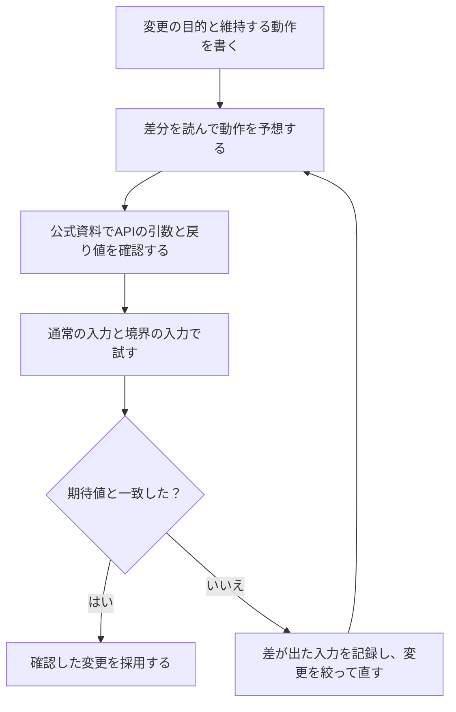

# AIが書いたコードとの付き合い方 — 差分と実行結果から採用を決める

ゲームのHPを減らす関数について、AIから「標準ライブラリを使えば短くできます」と提案が来たとします。たとえばHPが70、ダメージが20なら、提案でも元のコードでも結果は50です。では、ダメージが負の値だったらどうでしょうか。**採用前に変えてよい動作を決め、差分と実行結果を照らし合わせます。** このページでは固定の提案を使って、AIに接続せずに練習できます。



## 提案を読む前に、守る動作を決める

この例の変更目的は、処理を短くすることです。HPは0から100の整数とし、ダメージが0以下ならHPを維持します。正のダメージを受けたら、その分だけHPを減らし、0を下回る場合は0にします。ダメージを受ける処理に、回復の動作は追加しません。

| 現在のHP | ダメージ | 期待するHP | 確かめること |
| --- | --- | --- | --- |
| 70 | 20 | 50 | 普通のダメージ |
| 70 | 70 | 0 | ちょうど0になる |
| 70 | 90 | 0 | 0より下がらない |
| 70 | 0 | 70 | 変化しない |
| 70 | -5 | 70 | 負の入力を無視する |

先に期待値を書くと、実際に出た値に合わせて仕様を書き換えるのを防げます。負の値を受け取ったときにエラーにするなど、別の仕様もあり得ます。この練習では上の表を基準にします。

## 差分で、消えた処理を探す

次の差分は、関数の本体だけを比べています。`-` は削除された行、`+` は追加された行です。読み方は[Gitの基本](/tools/git-basics.html)で練習できます。

```diff
-    if (damage <= 0)
-    {
-        return hp;
-    }
-    int remaining = hp - damage;
-    return remaining < 0 ? 0 : remaining;
+    return Math.Clamp(hp - damage, 0, 100);
```

提案では、負のダメージを無視していた分岐が消えています。`damage` が `-5` なら、`70 - (-5)` で75になります。`Math.Clamp` がその75をどう扱うか、使う版の公式資料で確認します。

## 呼び出しているAPIを公式資料で確認する

この練習は .NET 10 を対象にします。プロジェクトファイルの `<TargetFramework>net10.0</TargetFramework>` を確かめ、Microsoft Learnで `Math.Clamp(Int32, Int32, Int32)` を開きます。C#の `int` に対応するオーバーロードです。引数の順番は値、下限、上限です。値が下限から上限の間なら、その値が戻ります。75は0から100の間にあるので、提案は75を返すと予想できます。 [Microsoft Learn — Math.Clamp](https://learn.microsoft.com/en-us/dotnet/api/system.math.clamp?view=net-10.0)

似た名前のAPIでも、引数の順番や境界の扱いは資料で確認します。版とオーバーロードの見分け方は[公式ドキュメントの読み方](/tools/reading-official-documentation.html)で練習できます。

## 手を動かす — 同じ入力で提案と修正後を比べる

.NET 10 SDKを使います。準備から進める場合は[開発環境の用意](/tools/setup-development-environment.html)を参照してください。PowerShellで練習用のフォルダーに移動し、まだ存在しない名前でプロジェクトを作ります。

```powershell
dotnet new console --framework net10.0 --output .\StudyAiReview
Set-Location .\StudyAiReview
```

エディターで `Program.cs` を開き、内容を次のコードに置き換えて保存します。`Check` は入力と期待値を受け取り、`ApplyDamage` の結果と比べる関数です。

```csharp
using System;

int failures = 0;
failures += Check(70, 20, 50);
failures += Check(70, 70, 0);
failures += Check(70, 90, 0);
failures += Check(70, 0, 70);
failures += Check(70, -5, 70);
return failures == 0 ? 0 : 1;

static int ApplyDamage(int hp, int damage)
{
    return Math.Clamp(hp - damage, 0, 100);
}

static int Check(int hp, int damage, int expected)
{
    int actual = ApplyDamage(hp, damage);
    string result = actual == expected ? "PASS" : "FAIL";
    Console.WriteLine($"{result} hp={hp}, damage={damage}: expected={expected}, actual={actual}");
    return actual == expected ? 0 : 1;
}
```

同じフォルダーで実行します。`$LASTEXITCODE` は直前のコマンドの終了コードです。

```powershell
dotnet run
$LASTEXITCODE
```

最初の4件は `PASS` です。最後の1件と終了コードを見ます。

```text
FAIL hp=70, damage=-5: expected=70, actual=75
1
```

`ApplyDamage` の `return` の行を次のように変更します。`Math.Max(damage, 0)` は、ダメージと0の大きい方を返します。負のダメージを0にしてからHPから引くので、HPが増えなくなります。 [Microsoft Learn — Math.Max](https://learn.microsoft.com/en-us/dotnet/api/system.math.max?view=net-10.0)

```csharp
return Math.Clamp(hp - Math.Max(damage, 0), 0, 100);
```

もう一度 `dotnet run` と `$LASTEXITCODE` を実行します。今度は5件とも `PASS` になり、終了コードは `0` です。別の入力を試すには、`failures += Check(100, 1, 99);` を `return` より前に足してください。HPが上限のときも、正のダメージで減ることを確認できます。

## 実際の作業で提案を取り込む

変更したい動作と維持したい動作を、入力と期待値で伝えると、提案を確認しやすくなります。差分を小さく分け、内容を説明できる変更から採用します。提案にインストールやファイル操作のコマンドが含まれる場合は、対象と作用を公式資料で確かめ、練習用のデータで試します。共有するコードやログからは、鍵、トークン、個人情報などを取り除きます。

今回の5件は、表にした動作を確認するためのテストです。実際のゲームに取り込むときは、どこから関数が呼ばれ、HPが0から100の範囲に入る前提をどこで守っているかも読みます。

## 理解度チェック

1. 負のダメージに対する動作を変えたのは、差分のどの部分ですか。

   ::: details 解答
   `damage <= 0` のときにHPをそのまま返す分岐が消えました。負の値を引くとHPが増え、結果が0から100の間にあれば `Math.Clamp` はその値を返します。
   :::

2. `Math.Clamp` の資料を開いたら、どの版と引数の型を確認しますか。

   ::: details 解答
   プロジェクトの `net10.0` に対応する .NET 10 を選び、C#の `int` に対応する `Int32` のオーバーロードを確認します。
   :::

3. 修正後に、負の値のテストだけを実行して終えてよいですか。

   ::: details 解答
   同じテスト一式を再実行します。負の入力の修正が、通常のダメージやHPが0になる境界の動作に影響していないかも確認できます。
   :::

## 関連項目

- [Gitの基本](/tools/git-basics.html)で、コミット前の差分を確認する。
- [公式ドキュメントの読み方](/tools/reading-official-documentation.html)で、使う版と動作条件を確かめる。
- [エラーメッセージの読み方](/tools/reading-error-messages.html)で、ビルドや実行の失敗を切り分ける。
- [開発の道具のロードマップ](/learn/roadmap.html?node=dev-ai#dev-tools)で達成条件を確認する。

## 参考資料

- [Microsoft Learn — .NET 10 の Math.Clamp](https://learn.microsoft.com/en-us/dotnet/api/system.math.clamp?view=net-10.0) · [Math.Max](https://learn.microsoft.com/en-us/dotnet/api/system.math.max?view=net-10.0)
- [Microsoft Learn — dotnet new](https://learn.microsoft.com/en-us/dotnet/core/tools/dotnet-new) · [dotnet run](https://learn.microsoft.com/en-us/dotnet/core/tools/dotnet-run)
- [Git公式 — git diff](https://git-scm.com/docs/git-diff)
