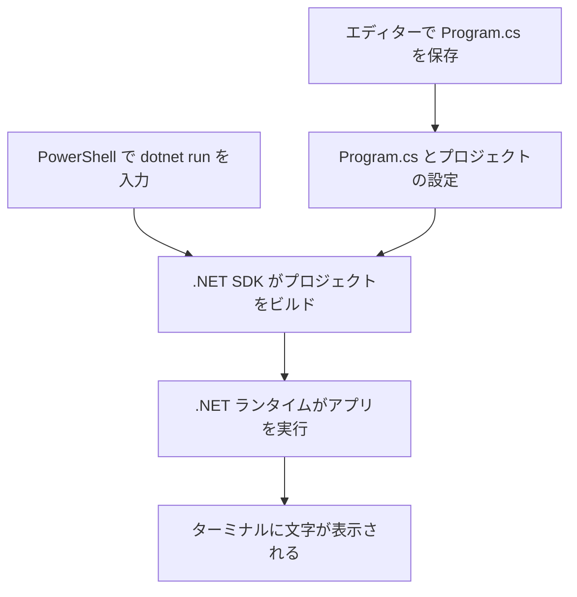

# 開発環境の用意 — Windowsで最初のC#を動かす

WindowsでC#のコンソールアプリを作り、PowerShellに文字を表示します。まず.NET SDKのバージョンを確認し、次に自分でソースファイルを開いて表示する文字を変えます。

## エディターと.NET SDKを用意する

エディターでC#のソースファイルを編集します。メモ帳でも試せます。Visual Studio Codeを使う場合は、Windows版の公式手順でインストールします。[Visual Studio CodeのWindows向け手順](https://code.visualstudio.com/docs/setup/windows)

**SDK（Software Development Kit）**には、C#のコンパイラ、ひな形からプロジェクトを作るツール、実行に必要な.NETランタイムが含まれます。ランタイムは、ビルドされた.NETアプリを動かします。この手順では.NET 10のSDKを使います。.NET 10は2026年11月12日時点でサポート中のLTS（長期サポート）版です。[Windowsへの.NETインストール](https://learn.microsoft.com/en-us/dotnet/core/install/windows) · [.NETのサポート方針](https://dotnet.microsoft.com/en-us/platform/support/policy/dotnet-core)



### バージョンを確かめる

PowerShellで次のコマンドを一行ずつ実行します。

```powershell
dotnet --list-sdks
dotnet --version
```

`--list-sdks` は、呼び出した `dotnet` から見えるSDKの一覧と場所を表示します。`--version` は、今のフォルダーで選ばれたSDKのバージョンを表示します。確認した環境では一覧に `10.0.403` があり、選ばれたバージョンも `10.0.403` でした。同じ.NET 10でも更新により末尾の数字は変わります。[dotnetコマンドのリファレンス](https://learn.microsoft.com/en-us/dotnet/core/tools/dotnet)

一覧に `10.0.` で始まるSDKがあれば、プロジェクトの作成へ進みます。なければ、[.NET 10のダウンロードページ](https://dotnet.microsoft.com/en-us/download/dotnet/10.0)で **SDK** のWindows用インストーラーを選びます。CPUの種類に合わせてx64またはArm64などを選び、インストール後にPowerShellを開き直して同じコマンドを実行します。WinGetを使える場合は、次のコマンドでも導入できます。[Windowsへの.NETインストール](https://learn.microsoft.com/en-us/dotnet/core/install/windows)

```powershell
winget install --id Microsoft.DotNet.SDK.10 --exact
```

インストール後もPowerShellが `dotnet` を見つけられない場合は、`Get-Command dotnet -All` で、どの実行ファイルが見つかるか確認します。一覧に.NET 10があるのに既存プロジェクト内で古いSDKが選ばれる場合は、そのフォルダーや親フォルダーの `global.json` がバージョンを指定している可能性があります。以下の練習は既存プロジェクトの外に作ったフォルダーで行います。[PowerShellがコマンドを探す順序](https://learn.microsoft.com/en-us/powershell/module/microsoft.powershell.core/about/about_command_precedence) · [global.jsonによるSDKの選択](https://learn.microsoft.com/en-us/dotnet/core/tools/global-json)

## コンソールプロジェクトを作る

PowerShellで練習用の親フォルダーへ移動します。その中に `HelloStudy` という名前のフォルダーがないことを確かめてから実行します。`console` はコンソールアプリのひな形、`net10.0` はアプリが対象とする.NETの版、`--output HelloStudy` は作成先です。[dotnet new](https://learn.microsoft.com/en-us/dotnet/core/tools/dotnet-new) · [.NETのターゲットフレームワーク](https://learn.microsoft.com/en-us/dotnet/standard/frameworks)

```powershell
dotnet new console --framework net10.0 --output HelloStudy
Set-Location HelloStudy
Get-ChildItem -Name
dotnet run
```

一覧から主なファイルを抜粋すると、`Program.cs` と `HelloStudy.csproj` があります。`Program.cs` がコード、`HelloStudy.csproj` が対象とする.NETの版などを記録するプロジェクトファイルです。`dotnet new` は依存関係を自動で復元するので、一覧には復元結果を保存する `obj` フォルダーも表示されます。[dotnet new の自動復元](https://learn.microsoft.com/en-us/dotnet/core/tools/dotnet-new#implicit-restore) · [復元時に obj に作られるファイル](https://learn.microsoft.com/en-us/dotnet/core/tools/sdk-errors/netsdk1004)

最後のコマンドは今のフォルダーのプロジェクトをビルドして起動します。ひな形を変更する前の表示は次のとおりです。[dotnet run](https://learn.microsoft.com/en-us/dotnet/core/tools/dotnet-run)

```text
Hello, World!
```

## 文字を変えて、同じコマンドで再実行する

Visual Studio Codeなら「フォルダーを開く」で `HelloStudy` を選び、一覧から `Program.cs` を開きます。メモ帳を使う場合は、PowerShellで `notepad .\Program.cs` と入力します。`Console.WriteLine` に渡す引用符の中を変え、ファイルを保存します。

```csharp
Console.WriteLine("Hello, Sny0 Study!");
```

同じPowerShellで、もう一度 `dotnet run` を実行します。

```text
Hello, Sny0 Study!
```

前の文字が表示される場合は、編集したファイルを保存したか、`Get-Location` で表示したフォルダーと開いた `Program.cs` の場所が一致するかを確認します。プロジェクトが見つからないと表示されたら、`Get-ChildItem -Name` で今のフォルダーに `HelloStudy.csproj` があるかを確認します。

## 理解度チェック

1. SDKの一覧と、現在選ばれたSDKのバージョンは、どのコマンドで確認できますか。
2. 表示する文字を変えるファイルと、対象の.NETの版が書いてあるファイルをそれぞれ指せますか。
3. `Program.cs` の文字を自分の好きな言葉に変え、保存して `dotnet run` を実行すると、何が表示されますか。

::: details 解答
1. 一覧は `dotnet --list-sdks`、現在のバージョンは `dotnet --version` で確認します。
2. 文字を変えるファイルは `Program.cs` です。対象の.NETの版は `HelloStudy.csproj` の `TargetFramework` に書かれています。
3. `Console.WriteLine` の引用符内に書いた文字が一行表示されます。
:::

## 関連項目

- [ロードマップの達成条件を確認する](/learn/roadmap.html?node=intro-setup#programming-intro)
- [ターミナル・シェル・コマンドの基本](/tools/terminal-shell-and-commands.html)
- [値・変数・型・式](/languages/variables-types-and-expressions.html)
- [エラーメッセージの読み方](/tools/reading-error-messages.html)

## 参考資料

- [Windowsへの.NETインストール](https://learn.microsoft.com/en-us/dotnet/core/install/windows) · [.NETのサポート方針](https://dotnet.microsoft.com/en-us/platform/support/policy/dotnet-core)
- [.NET CLIのバージョン表示](https://learn.microsoft.com/en-us/dotnet/core/tools/dotnet) · [プロジェクトの作成](https://learn.microsoft.com/en-us/dotnet/core/tools/dotnet-new) · [プロジェクトの実行](https://learn.microsoft.com/en-us/dotnet/core/tools/dotnet-run)
